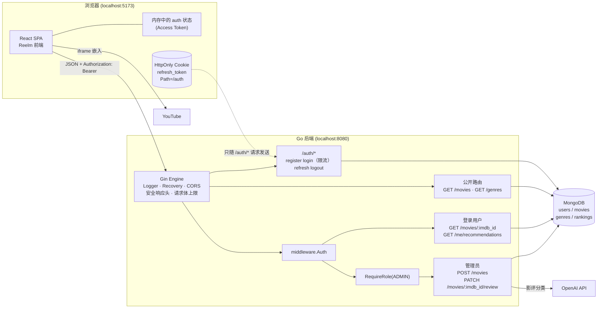
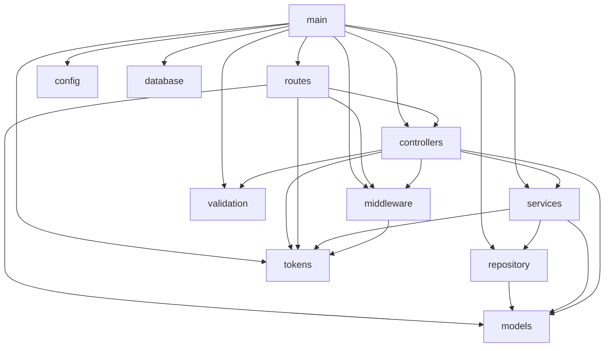
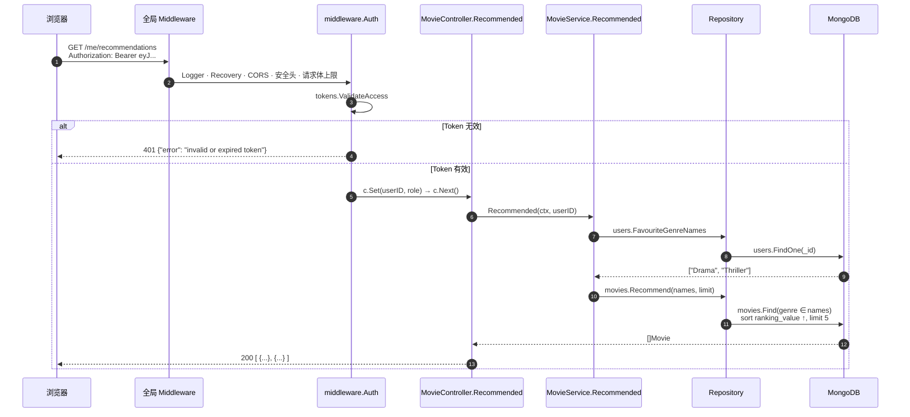
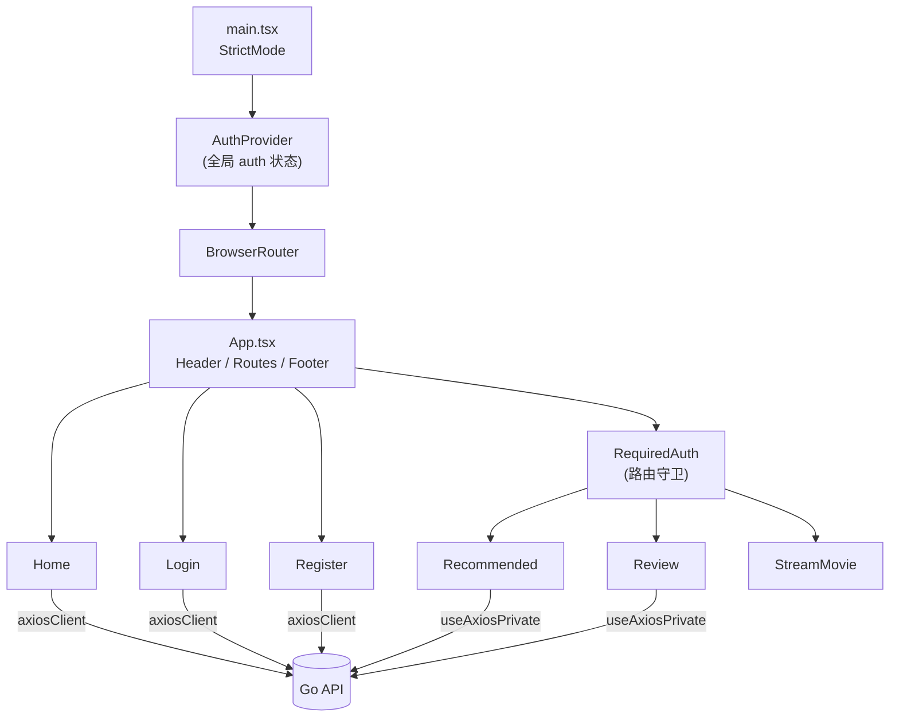

# 第 02 章　系统架构

> 本章目标：理解系统由哪些部分组成、它们之间如何通信，以及后端代码内部的分层与依赖关系。

---

## 2.1 什么是“架构”？

**What**：软件架构是对系统“由哪些部件组成、部件之间如何协作”的高层描述。它不关心某一行代码怎么写，而关心**职责如何划分**、**数据如何流动**。

**Why**：没有清晰的架构，代码会变成“一团意大利面”——改一个地方牵动十个地方。有了架构，你就知道新功能该写在哪里、出了 bug 该去哪里找。

**When**：在写第一行代码之前就应该想清楚（哪怕只是草图），并在项目成长时持续调整。

---

## 2.2 整体系统架构



### 图解说明

1. **浏览器里运行的是一个 SPA**（Single Page Application，单页应用）。页面切换由 React Router 在浏览器内完成，不会每次都向服务器请求新的 HTML。
2. **前端只和 Go 后端通信**（YouTube 除外）。前端从不直接连接 MongoDB 或 OpenAI——数据库地址和 OpenAI 密钥只存在于服务器上。
3. **两种凭证走两条不同的路**：
   - Access Token 保存在 JavaScript 内存里，由代码手动放进 `Authorization` Header。
   - Refresh Token 保存在 HttpOnly Cookie 里，JavaScript **读不到**它。Cookie 的 `Path=/auth`，浏览器只在请求 `/auth/...` 时才会携带它。
4. **请求进入 Gin 后按路由组分流**：公开路由直接到达 Handler；登录用户的路由要先通过 `middleware.Auth`；管理员路由还要再通过 `RequireRole("ADMIN")`。
5. **OpenAI 只在一个场景下被调用**：管理员更新影评时。
6. **YouTube 由浏览器直接访问**，后端完全不参与视频播放。

---

## 2.3 前后端分离架构

**What**：前端（UI）和后端（API）是两个独立的程序，各自开发、各自运行、通过 HTTP + JSON 通信。

**Why**：
- 前后端可以用不同语言、由不同团队开发。
- 同一个后端 API 可以同时服务 Web、手机 App。
- 前端可以部署到 CDN，后端可以独立扩容。

**代价（What happens / trade-offs）**：
- **跨域问题**：前端在 `:5173`，后端在 `:8080`，端口不同即“不同源”，浏览器默认会拦截。因此需要 **CORS** 配置（第 12 章）。
- **认证更复杂**：不能像传统网站那样简单地用 Session，需要 Token + Cookie 组合（第 11 章）。

**替代方案对比**

| 方案 | 优点 | 缺点 |
|---|---|---|
| 前后端分离（本项目） | 灵活、可独立部署、多端复用 | CORS、认证复杂 |
| 服务端渲染（如 Go `html/template`） | 简单，无跨域，SEO 好 | 交互体验差，前后端耦合 |
| 全栈框架（如 Next.js） | 一套代码、同源部署 | 被框架绑定，后端能力有限 |
| 后端托管前端静态文件 | 同源，无 CORS 问题 | 部署耦合 |

---

## 2.4 后端分层架构

后端采用经典的**分层架构**：每一层只做一类事情，只依赖它下面的层。

```text
main.go          ← 组装层：读配置、连数据库、创建各层对象并把它们连起来、启动 HTTP Server
  │
routes/          ← 路由层：URL + HTTP 方法 → Handler；决定哪些路由需要登录或管理员
middleware/      ← 中间件层：认证、角色检查、限流、安全响应头、请求体上限
  │
controllers/     ← HTTP 层：解析和校验请求、调用 service、把结果或错误转换成 HTTP 响应
  │
services/        ← 业务层：注册/登录规则、推荐逻辑、影评评级（不知道 HTTP，也不知道 MongoDB）
  │
repository/      ← 数据访问层：所有 MongoDB 查询都在这里
  │
models/          ← 数据结构：数据库文档、请求 DTO、响应 DTO

config/          ← 启动时一次性读取并校验环境变量
tokens/          ← 签发和校验 JWT（纯计算，不访问数据库）
validation/      ← 全局共享的 validator 和自定义校验规则
database/        ← 建立连接、创建索引
cmd/seed/        ← 独立的命令行程序：写入种子数据、提升管理员
```

### 模块依赖图

下图根据 `go list` 的真实导入关系绘制：



### 图解说明

- 箭头表示 “import（依赖）”。例如 `services --> repository` 表示 `services` 包导入了 `repository` 包。
- **依赖方向始终向下**。`repository` 不知道 `services` 的存在，`services` 不知道 `controllers` 的存在。
- **没有循环依赖**。Go 语言**禁止**包之间循环导入（A 导入 B，B 又导入 A 会编译失败）。分层结构天然避免了循环。
- `models`、`tokens`、`config`、`validation`、`database` 处于最底层，不依赖项目中任何其他包。
- `main` 是唯一知道“所有零件”的地方：它创建 repository，交给 service，再把 service 交给 controller。这叫**组合根**（Composition Root）。

### 为什么要分这么多层？

| 层 | 负责 | 不负责 | 好处 |
|---|---|---|---|
| controllers | HTTP 细节：状态码、Cookie、JSON | 业务规则、SQL/查询 | 换成 gRPC 或 CLI 时只需要换这一层 |
| services | 业务规则：角色固定为 USER、Refresh Token 轮换、只接受白名单评级 | HTTP、数据库驱动 | 可以用内存假实现单元测试（第 15 章） |
| repository | MongoDB 查询、把驱动错误翻译成 `ErrNotFound` / `ErrDuplicate` | 业务判断 | 换数据库时只需要改这一层 |

### 依赖倒置：services 依赖的是接口

`services` 并不直接依赖 `*repository.UserRepository`，而是在自己的包里定义它**需要**的接口：

```go
// S/services/auth_service.go
type UserStore interface {
	Create(ctx context.Context, user *models.User) error
	FindByEmail(ctx context.Context, email string) (*models.User, error)
	// ...
}
```

`repository.UserRepository` 恰好实现了这些方法，所以 `main` 可以把它传进去；测试时则传入 `internal/memstore` 中的内存实现。Go 的接口是**隐式实现**的（不需要写 `implements`），这让“由使用方定义接口”变得非常自然。

---

## 2.5 一个请求的生命周期（总览）

以 `GET /me/recommendations` 为例：



**说明**：
1. 浏览器发出请求，Header 中带着 Access Token。
2. 请求先经过全局 Middleware：日志、panic 恢复、CORS、安全响应头、请求体大小限制。
3. `middleware.Auth` 校验 Token。失败就直接返回 401，**后面的 Handler 根本不会执行**（`c.AbortWithStatusJSON`）。
4. 成功时，把用户 ID 和角色存入 `gin.Context`，Controller 通过 `middleware.UserID(c)` 读取。
5. Controller 只负责“从 HTTP 中取出参数、调用 service、写出 JSON”；查询数据库的是 repository。

第 14 章会把这个过程细化到每一行代码。

---

## 2.6 架构设计取舍

### 本项目的选择
- **依赖注入**：所有依赖通过构造函数传入（`NewAuthService(users, catalog, tm)`），没有全局变量，也没有在函数内部偷偷读取环境变量。
- **配置集中**：`config.Load()` 在启动时读取并校验所有配置，缺少或格式错误时立即退出，并一次性列出所有问题。
- **路由组**：中间件挂在路由组上，一条路由是否需要登录或管理员，只取决于它写在哪个组里。
- **Token 存储策略**：Access Token 放内存，Refresh Token 放 HttpOnly Cookie，数据库只存 Refresh Token 的哈希。

### 分层的代价
分层不是免费的：
- **文件更多**：一个功能要改 controller、service、repository 三处。
- **对小项目可能过度**：只有两三个接口的原型，直接在 Handler 里写查询更快。

判断标准是：**当你开始想写测试、或者同一段逻辑要被第二个地方使用时，就该分层了**。本项目有认证、权限、外部 API 和多种业务规则，分层带来的可测试性收益明显大于成本。

### 替代方案对比

| 方案 | 说明 | 适用场景 |
|---|---|---|
| 单层（Handler 里直接写查询） | 最少的代码 | 原型、脚本 |
| 三层（本项目） | controller / service / repository | 大多数中小型 API |
| 按功能分包（`user/`、`movie/` 各自包含三层） | 代码按业务聚合 | 功能很多、团队较大时 |
| 六边形 / Clean Architecture | 更严格的端口与适配器 | 业务规则复杂、长期演进的系统 |

---

## 2.7 前端架构



- `axiosClient`：普通实例，用于公开接口。
- `useAxiosPrivate()`：带拦截器的实例，自动附加 Token、自动刷新。
- `AuthProvider` 包在 `BrowserRouter` **外层**，所以任何页面都能通过 `useAuth()` 读到登录状态。

---

## 本章练习

> 答案见 [第 20 章](20-exercise-solutions.md#第-02-章)

**关键概念回顾**
- 什么是前后端分离？它带来了哪两个额外问题？
- Go 为什么禁止循环导入？本项目如何避免？

**面试题 2.1** “你的 Refresh Token 和 Access Token 分别存在哪里？为什么不都放在 localStorage？”

**面试题 2.2** “如果要给这个项目增加手机 App，后端需要改什么？”

**练习 2.3** 在不看本章的情况下，画出模块依赖图，然后打开每个 `.go` 文件的 `import` 区块核对。

**练习 2.4** 假设要新增一个 `reviews` 包，用来存放多用户评论。它应该依赖哪些包？哪些包会依赖它？

**调试挑战 2.5** 如果有人在 `repository` 包里 `import` 了 `services` 包（例如想复用某个错误变量），会发生什么？试着预测编译器的报错信息，然后实际操作验证（验证后记得改回来）。

**理解检验 2.6** 2.5 节的时序图中，如果 Token 有效但用户已经被从数据库删除，最终会返回什么？（提示：仔细阅读 `MovieService.Recommended` 对 `repository.ErrNotFound` 的处理。）
