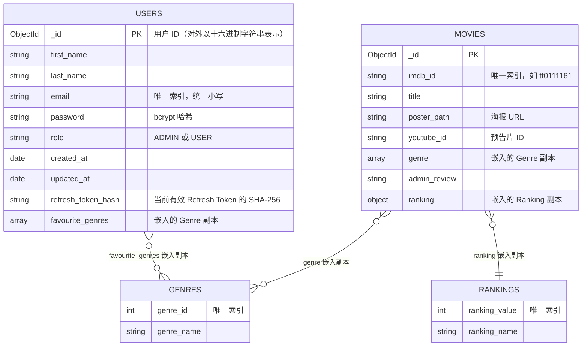

# 第 07 章　数据库设计与连接

> 本章目标：理解 MongoDB 的文档模型、本项目四个集合的结构与关系，掌握 Go 中连接 MongoDB 的方法，并能独立准备种子数据。

---

## 7.1 MongoDB 基础

### What
MongoDB 是一个**文档型数据库**（Document Database），属于 NoSQL 的一种。它的数据组织方式是：

| 关系型数据库（如 MySQL） | MongoDB |
|---|---|
| Database（数据库） | Database |
| Table（表） | **Collection（集合）** |
| Row（行） | **Document（文档）**，类似 JSON 对象 |
| Column（列） | Field（字段） |
| 固定的 Schema | **灵活的 Schema**：同一集合中的文档可以有不同字段 |
| JOIN | `$lookup`（聚合管道），或者直接**嵌入（embed）**数据 |

文档在磁盘上以 **BSON**（Binary JSON）格式存储。BSON 比 JSON 多了一些类型：`ObjectId`、`Date`、`Int32/Int64`、`Decimal128` 等。

### Why（为什么本项目适合 MongoDB）
- 电影的 `genre` 是一个数组、`ranking` 是一个子对象——天然适合用嵌套文档表示，不需要额外的关联表。
- Schema 灵活，开发初期修改字段很方便。

### 何时**不**适合用 MongoDB
- 数据之间有大量复杂的多对多关系，并且需要强一致性的事务（如银行转账）。
- 需要复杂的报表查询（多表 JOIN、分组统计）。

---

## 7.2 集合设计

本项目使用 `DATABASE_NAME`（示例值 `magic-stream-movies`）数据库下的 4 个集合：

| 集合 | Repository | 写入方 | 读取方 |
|---|---|---|---|
| `users` | `UserRepository` | 注册（`Create`）、登录/刷新/登出（`SetRefreshTokenHash`、`RotateRefreshTokenHash`） | 登录（`FindByEmail`）、刷新（`FindByID`）、推荐（`FavouriteGenreNames`） |
| `movies` | `MovieRepository` | 添加电影（`Create`）、写影评（`UpdateReview`） | 列表（`List`）、详情（`FindByImdbID`）、推荐（`Recommend`） |
| `genres` | `CatalogRepository` | 种子脚本 `cmd/seed` | 类型列表（`Genres`）、按 ID 查名称（`GenresByIDs`） |
| `rankings` | `CatalogRepository` | 种子脚本 `cmd/seed` | 写影评、添加电影（`Rankings`） |

每个集合的所有查询都集中在一个 repository 里。想知道“谁会修改 users 集合”，只需要看 `user_repository.go` 一个文件。

### 7.2.1 数据关系图



### 图解说明

- `genres` 和 `rankings` 是两个**参考数据（lookup / reference data）**集合，相当于“字典表”。
- 关键设计决策：`users.favourite_genres`、`movies.genre`、`movies.ranking` 都是**嵌入的副本**，而不是只存一个 ID 引用。这叫**反范式化（denormalization）**。
- 图中的连线是“逻辑关系”，MongoDB 没有外键约束。引用的正确性由应用代码保证（见 7.2.2 节）。

### 7.2.2 嵌入 vs 引用：一个重要的设计权衡

| | 嵌入副本（本项目） | 只存引用 ID |
|---|---|---|
| 示例 | `"genre": [{"genre_id": 1, "genre_name": "Comedy"}]` | `"genre_ids": [1]` |
| 读取 | 一次查询即可拿到完整数据 ✅ | 需要再查 `genres` 集合或用 `$lookup` |
| 按名称筛选 | 可以直接 `{"genre.genre_name": {"$in": [...]}}` ✅ | 先查名称对应的 ID |
| 修改类型名称 | 必须更新**所有**电影和用户文档 ❌ | 只改 `genres` 一处 ✅ |
| 数据一致性 | 需要应用代码保证副本正确 ⚠️ | 由 ID 保证 |

本项目选择嵌入，换取了**读取简单**和**推荐查询方便**。这在类型名称几乎不会改变的场景下是合理的。

**嵌入副本如何保证正确？** 关键在于：**副本只能由服务器从 `genres` 集合中复制，绝不能直接使用客户端提交的内容**。所以注册和添加电影的请求只提交 ID：

```json
{ "favourite_genre_ids": [2, 5] }
```

`AuthService.Register` 和 `MovieService.Create` 用这些 ID 查询 `genres` 集合，拿到的条数与提交的 ID 数量不一致，就说明有不存在的 ID，返回 `400 one or more genres do not exist`；一致时，存入数据库的就是从 `genres` 复制出来的 `{genre_id, genre_name}`。

```go
// S/services/auth_service.go（Register 节选）
genres, err := s.genres.GenresByIDs(ctx, req.FavouriteGenreIDs)
if err != nil {
	return nil, fmt.Errorf("look up genres: %w", err)
}
if len(genres) != len(req.FavouriteGenreIDs) {
	return nil, ErrUnknownGenre
}
```

如果直接接收 `{"genre_id": 999, "genre_name": "Anything"}` 这样的对象并原样保存，客户端就能往数据库里写入任意“类型”，推荐功能也会被污染。（ID 列表上的 `unique` 校验规则保证了不会因为重复 ID 而让数量比较失灵。）

---

## 7.3 文档示例

### 7.3.1 `movies`

以下是种子数据中的一条文档（`S/cmd/seed/data/movies.json`，`_id` 由 MongoDB 生成）：

```json
{
  "_id": { "$oid": "6650a1f0c2b4a1e5d0000001" },
  "imdb_id": "tt0111161",
  "title": "The Shawshank Redemption",
  "poster_path": "https://image.tmdb.org/t/p/w300/2GgerXCbCMgvt2kLwWEmJWCSG65.jpg",
  "youtube_id": "PLl99DlL6b4",
  "genre": [
    { "genre_id": 2, "genre_name": "Drama" }
  ],
  "admin_review": "this movies made my day!",
  "ranking": { "ranking_value": 1, "ranking_name": "Excellent" }
}
```

### 7.3.2 `rankings`

`rankings` 集合有两条约定，都写在代码里：

1. `models.NotRankedValue = 999` 表示“未评级”。`MovieService.UpdateReview` 在给 LLM 的候选列表中排除它；新添加的电影一律从它开始。
2. `MovieRepository.Recommend` 按 `ranking.ranking_value` **升序**排序——所以**数值越小，评级越好**，999 排在最后。

种子数据（`S/cmd/seed/data/rankings.json`）如下（名称可以自定义，但请保持“越小越好、999 表示未评级”的约定）：

```json
[
  { "ranking_value": 1,   "ranking_name": "Excellent" },
  { "ranking_value": 2,   "ranking_name": "Good" },
  { "ranking_value": 3,   "ranking_name": "Okay" },
  { "ranking_value": 4,   "ranking_name": "Bad" },
  { "ranking_value": 5,   "ranking_name": "Terrible" },
  { "ranking_value": 999, "ranking_name": "Not_Ranked" }
]
```

### 7.3.3 `genres`

种子数据中共 9 个类型（`S/cmd/seed/data/genres.json`，节选）：

```json
[
  { "genre_id": 1, "genre_name": "Comedy" },
  { "genre_id": 2, "genre_name": "Drama" },
  { "genre_id": 3, "genre_name": "Western" },
  { "genre_id": 4, "genre_name": "Fantasy" }
]
```

### 7.3.4 `users`（由注册接口生成）

```json
{
  "_id": { "$oid": "6650b2c3d4e5f60718293a4b" },
  "first_name": "Ada",
  "last_name": "Lovelace",
  "email": "ada@example.com",
  "password": "$2a$10$...（bcrypt 哈希，60 个字符）",
  "role": "USER",
  "created_at": { "$date": "2026-10-30T08:00:00Z" },
  "updated_at": { "$date": "2026-10-30T08:00:00Z" },
  "refresh_token_hash": "8f49ecc395ce1a85...（64 个十六进制字符）",
  "favourite_genres": [ { "genre_id": 2, "genre_name": "Drama" } ]
}
```

几个设计要点：
- **只有一个 ID**：`_id` 就是用户 ID。`UserRepository.Create` 在插入前用 `bson.NewObjectID()` 生成它并回填到 `user.ID`；对外（JWT、响应中的 `user_id`）使用它的十六进制字符串 `user.ID.Hex()`，查询时再用 `bson.ObjectIDFromHex` 转回来。不需要再维护一个与 `_id` 意义相同的 `user_id` 字段。
- **邮箱统一小写**：`AuthService` 在注册和登录时都调用 `NormalizeEmail`，再加上唯一索引，同一个邮箱不会因为大小写不同而注册两次。
- **只存 Refresh Token 的哈希**：数据库泄露时，攻击者拿到的哈希无法直接当作 Token 使用（第 11 章）。Access Token 根本不存数据库——它有效期只有 15 分钟，而且服务器从不需要查找它。
- **`refresh_token_hash` 的 `omitempty`**：登出时这个字段会被 `$unset` 删除，未登录的用户文档中没有它。

---

## 7.4 连接数据库：逐行讲解 `database_connection.go`

### 7.4.1 `Connect()`

```go
// S/database/database_connection.go
// Connect opens a client and pings once, so connection problems surface at startup.
// Never log the URI: it may contain a password.
func Connect(ctx context.Context, uri string) (*mongo.Client, error) {
	client, err := mongo.Connect(options.Client().ApplyURI(uri))   // ①
	if err != nil {
		return nil, fmt.Errorf("connect to mongodb: %w", err)      // ②
	}

	if err := client.Ping(ctx, nil); err != nil {                  // ③
		_ = client.Disconnect(context.Background())                // ④
		return nil, fmt.Errorf("ping mongodb: %w", err)
	}

	return client, nil
}
```

| 步骤 | 说明 |
|---|---|
| 参数 | URI 由调用方传入（来自 `config.Config`），`database` 包不读环境变量，也不知道 `.env` 的存在。 |
| ① | **Builder 模式**：`options.Client()` 返回一个选项对象，链式调用 `.ApplyURI()` 设置参数。`mongo.Connect` **并不会立即建立网络连接**，它只是解析选项、创建客户端并在后台启动连接池。URI 格式错误会在这里就返回错误。 |
| ② | **返回错误而不是吞掉它**。`%w` 包装原始错误：调用方看到的是 `connect to mongodb: error parsing uri: ...`，既有上下文，又能用 `errors.Is` 判断原始错误。 |
| ③ | `Ping` 才会真正与服务器通信。放在 `Connect` 里，启动时就能发现“MongoDB 没开”“密码错误”之类的问题，而不是等到第一个用户请求。`ctx` 带有超时（`main` 中为 15 秒），服务器不可达时不会无限等待。 |
| ④ | Ping 失败时释放已经创建的客户端资源，再返回错误。 |

**注意没有做的事**：不打印 URI。MongoDB URI 里通常包含用户名和密码，打印到 stdout 后，日志会被收集到日志系统、CI 输出、截图中，造成凭证泄露。

调用方：

```go
// S/main.go（run 节选）
client, err := database.Connect(startupCtx, cfg.MongoURI)
if err != nil {
	return err                   // main 打印错误并以非 0 状态退出
}
defer func() {
	if err := client.Disconnect(context.Background()); err != nil {
		log.Printf("disconnect mongodb: %v", err)
	}
}()

db := client.Database(cfg.DatabaseName)   // 只创建一次 *mongo.Database
```

`run()` 返回 error 而不是直接 `log.Fatal`，这一点很重要：`log.Fatal` 会立刻调用 `os.Exit`，**已注册的 `defer` 不会执行**，数据库连接就无法正常断开。

### 7.4.2 什么是连接池？为什么只创建一个 Client？

**What**：`*mongo.Client` 内部维护着一组到 MongoDB 的 TCP 连接（连接池）。每次查询从池中借一个连接，用完归还。

**Why**：建立 TCP 连接 + TLS 握手 + 认证，代价很高（几十到几百毫秒）。复用连接可以大幅降低延迟。

**本项目的做法**：`main` 创建**一个** Client 和一个 `*mongo.Database`，再传给各个 repository 的构造函数。`*mongo.Client` 是并发安全的，所有请求共享它。

**如果不这样做**：如果每个请求都 `mongo.Connect` 一次，很快就会耗尽数据库的连接数上限。

### 7.4.3 Repository：每个集合一个类型

```go
// S/repository/user_repository.go
type UserRepository struct {
	coll *mongo.Collection
}

func NewUserRepository(db *mongo.Database) *UserRepository {
	return &UserRepository{coll: db.Collection("users")}
}
```

- `db.Collection(name)` 是**纯内存操作**，不访问网络。在构造函数中调用一次，保存在结构体里，之后每个方法都直接使用 `r.coll`。
- 集合名只在 repository 中出现一次。其他层不知道数据存在哪个集合里。

### 7.4.4 把驱动错误翻译成领域错误

```go
// S/repository/repository.go
var (
	ErrNotFound  = errors.New("not found")
	ErrDuplicate = errors.New("duplicate key")
)

// translate maps driver errors to this package's errors and returns anything else unchanged.
func translate(err error) error {
	switch {
	case err == nil:
		return nil
	case errors.Is(err, mongo.ErrNoDocuments):
		return ErrNotFound
	case mongo.IsDuplicateKeyError(err):
		return ErrDuplicate
	}
	return err
}
```

**Why**：`services` 需要区分“找不到”“重复”“其他故障”三种情况，但不应该为此导入 mongo-driver。翻译之后，service 写的是 `errors.Is(err, repository.ErrNotFound)`，换成 PostgreSQL 时只需要在新的 repository 里把 `sql.ErrNoRows` 翻译成同一个 `ErrNotFound`。

**区分错误为什么重要？** 如果把所有 `FindOne` 错误都当成“找不到”，数据库宕机时用户会看到 404“电影不存在”，运维人员也会被误导。本项目中只有 `ErrNotFound` 会变成 404，其他错误都是 500 并记录日志。

### 7.4.5 更新时用 `MatchedCount` 判断是否存在

```go
// S/repository/movie_repository.go
func (r *MovieRepository) UpdateReview(ctx context.Context, imdbID, review string, ranking models.Ranking) error {
	result, err := r.coll.UpdateOne(ctx,
		bson.M{"imdb_id": imdbID},
		bson.M{"$set": bson.M{"admin_review": review, "ranking": ranking}},
	)
	if err != nil {
		return err
	}
	if result.MatchedCount == 0 {
		return ErrNotFound
	}
	return nil
}
```

`UpdateOne` 在没有文档匹配时**不会报错**，只是 `MatchedCount` 为 0。所以要显式检查。（`ModifiedCount` 则表示实际被修改的文档数——如果新值与旧值相同，它会是 0，但这不代表“不存在”。）

---

## 7.5 Context 与超时

每个 Controller 方法开头都有这样的代码：

```go
ctx, cancel := context.WithTimeout(c.Request.Context(), h.timeout)
defer cancel()
```

### What
`context.Context` 是 Go 标准库的接口，用来在调用链中传递**截止时间（deadline）**、**取消信号**和**请求范围的值**。

### Why
- 如果数据库卡住了，不设超时的话，Handler 会永远等下去，goroutine 和连接都被占用。
- 如果客户端断开了连接，继续查询也是浪费资源。

### How it works
- `context.WithTimeout(parent, d)` 返回一个子 Context，在 `d` 时间后自动取消。
- 父 Context 是 `c.Request.Context()`：`net/http` 在**客户端断开连接**或服务器关闭时会取消它，这个取消信号会传递给子 Context，进而传给 MongoDB 驱动，正在执行的查询会被中止。
- 这个 `ctx` 一路传给 service 和 repository：`h.movies.List(ctx)` → `s.movies.List(ctx)` → `coll.Find(ctx, ...)`。整条调用链共享同一个截止时间。
- `defer cancel()`：**必须调用**，否则定时器资源要等到超时才会被释放（`go vet` 会对遗漏 `cancel` 的情况发出警告）。

> **为什么不直接把 `c`（`*gin.Context`）当作父 Context？** `*gin.Context` 虽然实现了 `context.Context` 接口，但默认情况下（`engine.ContextWithFallback = false`）它的 `Done()` 返回 nil，**不会**传递客户端断开的信号。而且 `gin.Context` 会被对象池复用（第 06 章 6.2.1），不应该传到 Handler 之外。用 `c.Request.Context()` 语义最清楚。

### 超时设多少？
- 普通请求：`REQUEST_TIMEOUT`，默认 10 秒。一次 `FindOne` 正常只需要几毫秒，10 秒已经足够宽松；超过这个时间，用户早就离开了。
- 写影评：`REQUEST_TIMEOUT + OPENAI_TIMEOUT`（默认 40 秒），因为要等待 LLM。其中调用 OpenAI 的那一步还有自己的 30 秒超时（第 10 章）。

超时都来自配置，而不是散落在代码里的魔法数字。

---

## 7.6 CRUD 操作速查（全部来自本项目的 repository）

| 操作 | 代码 | 位置 |
|---|---|---|
| 查询全部 | `coll.Find(ctx, bson.M{})` + `cursor.All(ctx, &items)` | `findAll`（`List`、`Genres`、`Rankings` 共用） |
| 查询一条 | `coll.FindOne(ctx, bson.M{"imdb_id": id}).Decode(&movie)` | `MovieRepository.FindByImdbID` |
| 按 `_id` 查询 | `bson.ObjectIDFromHex(id)` → `FindOne(ctx, bson.M{"_id": oid})` | `UserRepository.FindByID` |
| 插入 | `coll.InsertOne(ctx, movie)`，重复键 → `ErrDuplicate` | `MovieRepository.Create`、`UserRepository.Create` |
| 更新 | `coll.UpdateOne(ctx, filter, bson.M{"$set": ...})` | `MovieRepository.UpdateReview` |
| 删除字段 | `bson.M{"$unset": bson.M{"refresh_token_hash": ""}}` | `UserRepository.SetRefreshTokenHash` |
| 条件更新（比较并交换） | `UpdateOne(ctx, bson.M{"_id": oid, "refresh_token_hash": old}, ...)` | `UserRepository.RotateRefreshTokenHash` |
| 排序 + 限制 | `options.Find().SetSort(...).SetLimit(n)` | `MovieRepository.Recommend` |
| 投影（只取部分字段） | `options.FindOne().SetProjection(bson.M{"favourite_genres.genre_name": 1})` | `UserRepository.FavouriteGenreNames` |
| 数组匹配 | `bson.M{"genre.genre_name": bson.M{"$in": names}}` | `MovieRepository.Recommend` |
| Upsert | `coll.ReplaceOne(ctx, filter, doc, options.Replace().SetUpsert(true))` | `cmd/seed` 的 `upsertAll` |

### 泛型辅助函数 `findAll`

```go
// S/repository/movie_repository.go
// findAll runs a query and decodes every result. With no results it returns an empty slice (JSON [] rather than null).
func findAll[T any](ctx context.Context, coll *mongo.Collection, filter any, opts ...options.Lister[options.FindOptions]) ([]T, error) {
	cursor, err := coll.Find(ctx, filter, opts...)
	if err != nil {
		return nil, err
	}
	defer cursor.Close(ctx)

	items := []T{}
	if err := cursor.All(ctx, &items); err != nil {
		return nil, err
	}
	return items, nil
}
```

- **泛型**（Go 1.18+）：`[T any]` 让同一段“查询 → 解码到切片”的代码可以用于 `Movie`、`Genre`、`Ranking`，调用时写 `findAll[models.Movie](...)`。
- **`items := []T{}` 而不是 `var items []T`**：前者是空切片，JSON 编码为 `[]`；后者是 nil 切片，编码为 `null`。前端拿到 `null` 时调用 `.map` 会报错。
- 每个错误分支都立即 `return`。如果 `Find` 出错后继续执行，`cursor` 是 nil，调用 `cursor.Close` 会 panic。

### Cursor（游标）是什么？
`Find` 不会一次返回所有文档，而是返回一个**游标**，像一个指针一样逐批从服务器拉取数据。
- `cursor.All(ctx, &slice)`：把所有结果读入切片，并**自动关闭游标**。
- `defer cursor.Close(ctx)`：保险起见仍然调用，确保异常路径也能释放服务器端资源。
- 对于大量数据，应该用 `for cursor.Next(ctx) { cursor.Decode(&item) }` 逐条处理，避免一次性占用大量内存。

---

## 7.7 索引

**What**：索引是数据库为某个字段建立的有序数据结构（B-tree），使查询不必扫描全部文档。

**Why**：没有索引时，`FindOne({"email": ...})` 会进行**全集合扫描（COLLSCAN）**。100 个用户无所谓，100 万个用户就会非常慢。

本项目在**每次启动时**由 `database.EnsureIndexes` 创建索引：

```go
// S/database/database_connection.go（节选）
indexes := map[string][]mongo.IndexModel{
	"users": {
		{Keys: bson.D{{Key: "email", Value: 1}}, Options: options.Index().SetUnique(true)},
	},
	"movies": {
		{Keys: bson.D{{Key: "imdb_id", Value: 1}}, Options: options.Index().SetUnique(true)},
		{Keys: bson.D{{Key: "genre.genre_name", Value: 1}, {Key: "ranking.ranking_value", Value: 1}}},
	},
	"genres":   {{Keys: bson.D{{Key: "genre_id", Value: 1}}, Options: options.Index().SetUnique(true)}},
	"rankings": {{Keys: bson.D{{Key: "ranking_value", Value: 1}}, Options: options.Index().SetUnique(true)}},
}
```

| 索引 | 服务于 |
|---|---|
| `users.email`（唯一） | 登录查询；保证同一邮箱只能注册一次 |
| `movies.imdb_id`（唯一） | 详情、更新影评；保证同一部电影不会被添加两次 |
| `movies.genre.genre_name + ranking.ranking_value` | 推荐查询：先按类型过滤，再按评级排序，索引可以同时满足两者 |
| `genres.genre_id`、`rankings.ranking_value`（唯一） | 字典表的主键；让 `GenresByIDs` 和种子脚本的 upsert 走索引 |

`users._id` 不需要额外创建，MongoDB 自动为 `_id` 建立唯一索引。

**为什么每次启动都调用？** `CreateMany` 是幂等的：索引已经存在且定义相同时什么也不做。这样新环境（同事的电脑、CI、生产）不需要手动执行任何脚本，索引就一定存在。

### 唯一索引如何消除竞态

注册时**不**先查询邮箱是否存在，而是直接插入：

```go
// S/services/auth_service.go（Register 节选）
// No "does this email exist?" query first: insert directly and let the unique index reject duplicates, avoiding a check-then-act race.
if err := s.users.Create(ctx, user); err != nil {
	if errors.Is(err, repository.ErrDuplicate) {
		return nil, ErrEmailTaken
	}
	return nil, fmt.Errorf("create user: %w", err)
}
```

如果写成“先 `CountDocuments` 查一下，没有再 `InsertOne`”，就是经典的 **“先检查后操作”（check-then-act）竞态条件**：两个请求同时注册同一个邮箱，都在对方插入之前完成了检查，都认为邮箱可用，最终产生两个同邮箱用户。唯一索引把“检查”和“插入”合并成数据库内部的一个原子操作，从根本上杜绝了这个问题。

---

## 7.8 导入种子数据

### 推荐方式：`cmd/seed`

```bash
cd Server/MagicStreamMoviesServer
go run ./cmd/seed                          # 创建索引，写入 9 个类型、6 个评级、16 部电影
go run ./cmd/seed -admin ada@example.com   # 另外把一个已注册用户提升为 ADMIN
```

- 数据文件在 `cmd/seed/data/*.json`，通过 `//go:embed data/*.json` **嵌入到编译后的二进制文件**中，所以在 Docker 容器里运行 `/app/seed` 时不需要另外复制 JSON 文件。
- 每条记录按唯一键（`genre_id`、`ranking_value`、`imdb_id`）执行 **upsert**（存在则替换，不存在则插入），所以可以重复运行，不会产生重复数据。
- 它还会清理旧版本数据中遗留的用户字段（`token`、`refresh_token`、`update_at`、`user_id`）。

```go
// S/cmd/seed/main.go（节选）
//go:embed data/*.json
var data embed.FS

func upsertAll[T any](ctx context.Context, db *mongo.Database, collection, key string, keyOf func(T) any) error {
	raw, err := data.ReadFile("data/" + collection + ".json")
	// ... json.Unmarshal 到 []T ...
	for _, doc := range docs {
		_, err := coll.ReplaceOne(ctx, bson.M{key: keyOf(doc)}, doc, options.Replace().SetUpsert(true))
		// ...
	}
}
```

### 其他方式
- **mongoimport**：`mongoimport --uri "$MONGODB_URI" --db magic-stream-movies --collection movies --file cmd/seed/data/movies.json --jsonArray`（注意它不会去重，重复执行会因唯一索引报错）。
- **MongoDB Compass**：集合 → “ADD DATA” → “Import JSON or CSV file”。
- **通过 API 添加单部电影**（需要管理员 Token）：

```bash
curl -X POST http://localhost:8080/movies \
  -H "Authorization: Bearer $ADMIN_TOKEN" -H "Content-Type: application/json" \
  -d '{"imdb_id":"tt0068646","title":"The Godfather",
       "poster_path":"https://image.tmdb.org/t/p/w300/3bhkrj58Vtu7enYsRolD1fZdja1.jpg",
       "youtube_id":"UaVTIH8mujA","genre_ids":[2,9]}'
```

API 只接收类型 ID；类型名称和“未评级”的初始评级由服务器填写。

---

## 本章练习

> 答案见 [第 20 章](20-exercise-solutions.md#第-07-章)

**关键概念回顾**
- 什么是反范式化？本项目在哪三个地方使用了它？
- `mongo.Connect` 会立刻建立网络连接吗？

**面试题 7.1** “什么是 check-then-act 竞态？你的注册接口是怎么避免它的？”

**面试题 7.2** “MongoDB 中嵌入文档和引用文档各适用什么场景？”

**练习 7.3** 在 `cmd/seed/data/movies.json` 中新增一部电影，运行 `go run ./cmd/seed` 两次，然后用 `curl http://localhost:8080/movies` 验证：新电影出现了，并且没有重复。

**练习 7.4** 在一个新数据库中（不运行服务器、不运行 seed）插入几个用户，用 `db.users.find({email: "ada@example.com"}).explain("executionStats")` 观察 `COLLSCAN`；然后运行 `go run ./cmd/seed` 创建索引，再观察 `IXSCAN`。

**练习 7.5** 不看源码，在你的重建项目中实现 `database.Connect(ctx, uri)` 和 `repository.translate`，然后写一个 `UserRepository.FindByEmail`，要求“找不到”返回 `ErrNotFound`、其他错误原样返回。

**调试挑战 7.6** 把 `MONGODB_URI` 改为 `not-a-uri`（在副本中），启动服务器。你看到的报错是什么？然后把 `database.Connect` 改成出错时 `return nil, nil`（吞掉错误），再启动一次，对比两次的输出。（验证后记得改回来。）

**调试挑战 7.7** 用 curl 注册一个 `favourite_genre_ids` 为空数组 `[]` 的用户，会得到什么响应？然后在副本中删掉 `UserRegister` 上的 `min=1` 规则，再注册一次并请求 `/me/recommendations`。为什么不会出错？如果把 `MovieService.Recommended` 中的 `len(genreNames) == 0` 判断删掉、并把 `FavouriteGenreNames` 中的 `make([]string, 0, ...)` 换成 `var names []string`，又会发生什么？（提示：nil 切片被编码成 BSON 时是什么？）

**理解检验 7.8** `MovieRepository.UpdateReview` 在 `MatchedCount == 0` 时返回 `ErrNotFound`，最终变成 HTTP 404 而不是 500。请追踪这个错误经过了哪几层、在哪里被转换。为什么是 404？
