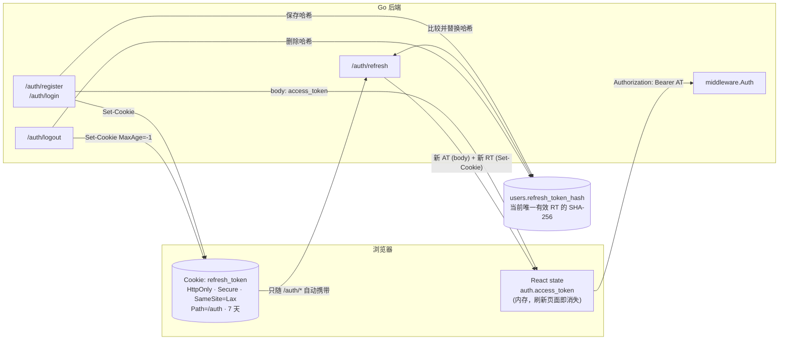
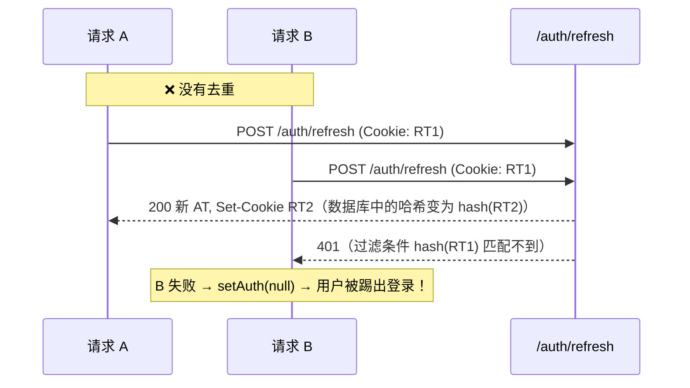
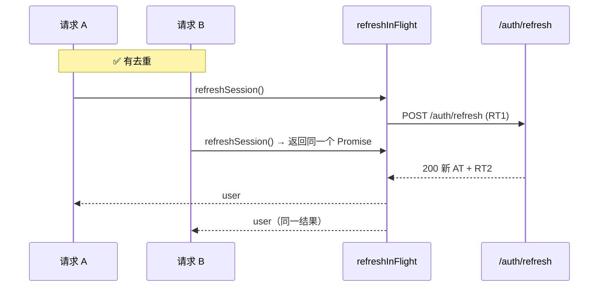
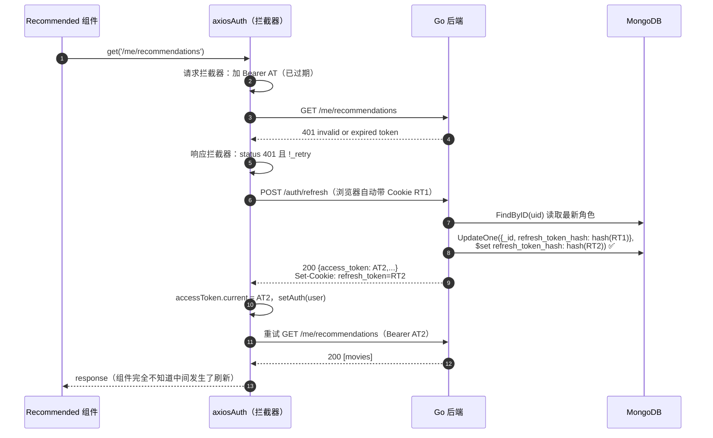
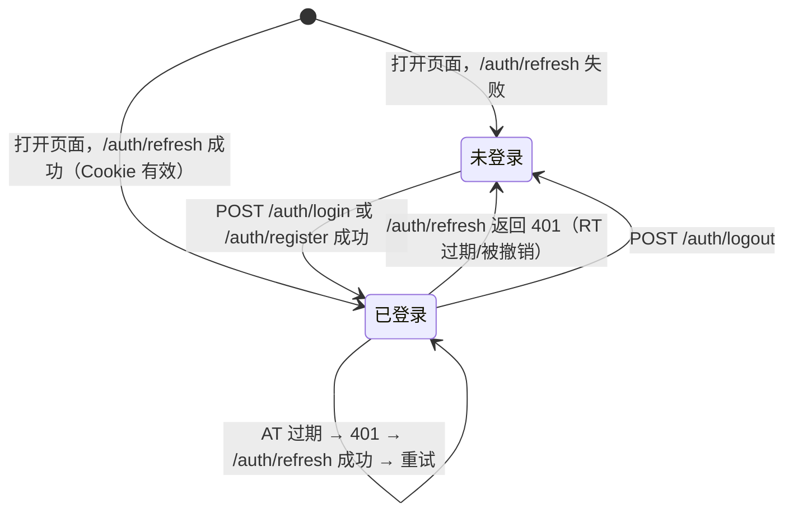

# 第 11 章　认证与授权

> 本章目标：彻底理解本项目的认证体系——密码如何安全存储、JWT 是什么、为什么要两种 Token、Refresh Token 如何轮换、Cookie 的各个属性意味着什么，以及前端如何做到“Token 过期后用户无感知地自动续期”。
>
> 这是全书最重要的一章，建议至少读两遍。

---

## 11.1 认证 vs 授权

| | 认证（Authentication，AuthN） | 授权（Authorization，AuthZ） |
|---|---|---|
| 回答的问题 | **你是谁？** | **你能做什么？** |
| 本项目中的实现 | 注册/登录（密码校验）、`middleware.Auth`（Token 校验） | `middleware.RequireRole("ADMIN")` |
| 失败时的状态码 | 401 Unauthorized | 403 Forbidden |

先认证，后授权。不知道你是谁，就无从判断你能做什么。在路由表中，这个顺序由嵌套路由组保证：`admin` 组建立在 `protected` 组之上（第 09 章 9.2.2）。

---

## 11.2 全局视图：本项目的认证架构



| 令牌 | 有效期 | 存放位置（客户端） | 存放位置（服务器） | 用途 |
|---|---|---|---|---|
| Access Token（AT） | 15 分钟 | JS 内存 | **不存** | 访问受保护 API |
| Refresh Token（RT） | 7 天 | HttpOnly Cookie | `users.refresh_token_hash`（SHA-256） | 只用于 `/auth/refresh`、`/auth/logout` |

代码分布：
- `tokens` 包：签发和校验 JWT、计算哈希（纯计算，不访问数据库）。
- `services.AuthService`：注册、登录、刷新、登出的业务规则。
- `controllers.AuthController`：读写 Cookie、写响应。
- `middleware.Auth` / `RequireRole`：保护其他接口。
- `repository.UserRepository`：保存和比较 RT 哈希。

---

## 11.3 第一步：安全地存储密码（bcrypt）

### 11.3.1 What & Why

**绝对不能明文存储密码。** 一旦数据库泄露（这种事经常发生），所有用户的密码都会暴露，而且很多用户会在多个网站使用同一个密码。

**哈希（Hash）**：一种单向函数，`hash(password) → 摘要`，无法从摘要反推密码。登录时对输入的密码做同样的哈希，比较摘要是否相同。

### 11.3.2 为什么需要“盐”（Salt）？
如果两个用户都用 `123456`，普通哈希得到的摘要相同，攻击者可以用预先计算好的“彩虹表”（rainbow table）批量破解。**盐**是每个用户独有的随机值，混入哈希计算，使相同密码产生不同摘要。

### 11.3.3 bcrypt 的输出格式

```text
$2a$10$N9qo8uLOickgx2ZMRZoMyeIjZAgcfl7p92ldGxad68LJZdL17lhWy
 │  │  └────────── 22 字符盐 ──────────┘└──────── 31 字符哈希 ───────┘
 │  └ cost = 10（2^10 = 1024 轮迭代）
 └ 算法版本
```

盐**直接存在哈希字符串里**，所以不需要单独存一个 `salt` 字段。

### 11.3.4 本项目的实现

注册时（`AuthService.Register`）：

```go
// bcrypt only uses the first 72 bytes. validator's max=72 counts characters, and multi-byte characters can exceed 72 bytes, so check bytes here.
if len(req.Password) > 72 {
	return nil, ErrPasswordTooLong
}
// ...
hash, err := bcrypt.GenerateFromPassword([]byte(req.Password), bcrypt.DefaultCost)
```

- `[]byte(password)`：把 string 转为字节切片（bcrypt 操作字节）。`len(string)` 返回的也是**字节数**，不是字符数。
- `bcrypt.DefaultCost` = 10。每增加 1，计算时间翻倍。
- **72 字节上限**：bcrypt 算法只使用前 72 字节，较新的 `x/crypto` 遇到更长的密码会直接返回错误。校验规则 `max=72` 数的是字符，`"é"` 是 1 个字符但占 2 个字节，所以 40 个 `é` 能通过校验却有 80 字节。这里按字节再检查一次，返回 400 而不是让 bcrypt 报错变成 500。

登录时（`AuthService.Login`）：

```go
// S/services/auth_service.go
func (s *AuthService) Login(ctx context.Context, email, password string) (*Session, error) {
	user, err := s.users.FindByEmail(ctx, NormalizeEmail(email))
	if errors.Is(err, repository.ErrNotFound) {
		_ = bcrypt.CompareHashAndPassword(s.dummyHash, []byte(password))
		return nil, ErrInvalidCredentials
	}
	if err != nil {
		return nil, fmt.Errorf("find user: %w", err)
	}

	if err := bcrypt.CompareHashAndPassword([]byte(user.PasswordHash), []byte(password)); err != nil {
		return nil, ErrInvalidCredentials
	}

	return s.startSession(ctx, user)
}
```

- `CompareHashAndPassword` 从哈希字符串中提取盐和 cost，对输入密码做同样的计算，然后用**常量时间比较**（防止通过响应时间推断出匹配了多少字节）。
- **两种失败返回同一个错误**：邮箱不存在和密码错误都是 `ErrInvalidCredentials`（`invalid email or password`），攻击者无法通过错误信息判断某个邮箱是否注册过（**用户枚举**）。
- **`dummyHash`：让两种失败耗时相同**。如果邮箱不存在时立即返回，而密码错误时要花约 50 毫秒算 bcrypt，攻击者测一下响应时间就能区分两者。所以邮箱不存在时，也对一个预先生成的假哈希做一次比对，结果直接丢弃。
- **数据库故障不是“密码错误”**：只有 `ErrNotFound` 被当作凭证错误，其他错误包装后返回，变成 500。

> **注册接口的权衡**：注册时邮箱已存在会返回 409 `email is already registered`，这仍然会暴露邮箱是否注册过。完全避免需要改变产品流程（例如“注册后发确认邮件，无论邮箱是否已存在都显示同样的提示”）。这是可用性与安全性之间常见的权衡；本项目通过注册接口的限流（第 12 章）提高了批量探测的成本。

### 11.3.5 常见错误
| 错误 | 后果 |
|---|---|
| 用 MD5/SHA-256 哈希密码 | 可被 GPU 高速暴力破解 |
| 自己拼接 `sha256(salt + password)` | 仍然太快 |
| 用 `==` 比较哈希字符串 | 时序攻击（理论上） |
| cost 设置过低（如 4） | 破解成本低 |
| 登录失败时提示“用户不存在”或“密码错误” | 用户枚举 |
| 用户不存在时立即返回 | 通过响应时间进行用户枚举 |

---

## 11.4 第二步：JWT

### 11.4.1 What

JWT（JSON Web Token，读作 “jot”）是一个由三部分组成、用 `.` 连接的字符串：

```text
eyJhbGciOiJIUzI1NiIsInR5cCI6IkpXVCJ9.eyJ1aWQiOiI2YWU0NGZmMzU5ZDBkODJjOGI1MDJmMTUi...In0.B9B7Bio...
└──────────── Header ────────────────┘└──────────── Payload ──────────────────────┘└ Signature ┘
```

- **Header**：`{"alg":"HS256","typ":"JWT"}`，Base64URL 编码。
- **Payload**（载荷，也叫 Claims）：要传递的数据，Base64URL 编码。
- **Signature**：`HMAC-SHA256(header + "." + payload, 密钥)`。

> ⚠️ **Base64URL 是编码，不是加密！** 任何人拿到 JWT 都能解码看到载荷内容。**不要在 JWT 中放密码或敏感信息。** 签名只保证“内容没有被篡改”，不保证“内容保密”。

### 11.4.2 本项目 JWT 的载荷

由 `tokens.Claims` 决定：

```go
// S/tokens/tokens.go
// Claims is the JWT payload. It carries only what authorization needs; names and email come from API responses.
type Claims struct {
	UserID string `json:"uid"`
	Role   string `json:"role"`
	jwt.RegisteredClaims
}
```

解码后的载荷：

```json
{
  "uid": "6ae44ff359d0d82c8b502f15",
  "role": "USER",
  "iss": "MagicStream",
  "sub": "6ae44ff359d0d82c8b502f15",
  "exp": 1793348471,
  "iat": 1793347571,
  "jti": "97bfcce098b87e7f0896388c54888a0a"
}
```

| 字段 | 来源 | 含义 |
|---|---|---|
| `uid`、`role` | 自定义字段（json tag） | 鉴权所需的全部信息 |
| `iss` | `RegisteredClaims.Issuer` | 签发者，校验时必须是 `MagicStream` |
| `sub` | `RegisteredClaims.Subject` | 主体（JWT 标准字段，这里与 `uid` 相同） |
| `exp`、`iat` | `ExpiresAt`、`IssuedAt` | 过期时间、签发时间（Unix 秒） |
| `jti` | `RegisteredClaims.ID` | 每个 Token 唯一的随机 ID |

**为什么载荷里没有姓名和邮箱？** 每个请求都要携带 Token，载荷越小越好；而且载荷只是编码、不是加密，个人信息放进去就会出现在日志、浏览器调试工具和任何经手的代理中。需要姓名时，前端使用登录响应中的 `UserResponse`。

### 11.4.3 Why：为什么用 JWT？

**无状态（Stateless）**：服务器验证 JWT 只需要密钥，**不需要查数据库**。`middleware.Auth` 中没有任何数据库操作——这使得每个受保护请求都能很快完成，并且多台服务器之间无需共享 Session 存储。

### 11.4.4 替代方案对比

| 方案 | 原理 | 优点 | 缺点 |
|---|---|---|---|
| **Session + Cookie** | 服务器存 Session，Cookie 只存 Session ID | 可随时撤销；简单 | 需要共享存储（如 Redis）；跨域麻烦 |
| **纯 JWT（长有效期）** | 一个 Token 用到底 | 简单 | 无法撤销；被盗后长期有效 |
| **短 AT + 长 RT（本项目）** | AT 无状态快速验证；RT 有状态可撤销 | 兼顾性能与可撤销 | 实现复杂 |
| OAuth2 / OIDC 第三方登录 | 交给 Google、Auth0 等 | 不用自己存密码 | 依赖第三方 |

### 11.4.5 为什么要两种 Token？

这是一个**权衡**：

- AT 是无状态的，**签发后无法撤销**。所以它的有效期必须**短**（15 分钟），即使被盗，损失也有限。
- 但让用户每 15 分钟重新登录一次体验太差。所以引入 RT：它有效期**长**（7 天），但每次使用都要**查数据库**确认没被撤销。
- RT 只发送给 `/auth/refresh` 和 `/auth/logout`，暴露面很小。

```go
// S/tokens/tokens.go
const (
	AccessTokenTTL  = 15 * time.Minute
	RefreshTokenTTL = 7 * 24 * time.Hour

	issuer = "MagicStream"
)
```

`time.Duration` 本质上是 `int64` 纳秒数，`15 * time.Minute` 是常量表达式，在编译期计算。`issuer` 小写开头，只在 `tokens` 包内可见。

---

## 11.5 签发 Token：`tokens.Manager`

```go
// S/tokens/tokens.go
// Manager holds two different signing keys, so an access token can never pass as a refresh token or vice versa.
type Manager struct {
	accessKey  []byte
	refreshKey []byte
	now        func() time.Time
}

func NewManager(accessKey, refreshKey []byte) *Manager {
	return &Manager{accessKey: accessKey, refreshKey: refreshKey, now: time.Now}
}

// Generate issues an access/refresh token pair.
func (m *Manager) Generate(userID, role string) (accessToken, refreshToken string, err error) {
	accessToken, err = m.sign(userID, role, AccessTokenTTL, m.accessKey)
	if err != nil {
		return "", "", fmt.Errorf("sign access token: %w", err)
	}
	refreshToken, err = m.sign(userID, role, RefreshTokenTTL, m.refreshKey)
	if err != nil {
		return "", "", fmt.Errorf("sign refresh token: %w", err)
	}
	return accessToken, refreshToken, nil
}

func (m *Manager) sign(userID, role string, ttl time.Duration, key []byte) (string, error) {
	now := m.now()
	claims := Claims{
		UserID: userID,
		Role:   role,
		RegisteredClaims: jwt.RegisteredClaims{
			Issuer:    issuer,
			Subject:   userID,
			IssuedAt:  jwt.NewNumericDate(now),
			ExpiresAt: jwt.NewNumericDate(now.Add(ttl)),
			// A random ID per token keeps two tokens issued in the same second distinct (refresh token rotation relies on this).
			ID: randomID(),
		},
	}
	return jwt.NewWithClaims(jwt.SigningMethodHS256, claims).SignedString(key)
}
```

### 11.5.1 密钥从哪里来？（Go 的初始化顺序）

密钥通过 `NewManager` 的参数传入，来源是 `main` 中已经校验过的 `cfg.SecretKey`（至少 32 字节，且两个密钥不同）。`tokens` 包本身不读环境变量。

为什么不写成包级变量？

```go
var secretKey = []byte(os.Getenv("SECRET_KEY"))   // ❌ 包级变量
```

Go 程序启动时，先初始化所有被导入包的**包级变量**，并执行它们的 `init()` 函数，**最后**才执行 `main()`。这一行会在 `main()` 调用 `godotenv.Load()` **之前**执行，此时环境变量里还没有 `SECRET_KEY`，得到的是**空切片**。而 golang-jwt 的 HMAC 签名**不会拒绝空密钥**——程序会“正常”运行，用空密钥签发所有 Token，任何人都能伪造 Token！

把密钥作为构造函数参数，就不存在“什么时候读取”的问题：`main` 先加载 `.env`、再校验配置、最后创建 `Manager`，顺序在代码中一目了然。测试也可以直接传入固定的测试密钥（`tokens_test.go` 就是这样做的）。

### 11.5.2 命名返回值

`Generate` 的签名 `(accessToken, refreshToken string, err error)` 给返回值起了名字。函数体内可以直接赋值 `accessToken, err = ...`（注意用的是 `=` 而不是 `:=`）。命名返回值在这里主要起**文档作用**：两个 `string` 返回值，调用方一看签名就知道哪个是哪个。

### 11.5.3 为什么每个 Token 都有随机的 `jti`？

`iat`、`exp` 精确到**秒**。如果同一秒内为同一个用户签发两次 RT（例如前端在页面加载时并发刷新），没有 `jti` 的话两个 Token 的载荷完全相同，签名也就完全相同——**新 RT 和旧 RT 是同一个字符串**，“旧 RT 作废”就失去了意义。`randomID()` 用 `crypto/rand` 生成 16 字节随机数，保证每个 Token 都不同。`tokens_test.go` 中的 `TestGeneratedTokensAreUnique` 锁定了这个行为。

### 11.5.4 `now func() time.Time`：可替换的时钟

`Manager` 把 `time.Now` 存成一个字段，而不是直接调用 `time.Now()`。生产代码中它就是 `time.Now`；测试可以替换它，例如让 `Generate` 认为现在是 16 分钟前，从而签发一个**已经过期**的 Token，测试过期校验（`TestExpiredTokenRejected`）——不需要真的等 15 分钟。

### 11.5.5 为什么 AT 和 RT 用不同的密钥？

如果用同一个密钥，**RT 就可以被当作 AT 使用**（签名能通过验证），反之亦然。用两个密钥，`ValidateAccess` 只接受用 `accessKey` 签名的，`ValidateRefresh` 只接受用 `refreshKey` 签名的，两种 Token 互不通用（`TestTokensAreNotInterchangeable`）。`config.Load()` 还会拒绝两个密钥相同的配置。

（另一种做法是在载荷中加一个 `typ: "access"` / `typ: "refresh"` 字段并校验。）

### 11.5.6 HS256 是什么？

- **HS256** = HMAC + SHA-256，**对称**签名：签名和验证用同一个密钥。适合签发方和验证方是同一个服务的场景（本项目）。
- **RS256 / ES256**：**非对称**签名，私钥签名、公钥验证。适合“一个认证服务签发，多个服务验证”的微服务场景——验证方只需要公钥，即使泄露也无法伪造 Token。

---

## 11.6 开始一个会话：注册与登录

注册和登录成功后做的事情完全一样，所以提取成了 `startSession`：

```go
// S/services/auth_service.go
func (s *AuthService) startSession(ctx context.Context, user *models.User) (*Session, error) {
	accessToken, refreshToken, err := s.tokens.Generate(user.ID.Hex(), user.Role)
	if err != nil {
		return nil, err
	}
	if err := s.users.SetRefreshTokenHash(ctx, user.ID.Hex(), tokens.Hash(refreshToken)); err != nil {
		return nil, fmt.Errorf("store refresh token: %w", err)
	}
	return &Session{User: user, AccessToken: accessToken, RefreshToken: refreshToken}, nil
}
```

Controller 把 `Session` 写成 HTTP 响应：

```go
// S/controllers/user_controller.go
// writeSession puts the refresh token in an HttpOnly cookie and the access token plus user data in the response body.
func (h *AuthController) writeSession(c *gin.Context, status int, s *services.Session) {
	h.setRefreshCookie(c, s.RefreshToken, int(tokens.RefreshTokenTTL.Seconds()))
	c.JSON(status, models.UserResponse{
		UserID:          s.User.ID.Hex(),
		FirstName:       s.User.FirstName,
		LastName:        s.User.LastName,
		Email:           s.User.Email,
		Role:            s.User.Role,
		AccessToken:     s.AccessToken,
		FavouriteGenres: s.User.FavouriteGenres,
	})
}
```

`RefreshTokenTTL.Seconds()` 返回 `float64`（604800.0），`int(...)` 转换为整数。

注意分工：**service 不知道 Cookie 的存在**，它只返回 `Session`（三个值）。“RT 放 Cookie、AT 放响应体”是 HTTP 层的决定。如果将来要支持手机 App（没有 Cookie），只需要在 controller 中换一种返回方式。

**示例**

```bash
curl -i -X POST http://localhost:8080/auth/login \
  -H 'Content-Type: application/json' \
  -d '{"email":"Ada@Example.com","password":"secret123"}'
```

```http
HTTP/1.1 200 OK
Set-Cookie: refresh_token=eyJ...; Path=/auth; Max-Age=604800; HttpOnly; Secure; SameSite=Lax
Content-Type: application/json; charset=utf-8

{"user_id":"6650...","first_name":"Ada","last_name":"Lovelace","email":"ada@example.com",
 "role":"USER","access_token":"eyJ...","favourite_genres":[{"genre_id":2,"genre_name":"Drama"}]}
```

邮箱写成 `Ada@Example.com` 也能登录：`NormalizeEmail` 把它转成小写，与注册时保存的形式一致。

---

## 11.7 Cookie 详解：`setRefreshCookie`

```go
// S/controllers/user_controller.go
const (
	refreshCookieName = "refresh_token"
	// The refresh token cookie is only sent with /auth/... requests; no other endpoint ever sees it.
	refreshCookiePath = "/auth"
)

func (h *AuthController) setRefreshCookie(c *gin.Context, value string, maxAge int) {
	http.SetCookie(c.Writer, &http.Cookie{
		Name:     refreshCookieName,
		Value:    value,
		Path:     refreshCookiePath,
		MaxAge:   maxAge,
		Secure:   h.cookie.Secure,
		HttpOnly: true,
		SameSite: h.cookie.SameSite,
	})
}
```

| 属性 | 本项目的值 | 含义 | 如果不设置会怎样 |
|---|---|---|---|
| `HttpOnly` | `true` | JavaScript 无法通过 `document.cookie` 读取 | XSS 攻击脚本可以直接偷走 RT |
| `Secure` | `COOKIE_SECURE`，默认 `true` | 只在 HTTPS 下发送（`localhost` 被浏览器视为安全上下文，例外） | 在 HTTP 中明文传输，可被中间人窃听 |
| `SameSite` | `COOKIE_SAMESITE`，默认 `Lax` | 见下文 | 浏览器默认按 `Lax` 处理 |
| `MaxAge` | 604800 | 7 天后过期；**负数表示立即删除** | 默认为会话 Cookie，关闭浏览器即失效 |
| `Path` | `/auth` | 只随 `/auth/...` 请求发送 | 默认是当前请求路径的“目录” |

> 为什么用 `http.SetCookie` 而不是 Gin 的 `c.SetCookie`？Gin 的 `c.SetCookie(name, value, maxAge, path, domain, secure, httpOnly)` 方法参数中**没有 SameSite**，需要提前调用 `c.SetSameSite(...)`。直接构造 `http.Cookie` 更清晰。

### 11.7.1 `Path=/auth`：最小暴露

RT 只有 `/auth/refresh` 和 `/auth/logout` 需要。如果 `Path=/`，浏览器会把它附加到**每一个**发往 API 的请求上（包括 `GET /movies`），这些请求的日志、代理、中间件都可能接触到它。限定路径之后，RT 只出现在真正需要它的两个请求中。这也是认证接口统一放在 `/auth` 前缀下的原因之一。

### 11.7.2 SameSite 的三个取值

| 值 | 行为 |
|---|---|
| `Strict` | 只有同站请求才携带 |
| `Lax`（大多数浏览器的默认值） | 同站请求 + 跨站的顶层导航 GET 携带 |
| `None` | 所有请求都携带（必须 `Secure`） |

**“站（site）”和“源（origin）”的区别**：
- 源 = 协议 + 域名 + **端口**。`http://localhost:5173` 和 `http://localhost:8080` 是**不同源**（所以需要 CORS）。
- 站 = 协议 + 可注册域名（**不含端口**）。它们是**同站**的。

所以本地开发时 `SameSite=Lax` 完全可以工作；生产环境中，只要前后端在同一个站点下（如 `reelm.com` 和 `api.reelm.com`），也同样适用。`Lax` 的好处是：**其他网站发起的跨站 POST 请求不会携带这个 Cookie**，`/auth/refresh` 和 `/auth/logout` 天然不受 CSRF 影响。

只有当前后端部署在**完全不同的站点**（如 `reelm.vercel.app` 和 `reelm-api.onrender.com`）时，才需要 `COOKIE_SAMESITE=None`。代价是：`SameSite=None` 的 Cookie 属于“第三方 Cookie”，越来越多的浏览器（Safari、Firefox 的严格模式等）会默认拦截。`config.Load()` 会拒绝 `SameSite=None` 而 `Secure=false` 的组合，因为浏览器本来也会拒绝这样的 Cookie。部署建议见第 17 章。

### 11.7.3 为什么 AT 不放 Cookie 或 localStorage？

| 存放位置 | XSS 能偷走吗？ | CSRF 风险 | 刷新页面后 |
|---|---|---|---|
| `localStorage` | ✅ 能（JS 可读） | 无 | 保留 |
| 普通 Cookie | ✅ 能 | 有 | 保留 |
| HttpOnly Cookie | ❌ 不能直接读 | 有 | 保留 |
| **JS 内存（本项目的 AT）** | 较难（需要在页面运行期间注入代码） | 无（需要手动加 Header） | **丢失** → 用 RT 恢复 |

本项目的组合是：**AT 在内存**（不受 CSRF 影响，因为浏览器不会自动附加 `Authorization` Header），**RT 在 HttpOnly + SameSite=Lax + Path=/auth 的 Cookie 中**（JS 读不到，跨站请求不携带，只发给认证接口）。这是当前业界推荐的 SPA 认证方案之一。

> **如果必须使用 `SameSite=None`**：恶意网站就可以触发 `POST /auth/refresh`。但攻击者**读不到响应**（CORS 只允许 `ALLOWED_ORIGINS` 读取响应），拿不到新的 AT，唯一的副作用是 RT 被轮换。`POST /auth/logout` 也可以被跨站触发，导致用户被强制登出。这种情况下可以在这两个接口上校验 `Origin` 头作为额外防御。

---

## 11.8 Token 持久化：只存 RT 的哈希

```go
// S/tokens/tokens.go
// Hash returns the SHA-256 hex digest of a token. The database stores only the refresh token's digest,
// so a leaked database does not yield usable tokens.
// Tokens are high-entropy random strings, so a fast hash is enough; bcrypt is not needed.
func Hash(token string) string {
	sum := sha256.Sum256([]byte(token))
	return hex.EncodeToString(sum[:])
}
```

```go
// S/repository/user_repository.go
// SetRefreshTokenHash stores the hash of the current refresh token, or clears it when hash is empty.
func (r *UserRepository) SetRefreshTokenHash(ctx context.Context, id, hash string) error {
	oid, err := bson.ObjectIDFromHex(id)
	if err != nil {
		return ErrNotFound
	}
	update := bson.M{"$set": bson.M{"updated_at": time.Now()}}
	if hash == "" {
		update["$unset"] = bson.M{"refresh_token_hash": ""}
	} else {
		update["$set"].(bson.M)["refresh_token_hash"] = hash
	}
	result, err := r.coll.UpdateOne(ctx, bson.M{"_id": oid}, update)
	if err != nil {
		return err
	}
	if result.MatchedCount == 0 {
		return ErrNotFound
	}
	return nil
}
```

逐点分析：

1. **为什么不存 AT？** AT 是无状态的，验证时从不查询数据库。把它存进数据库没有任何用途，只会带来风险——任何能读取数据库的人都能拿到 15 分钟内有效的 AT。
2. **为什么存 RT 的哈希而不是 RT 本身？** 道理和密码一样：数据库泄露时，攻击者拿到的是哈希，无法反推出 RT，也就无法冒充用户刷新。校验时对 Cookie 中的 RT 算一次哈希，再与数据库比较。
3. **为什么用 SHA-256 而不用 bcrypt？** 密码需要“慢”哈希，是因为人选的密码熵很低，可以被暴力枚举。RT 是服务器生成的高熵随机串（包含签名和 128 位随机 `jti`），不可能被枚举，所以快速哈希就足够了。每次刷新都跑一遍 bcrypt 只会白白消耗 CPU。
4. **`$unset`**：登出时直接删除这个字段，而不是设为空字符串。
5. **`updated_at`**：必须与 `models.User` 的 bson tag 完全一致。在 `bson.M{...}` 中手写的字段名是普通字符串，编译器不会检查；写错（例如 `update_at`）不会有任何报错，只会在文档里多出一个字段，而真正的 `updated_at` 永远不更新。每次在更新语句中手写字段名时，都要对照 struct tag 检查一遍；也可以在 repository 的集成测试中读回文档、断言 `updated_at` 已经变化，把这个行为锁定下来。
6. `update["$set"].(bson.M)`：`bson.M` 的值类型是 `any`，要往嵌套的 map 里加字段，需要先**类型断言**回 `bson.M`。

---

## 11.9 刷新：Token 轮换

### 11.9.1 代码

```go
// S/services/auth_service.go
// Refresh trades a refresh token for a new token pair. Each refresh token can be used only once (rotation).
func (s *AuthService) Refresh(ctx context.Context, refreshToken string) (*Session, error) {
	claims, err := s.tokens.ValidateRefresh(refreshToken)                 // ① 签名、过期、签发者
	if err != nil {
		return nil, ErrInvalidRefreshToken
	}

	// Read the latest role and name from the database instead of trusting the old token.
	user, err := s.users.FindByID(ctx, claims.UserID)                     // ② 最新的用户数据
	if errors.Is(err, repository.ErrNotFound) {
		return nil, ErrInvalidRefreshToken
	}
	if err != nil {
		return nil, fmt.Errorf("find user: %w", err)
	}

	accessToken, newRefreshToken, err := s.tokens.Generate(user.ID.Hex(), user.Role)   // ③
	if err != nil {
		return nil, err
	}

	err = s.users.RotateRefreshTokenHash(ctx, user.ID.Hex(), tokens.Hash(refreshToken), tokens.Hash(newRefreshToken)) // ④
	if errors.Is(err, repository.ErrNotFound) {
		// The stored hash has changed: the token was already used, the user logged out, or they signed in elsewhere.
		return nil, ErrInvalidRefreshToken
	}
	if err != nil {
		return nil, fmt.Errorf("rotate refresh token: %w", err)
	}

	return &Session{User: user, AccessToken: accessToken, RefreshToken: newRefreshToken}, nil
}
```

Controller 部分：

```go
// S/controllers/user_controller.go
// Refresh handles POST /auth/refresh: it trades the refresh token cookie for a new token pair.
func (h *AuthController) Refresh(c *gin.Context) {
	refreshToken, err := c.Cookie(refreshCookieName)
	if err != nil {
		c.JSON(http.StatusUnauthorized, gin.H{"error": "missing refresh token"})
		return
	}
	ctx, cancel := context.WithTimeout(c.Request.Context(), h.timeout)
	defer cancel()

	session, err := h.auth.Refresh(ctx, refreshToken)
	if err != nil {
		h.setRefreshCookie(c, "", -1)       // 无效的 Cookie 顺便清掉
		respondError(c, err)
		return
	}
	h.writeSession(c, http.StatusOK, session)
}
```

### 11.9.2 What：Refresh Token 轮换（Rotation）

**每次使用 RT 换取新 AT 时，同时签发一个新的 RT，并让旧 RT 失效。**

### 11.9.3 Why

- **限制被盗 RT 的寿命**：如果攻击者偷到了一个 RT，一旦合法用户先刷新了一次，攻击者手里的 RT 就作废了。
- **让登出真正生效**：登出时删除数据库中的哈希，步骤 ④ 的比较让任何旧 RT 都无法再使用。如果没有这个检查，JWT 签名有效的 RT 在 7 天内都能用，登出就只是“前端假装登出”。

### 11.9.4 步骤 ④：比较并交换（Compare-and-Swap）

```go
// S/repository/user_repository.go
// RotateRefreshTokenHash replaces the hash with newHash only if it still equals oldHash.
// The check and the update are one statement, so of two concurrent requests holding the same old token only one succeeds.
func (r *UserRepository) RotateRefreshTokenHash(ctx context.Context, id, oldHash, newHash string) error {
	// ...
	result, err := r.coll.UpdateOne(ctx,
		bson.M{"_id": oid, "refresh_token_hash": oldHash},
		bson.M{"$set": bson.M{"refresh_token_hash": newHash, "updated_at": time.Now()}},
	)
	// ...
	if result.MatchedCount == 0 {
		return ErrNotFound
	}
	return nil
}
```

为什么不写成“先读出用户、在 Go 里比较哈希、再更新”？因为那又是一个 **check-then-act 竞态**（第 07 章 7.7）：两个请求带着同一个旧 RT 同时到达，都读到了相同的哈希、都比较通过、都签发了新 RT——一个 RT 被用了两次，轮换形同虚设。

把“比较”写进 `UpdateOne` 的过滤条件，MongoDB 对单个文档的更新是原子的：第一个请求把哈希换掉之后，第二个请求的过滤条件就匹配不到了（`MatchedCount == 0`），被拒绝。这种“仅当当前值等于预期值时才更新”的模式叫做**比较并交换**（CAS），是无锁并发控制的基础。

### 11.9.5 为什么步骤 ② 要重新查数据库？

因为 RT 载荷中的 `role` 可能已经过时（例如管理员刚刚把这个用户提升或降级了）。从数据库读取最新数据来签发新 AT，能保证权限变更最多 15 分钟后生效。`services_test.go` 中的 `TestRefreshRotatesAndRejectsReuse` 验证了这一点：在数据库中把用户改为 ADMIN 后刷新，新 Token 带着 ADMIN 角色。

### 11.9.6 进一步增强：重用检测

更严格的做法（OAuth 2.0 安全最佳实践中推荐）：如果收到一个**签名有效、但不是最新**的 RT，说明这个 RT 可能被盗用了（合法用户和攻击者中有一方在用旧的）。此时应该**撤销该用户的所有会话**（删除数据库中的哈希），强制双方重新登录。本项目在这种情况下只拒绝请求，可以作为练习实现（练习 11.8）。

---

## 11.10 登出

```go
// S/services/auth_service.go
// Logout revokes the refresh token on the server. An invalid token is a no-op (logging out always "succeeds").
func (s *AuthService) Logout(ctx context.Context, refreshToken string) error {
	claims, err := s.tokens.ValidateRefresh(refreshToken)
	if err != nil {
		return nil
	}
	err = s.users.SetRefreshTokenHash(ctx, claims.UserID, "")
	if err != nil && !errors.Is(err, repository.ErrNotFound) {
		return fmt.Errorf("clear refresh token: %w", err)
	}
	return nil
}
```

```go
// S/controllers/user_controller.go
// Logout handles POST /auth/logout. The user is identified by the refresh token cookie, not the request body.
func (h *AuthController) Logout(c *gin.Context) {
	if refreshToken, err := c.Cookie(refreshCookieName); err == nil {
		ctx, cancel := context.WithTimeout(c.Request.Context(), h.timeout)
		defer cancel()
		if err := h.auth.Logout(ctx, refreshToken); err != nil {
			respondError(c, err)
			return
		}
	}
	h.setRefreshCookie(c, "", -1)
	c.JSON(http.StatusOK, gin.H{"message": "logged out"})
}
```

**设计要点**：
- 用户身份来自**已验证的 Cookie**，而不是请求体中的 `user_id`。否则任何人都能通过发送别人的 `user_id` 来让别人登出。
- **幂等（Idempotent）**：即使没有 Cookie 或 Cookie 无效，也返回 200 并清除 Cookie。多次调用结果相同，前端无需处理特殊情况。只有真正的数据库故障才返回 500。
- `MaxAge: -1` 让浏览器立即删除 Cookie（Go 会生成 `Max-Age=0` 头）。删除 Cookie 时 `Path` 必须与设置时相同，所以这里同样使用 `refreshCookiePath`。

**局限**：已经签发出去的 AT 在 15 分钟内**仍然有效**（无状态的代价）。如果需要立即失效，必须引入 AT 黑名单（又回到了有状态），或者把 AT 有效期缩得更短。

---

## 11.11 校验 Token：`parse`

```go
// S/tokens/tokens.go
func (m *Manager) ValidateAccess(tokenString string) (*Claims, error) {
	return m.parse(tokenString, m.accessKey)
}

func (m *Manager) ValidateRefresh(tokenString string) (*Claims, error) {
	return m.parse(tokenString, m.refreshKey)
}

func (m *Manager) parse(tokenString string, key []byte) (*Claims, error) {
	claims := &Claims{}
	_, err := jwt.ParseWithClaims(tokenString, claims,
		func(*jwt.Token) (any, error) { return key, nil },
		// Restrict the algorithm before the signature is checked, to prevent alg confusion attacks.
		jwt.WithValidMethods([]string{jwt.SigningMethodHS256.Alg()}),
		jwt.WithIssuer(issuer),
		jwt.WithExpirationRequired(),
		jwt.WithTimeFunc(m.now),
	)
	if err != nil {
		return nil, err
	}
	if claims.UserID == "" {
		return nil, errors.New("token has no user id")
	}
	return claims, nil
}
```

### 11.11.1 `ParseWithClaims` 做了什么？

1. 按 `.` 分割三段，Base64URL 解码 Header 和 Payload。
2. 把 Payload JSON 解码到 `claims`（因为传入的是指针，函数会填充它）。
3. 检查 Header 中的 `alg` 是否在 `WithValidMethods` 允许的列表中——**在验证签名之前**。
4. 调用第三个参数——**密钥函数（keyFunc）**——获取验证用的密钥。这个回调设计允许根据 Token Header 中的信息（如 `kid`）选择不同的密钥；本项目只有一个密钥，直接返回。
5. 用该算法验证签名。
6. 校验时间相关的 Claims：`exp`（过期）、`nbf`（生效时间）、`iat`，以及选项要求的 `iss`。

### 11.11.2 每个选项防御什么？

| 选项 | 如果不加 |
|---|---|
| `WithValidMethods([HS256])` | **算法混淆攻击**：库会使用 Token Header 中声明的算法。如果服务器同时支持对称和非对称算法，攻击者可以把 `alg` 改成 HS256，用**公钥**当作 HMAC 密钥伪造签名。限定算法列表、并且在验证签名**之前**检查，是防御这类攻击的标准做法。 |
| `WithIssuer("MagicStream")` | 其他系统签发的、恰好用了相同密钥的 Token 也会被接受（例如开发环境和生产环境误用了同一个密钥）。 |
| `WithExpirationRequired()` | golang-jwt 默认只在 `exp` **存在时**检查它。一个没有 `exp` 的 Token 会被当作**永不过期**。 |
| `WithTimeFunc(m.now)` | 不影响安全，只是让测试可以控制“现在”。 |

**不需要手动检查过期**：`ParseWithClaims` 已经检查了 `exp`，过期的 Token 会返回 `jwt.ErrTokenExpired`。再写一遍 `if claims.ExpiresAt.Time.Before(time.Now())` 既多余，又会在 `ExpiresAt` 为 nil 时 panic。

**`claims.UserID == ""` 检查**：签名有效、但载荷中没有 `uid` 的 Token 不应该被当作某个用户。正常签发的 Token 不会出现这种情况，这是一道防御性检查。

**一个实现，两种 Token**：`ValidateAccess` 和 `ValidateRefresh` 只是传入不同的密钥，校验规则完全相同，不会出现“改了一个忘了另一个”的情况。

`tokens_test.go` 中的 `TestRejectsOtherAlgorithmsAndIssuers` 分别构造了 `alg: none`、HS512、错误的签发者、缺少 `exp` 的 Token，断言它们全部被拒绝。

---

## 11.12 从请求中提取 Token：`middleware.Auth`

```go
// S/middleware/auth.go
// Auth validates "Authorization: Bearer <access token>" and stores the user ID and role in the context.
func Auth(tm *tokens.Manager) gin.HandlerFunc {
	return func(c *gin.Context) {
		tokenString, found := strings.CutPrefix(c.GetHeader("Authorization"), "Bearer ")
		if !found || tokenString == "" {
			c.AbortWithStatusJSON(http.StatusUnauthorized, gin.H{"error": "missing bearer token"})
			return
		}

		claims, err := tm.ValidateAccess(tokenString)
		if err != nil {
			c.AbortWithStatusJSON(http.StatusUnauthorized, gin.H{"error": "invalid or expired token"})
			return
		}

		c.Set(ctxUserID, claims.UserID)
		c.Set(ctxRole, claims.Role)
		c.Next()
	}
}
```

- `strings.CutPrefix(s, prefix)`（Go 1.20+）：如果 `s` 以 `prefix` 开头，返回去掉前缀后的字符串和 `true`。没有 `Authorization` 头时 `s` 是空字符串，`found` 为 `false`，一个判断就覆盖了“没有头”和“格式不对”两种情况。
- `Bearer` 是 RFC 6750 定义的认证方案名，意为“持有者令牌”——谁持有它，谁就被认为是该用户。这也是为什么 Token 绝不能泄露。
- 前缀比较区分大小写，`bearer xxx` 会被拒绝。RFC 规定方案名不区分大小写，但几乎所有客户端都发送 `Bearer`。
- **错误信息不透露细节**：Token 过期、签名错误、算法不对，客户端看到的都是 `invalid or expired token`。具体原因对合法用户没有帮助，对攻击者却有参考价值。

这个中间件是一个**工厂函数**：`Auth(tm)` 在注册路由时执行一次，返回的闭包在每个请求中执行，通过闭包访问 `tm`。第 12 章详解中间件。

---

## 11.13 授权：从 Context 获取身份

```go
// S/middleware/auth.go
// Context keys for the caller's identity. They are private to this package; other packages use the accessors below.
const (
	ctxUserID = "userID"
	ctxRole   = "role"
)

// UserID returns the user ID set by Auth, or "" if Auth did not run.
func UserID(c *gin.Context) string { return c.GetString(ctxUserID) }

// Role returns the role set by Auth, or "" if Auth did not run.
func Role(c *gin.Context) string { return c.GetString(ctxRole) }
```

- `c.GetString(key)` 是 Gin 提供的便捷方法：取出值并断言为 `string`，键不存在或类型不对时返回空字符串，不会 panic。
- 键名是**未导出的常量**。写入方（`Auth`）和读取方（`UserID`、`Role`）都在 `middleware` 包内，其他包只能通过函数读取——不会出现一处写 `"userId"`、另一处读 `"userID"` 这种大小写拼错导致永远读不到的 bug。

### 11.13.1 `RequireRole`

```go
// S/middleware/auth.go
// RequireRole must run after Auth. A signed-in user with the wrong role gets 403, not 401:
// a 401 would make the frontend think the token expired and try to refresh it.
func RequireRole(roles ...string) gin.HandlerFunc {
	return func(c *gin.Context) {
		if !slices.Contains(roles, Role(c)) {
			c.AbortWithStatusJSON(http.StatusForbidden, gin.H{"error": "insufficient permissions"})
			return
		}
		c.Next()
	}
}
```

| 接口 | 需要的权限 | 如何保证 |
|---|---|---|
| `GET /movies/:imdb_id`、`GET /me/recommendations` | 登录 | 注册在 `protected` 组 |
| `POST /movies`、`PATCH /movies/:imdb_id/review` | ADMIN | 注册在 `admin` 组 |

- `roles ...string` 是**可变参数**：可以写 `RequireRole("ADMIN")`，也可以写 `RequireRole("ADMIN", "EDITOR")`。函数内部 `roles` 是 `[]string`。
- `slices.Contains`（Go 1.21+ 标准库）：判断切片中是否包含某个元素。
- 如果有人把 `RequireRole` 错误地挂在没有 `Auth` 的组上，`Role(c)` 返回空字符串，不在列表中，结果是 403——**失败时默认拒绝**，而不是默认放行。

### 11.13.2 角色变更的延迟

AT 中的 `role` 在签发时就固定了。如果管理员被降级，他手上的 AT 在**最多 15 分钟**内仍然拥有 ADMIN 权限；下一次刷新时会拿到新角色。这是无状态 Token 的固有权衡。

---

## 11.14 前端：Token 的完整生命周期

### 11.14.1 页面加载时恢复会话（`AuthProvider`）

```tsx
// C/src/context/AuthProvider.tsx
function AuthProvider({ children }: AuthProviderProps) {
  // Held in memory only (never localStorage), so the access token is gone on reload
  const [auth, setAuth] = useState<User | null>(null);
  const [loading, setLoading] = useState(true);

  // On page load, restore the session from the HttpOnly refresh_token cookie
  useEffect(() => {
    let active = true;
    refreshSession()
      .then((user) => { if (active) setAuth(user); })
      .catch(() => { if (active) setAuth(null); })
      .finally(() => { if (active) setLoading(false); });
    return () => { active = false; };
  }, []);
  // ...
}
```

- `useEffect(fn, [])`：组件**首次挂载后**执行一次。
- 返回的函数是**清理函数**，组件卸载时执行。
- `active` 标志：防止组件卸载后还调用 `setState`（异步请求返回时组件可能已不存在）。
- `loading` 的作用：在恢复完成前，`RequiredAuth` 不应该急着把用户重定向到登录页（否则已登录用户每次刷新页面都会闪一下登录页）。

### 11.14.2 并发去重：`refreshSession`

```ts
// C/src/api/axiosConfig.ts
let refreshInFlight: Promise<User> | null = null

// Exchanges the HttpOnly refresh_token cookie for a new access token (plus user info).
// The server rotates the refresh token on every call, so concurrent callers must share
// one request; a second request with the old cookie would be rejected as revoked.
export function refreshSession(): Promise<User> {
    if (!refreshInFlight) {
        refreshInFlight = axiosClient
            .post<User>('/auth/refresh')
            .then(response => response.data)
            .finally(() => { refreshInFlight = null })
    }
    return refreshInFlight
}
```

**为什么这是必须的？** 因为服务器的 **RT 轮换**。设想同时有两个请求都发现 AT 过期了：





模块级变量 `refreshInFlight` 保存着“正在进行中的刷新 Promise”。第二个调用者直接复用它。请求结束后（无论成功失败）在 `.finally` 中清空，下次需要时再发起新请求。

> **一个容易忽略的场景：React StrictMode。** `main.tsx` 使用了 `<StrictMode>`。在**开发模式**下，React 会故意把每个 `useEffect` 执行两次（挂载 → 卸载 → 再挂载），用来帮你发现副作用中的 bug。这意味着 `AuthProvider` 在页面加载时会调用两次 `refreshSession()`。如果没有去重，第二次调用必然因为 RT 已被轮换而失败——**开发时每次刷新页面都会被登出**。去重机制正好解决了这个问题。

### 11.14.3 自动附加 Token 与自动刷新：`useAxiosPrivate`

```tsx
// C/src/hook/useAxiosPrivate.tsx（核心部分）
const axiosAuth = useMemo(() => axios.create({ baseURL: apiUrl, withCredentials: true }), []);
const { auth, setAuth } = useAuth();

// Interceptors read the token through a ref so the axios instance stays stable
const accessToken = useRef(auth?.access_token);
useEffect(() => { accessToken.current = auth?.access_token; }, [auth]);

useEffect(() => {
  // 请求拦截器：自动加 Authorization
  const requestInterceptor = axiosAuth.interceptors.request.use(config => {
    if (accessToken.current && !config.headers.Authorization) {
      config.headers.Authorization = `Bearer ${accessToken.current}`;
    }
    return config;
  });

  // 响应拦截器：401 → 刷新 → 重试
  const responseInterceptor = axiosAuth.interceptors.response.use(
    response => response,
    async (error: AxiosError) => {
      const originalRequest = error.config as RetryableRequestConfig | undefined;
      if (!originalRequest || error.response?.status !== 401 || originalRequest._retry) {
        return Promise.reject(error);                         // 不是 401（例如 403），或已经重试过
      }
      originalRequest._retry = true;                          // 标记，防止无限循环
      try {
        const user = await refreshSession();
        accessToken.current = user.access_token;
        setAuth(user);
        originalRequest.headers.Authorization = `Bearer ${user.access_token}`;
        return axiosAuth(originalRequest);                    // 用新 Token 重试原请求
      } catch (refreshError) {
        if (axios.isAxiosError(refreshError) && refreshError.response?.status === 401) {
          setAuth(null);                                      // RT 也失效了 → 登出
        }
        return Promise.reject(refreshError);
      }
    });

  return () => {                                              // 清理：移除拦截器
    axiosAuth.interceptors.request.eject(requestInterceptor);
    axiosAuth.interceptors.response.eject(responseInterceptor);
  };
}, [axiosAuth, setAuth]);
```

**关键设计**：

| 技术 | 为什么 |
|---|---|
| `useMemo(() => axios.create(...), [])` | 让 axios 实例在组件的整个生命周期内保持不变。如果每次渲染都新建，依赖它的 `useEffect`（如 `Recommended` 中的数据请求）会无限重复执行。 |
| `useRef` 保存 Token | `ref` 的变化**不会**触发重新渲染，也不会让 `useEffect` 重新执行。拦截器通过 `accessToken.current` 总能读到最新值，而无需重新注册。 |
| `_retry` 标志 | 如果刷新后重试仍然返回 401，不再刷新，避免死循环。 |
| 只拦截 401 | 403（权限不足）不是 Token 的问题，刷新也没用，直接交给组件处理。这正是后端必须区分 401 和 403 的原因。 |
| `!config.headers.Authorization` | 重试时已手动设置了新 Token，请求拦截器不要用旧值覆盖它。 |
| `eject` | 组件卸载时移除拦截器，避免内存泄漏和重复拦截。 |
| `TypeScript interface extends` | `RetryableRequestConfig` 扩展 axios 的配置类型，添加自定义的 `_retry` 字段。 |

### 11.14.4 Token 刷新完整时序图



### 11.14.5 一个细节：`auth` 为空时的请求

`auth` 为 `null` 时（未登录或会话还没恢复），请求拦截器不会添加 `Authorization`。这样的请求发出去会得到 401 → 拦截器尝试刷新 → 如果 Cookie 有效则成功重试。这能工作，但多了一次往返。`RequiredAuth` 保证受保护页面只在 `auth` 存在时才渲染，所以实际中这种情况很少发生。

---

## 11.15 完整认证流程总结



---

## 本章练习

> 答案见 [第 20 章](20-exercise-solutions.md#第-11-章)

**关键概念回顾**
- 认证和授权的区别？
- 为什么 AT 要短、RT 要长？为什么 RT 要轮换？
- HttpOnly、Secure、SameSite 分别防御什么？
- 为什么签名密钥通过 `tokens.NewManager` 的参数传入，而不是写成包级变量？

**面试题 11.1** “JWT 能被撤销吗？如果需要立即让某个用户的所有会话失效，你会怎么做？”

**面试题 11.2** “JWT 的载荷是加密的吗？可以在里面放什么、不能放什么？”

**面试题 11.3** “Access Token 应该存在哪里？比较 localStorage、Cookie 和内存。”

**面试题 11.4** “什么是 Refresh Token 轮换？什么是重用检测？”

**面试题 11.5** “HS256 和 RS256 有什么区别？各适用什么场景？”

**练习 11.6** 不看源码，在你的重建项目中实现 `tokens.Manager` 的 `Generate`、`ValidateAccess`、`ValidateRefresh`，并写测试证明：两种 Token 不能互换；`alg: none`、缺少 `exp`、错误签发者的 Token 都被拒绝。

**练习 11.7** 不看源码，实现 `UserRepository.RotateRefreshTokenHash`。然后写一个集成测试：启动 10 个 goroutine 同时用同一个旧哈希调用它，断言**恰好一个**成功。再把实现改成“先 `FindOne` 读出哈希、在 Go 中比较、再 `UpdateOne`”，重新运行测试，观察结果。

**练习 11.8** 实现“重用检测”：当收到签名有效但与数据库不一致的 RT 时，删除该用户的 RT 哈希，强制所有设备重新登录。为它写一个 service 层测试。

**练习 11.9** 用 curl 完整走一遍：登录（保存 Cookie 到文件 `-c cookies.txt`）→ 用 AT 访问 `/me/recommendations` → 刷新（`-b cookies.txt -c cookies.txt`）→ 用旧 RT 再刷新一次（应失败）→ 登出 → 再刷新一次（应失败）。观察 `cookies.txt` 中 Cookie 的 Path 列。

**调试挑战 11.10** 在 `refreshSession` 中删除去重逻辑（直接每次 `post('/auth/refresh')`），在开发模式下刷新页面。观察会发生什么，并用 11.9.4 节和 11.14.2 节的知识解释。

**调试挑战 11.11** 把 AT 有效期临时改为 10 秒，登录后等待 15 秒再访问推荐页。在浏览器 DevTools 的 Network 面板中，你会看到哪几个请求？按顺序列出。

**理解检验 11.12** 用户 A 在电脑和手机上都登录了。手机上刷新了一次 Token 之后，电脑上会发生什么？这是期望的行为吗？如何支持多设备同时在线？
