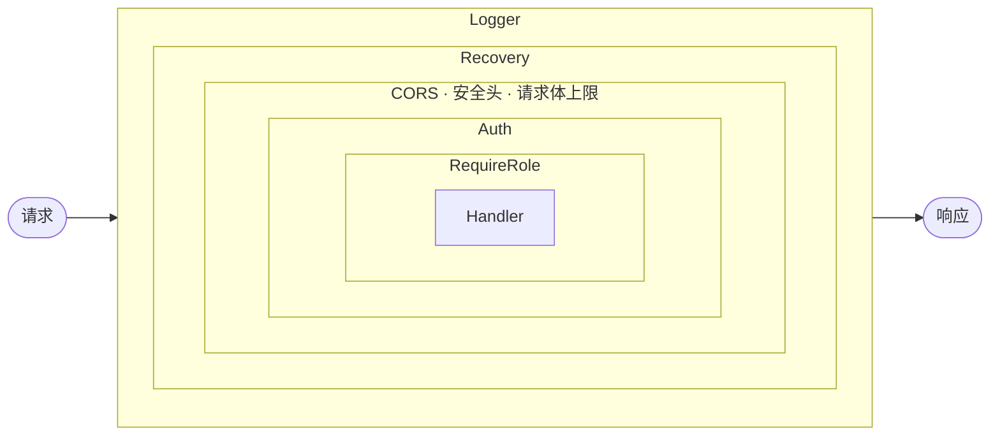

# 第 12 章　Middleware

> 本章目标：理解 Middleware 的执行模型（洋葱模型），读懂项目中的 Logger、Recovery、CORS、安全响应头、请求体限制、限流、认证和角色检查，并学会自己编写 Middleware。

---

## 12.1 What：什么是 Middleware？

Middleware（中间件）是**在请求到达 Handler 之前、或响应返回客户端之前执行的函数**。它处理那些**与具体业务无关、但很多接口都需要**的事情——称为“横切关注点（cross-cutting concerns）”：

- 认证（这个请求是谁发的？）
- 日志（记录每个请求的耗时、状态码）
- CORS（是否允许这个跨域请求？）
- 错误恢复（Handler panic 了怎么办？）
- 限流、压缩、请求 ID……

### Why
如果没有 Middleware，每个受保护的 Handler 都要在开头复制粘贴一遍“解析 Token、校验、取出用户 ID”的代码。一旦校验逻辑要修改，就得改十几个地方。

---

## 12.2 How：Gin 的 Middleware 执行模型

### 12.2.1 本质

在 Gin 中，Middleware 和 Handler **是同一种东西**：都是 `gin.HandlerFunc`（`func(*gin.Context)`）。一个路由的完整处理链就是一个 `[]HandlerFunc` 切片，Gin 按顺序执行。

### 12.2.2 `c.Next()` 与 `c.Abort()`

- `c.Next()`：**立即执行**链中剩余的所有函数，执行完毕后**返回**到当前函数继续。
- `c.Abort()`：标记“停止”，链中**后续**的函数都不会被执行（但当前函数会继续执行到结束，所以 `Abort()` 之后通常要 `return`）。
- `c.AbortWithStatusJSON(code, obj)` = `c.Abort()` + `c.JSON(code, obj)`，一步完成，不容易漏掉。本项目的中间件都用它。
- 如果一个 Middleware 既不调用 `Next()` 也不调用 `Abort()`，Gin 会在它返回后**自动**继续执行下一个。

### 12.2.3 洋葱模型



```go
func Timing() gin.HandlerFunc {
	return func(c *gin.Context) {
		start := time.Now()          // ← “进入洋葱”时执行
		c.Next()                     // ← 执行内层所有 Middleware 和 Handler
		log.Printf("%s %s %d %v",    // ← “离开洋葱”时执行
			c.Request.Method, c.Request.URL.Path, c.Writer.Status(), time.Since(start))
	}
}
```

`c.Next()` 之前的代码按注册顺序执行，之后的代码按**逆序**执行。Gin 的 `Logger` 正是这样工作的：它需要在 Handler 执行**之后**才能知道状态码和耗时。

---

## 12.3 项目中的 Middleware 一览

| Middleware | 来源 | 注册位置 | 作用范围 |
|---|---|---|---|
| `gin.Logger()` | Gin 内置 | `main.go`：`router.Use` | 所有请求 |
| `gin.Recovery()` | Gin 内置 | `main.go`：`router.Use` | 所有请求 |
| `cors.New(...)` | gin-contrib/cors | `main.go`：`router.Use` | 所有请求 |
| `SecurityHeaders()` | 项目 `middleware/security.go` | `main.go`：`router.Use` | 所有请求 |
| `BodyLimit(1 MB)` | 项目 `middleware/security.go` | `main.go`：`router.Use` | 所有请求 |
| `RateLimit(...)` | 项目 `middleware/security.go` | `routes.go`：单条路由 | `POST /auth/login`、`POST /auth/register` |
| `Auth(tm)` | 项目 `middleware/auth.go` | `routes.go`：`protected` 组 | 登录用户和管理员的路由 |
| `RequireRole("ADMIN")` | 项目 `middleware/auth.go` | `routes.go`：`admin` 组 | 管理员路由 |

全局中间件的注册：

```go
// S/main.go（节选）
router := gin.New()
// Trust no proxy's X-Forwarded-For, otherwise clients could spoof their IP to dodge rate limiting. List your proxies here when deploying behind one.
if err := router.SetTrustedProxies(cfg.TrustedProxies); err != nil {
	return err
}
router.Use(
	gin.Logger(),
	gin.Recovery(),
	cors.New(cors.Config{ ... }),
	middleware.SecurityHeaders(),
	middleware.BodyLimit(maxBodyBytes),
)
routes.Register(router, tokenManager, authController, movieController)
```

- **`gin.New()` 而不是 `gin.Default()`**：`gin.Default()` = `gin.New()` + 自动 `Use(Logger(), Recovery())`。这里显式列出所有全局中间件，读代码的人一眼就能看到完整的列表和顺序；如果用 `gin.Default()` 再 `Use(gin.Logger())`，就会不知不觉注册两个 Logger，每个请求的日志打印两次。
- **先 `Use`，再注册路由**：`router.Use` 只影响**之后**注册的路由（第 09 章 9.2.3）。所有全局中间件在 `routes.Register` 之前一次性添加，保证每条路由（包括 `/health`）都经过它们。
- **顺序有意义**：Logger 在最外层，才能记录到所有请求（包括被内层拒绝的）的状态码和耗时；Recovery 紧随其后，捕获内层所有中间件和 Handler 的 panic。

### 12.3.1 Recovery：为什么它很重要

**What**：捕获 Handler 中的 `panic`，返回 500，并打印堆栈，**程序继续运行**。

**如果没有它**：Go 的 `net/http` 服务器本身也会恢复单个请求处理 goroutine 中的 panic（打印日志并断开该连接），但客户端会收到一个空响应或连接重置，而不是一个有意义的 500。Gin 的 Recovery 让行为更可控。

Recovery 是**最后一道防线**，而不是正常的错误处理方式。代码中的错误应该用 `error` 返回值处理（第 13 章）；panic 只应该出现在真正“不可能发生”的情况下。

---

## 12.4 CORS 详解

### 12.4.1 What：同源策略与 CORS

**同源策略（Same-Origin Policy）**：浏览器的核心安全机制。`http://localhost:5173` 上的 JavaScript **默认不能读取** `http://localhost:8080` 的响应。

**Why 有这个限制**：如果没有它，你访问的任何恶意网站都能用 JS 向你的网银发请求（浏览器会自动带上你的 Cookie），并读取你的账户信息。

**CORS（Cross-Origin Resource Sharing）** 是服务器**主动放宽**同源策略的机制：服务器在响应头中声明“我允许哪些源访问”。

> **重要认知**：CORS 是**浏览器**执行的限制。`curl`、Postman、服务器之间的调用**完全不受 CORS 影响**。CORS 不是用来保护 API 的认证机制，它保护的是**用户**（防止恶意网站利用用户的浏览器）。

### 12.4.2 预检请求（Preflight）

对于“非简单请求”（例如带 `Authorization` 头、`Content-Type: application/json`、或使用 `PATCH` 方法），浏览器会先发一个 `OPTIONS` 请求询问：

```http
OPTIONS /movies/tt0111161/review HTTP/1.1
Origin: http://localhost:5173
Access-Control-Request-Method: PATCH
Access-Control-Request-Headers: authorization, content-type
```

服务器（CORS Middleware）回答：

```http
HTTP/1.1 204 No Content
Access-Control-Allow-Origin: http://localhost:5173
Access-Control-Allow-Methods: GET,POST,PATCH,OPTIONS
Access-Control-Allow-Headers: Origin,Content-Type,Authorization
Access-Control-Allow-Credentials: true
Access-Control-Max-Age: 43200
```

浏览器确认允许后，才发送真正的 `PATCH` 请求。

### 12.4.3 本项目的配置逐行解读

允许的源来自配置（`config.Load()` 中解析 `ALLOWED_ORIGINS`）：

```go
// S/config/config.go（节选）
AllowedOrigins: splitList(envOr("ALLOWED_ORIGINS", "http://localhost:5173")),

func splitList(s string) []string {
	var out []string
	for _, part := range strings.Split(s, ",") {
		if part = strings.TrimSpace(part); part != "" {
			out = append(out, part)
		}
	}
	return out
}
```

`splitList` 支持逗号分隔的多个源，去掉空格，并忽略空项（例如末尾多写了一个逗号）。

```go
// S/main.go（节选）
cors.New(cors.Config{
	AllowOrigins:     cfg.AllowedOrigins,
	AllowMethods:     []string{"GET", "POST", "PATCH", "OPTIONS"},
	AllowHeaders:     []string{"Origin", "Content-Type", "Authorization"},
	AllowCredentials: true,
	MaxAge:           12 * time.Hour,
}),
```

| 配置 | 值 | 含义 |
|---|---|---|
| `AllowOrigins` | 来自配置 | 白名单。**必须是精确的源**，不能带路径或末尾斜杠（`http://localhost:5173/` 是错的）。 |
| `AllowMethods` | GET、POST、PATCH、OPTIONS | 允许的 HTTP 方法——只列出 API 实际使用的，不多开放。 |
| `AllowHeaders` | `Origin, Content-Type, Authorization` | 允许前端发送的请求头。**`Authorization` 必须在这里**，否则带 Token 的请求会被预检拒绝。 |
| `AllowCredentials` | `true` | 允许跨域请求携带 Cookie。**这是 RT Cookie 能工作的前提。** 前端也必须设置 `withCredentials: true`。 |
| `MaxAge` | 12 小时 | 浏览器缓存预检结果的时长，减少 OPTIONS 请求次数（浏览器自身也有上限，例如 Chrome 最多缓存 2 小时）。 |

### 12.4.4 常见错误与安全问题

| 错误 | 后果 |
|---|---|
| `AllowOrigins: ["*"]` 同时 `AllowCredentials: true` | gin-contrib/cors（v1.7.9）**不会报错**，会照常返回 `Access-Control-Allow-Origin: *`；但 CORS 规范禁止在携带凭证的请求中使用 `*`，**浏览器会拒绝**这个响应，所有带 Cookie 的请求都会失败 |
| “反射”任意 Origin（把请求的 Origin 原样写回响应头）且允许凭证 | **任何网站**都能以用户身份调用 API 并读取响应——严重漏洞 |
| 忘记把生产环境前端域名加进白名单 | 生产环境全部请求失败 |
| 白名单写成 `http://localhost:5173/`（多了斜杠） | 不匹配，CORS 失败 |

本项目使用**明确的白名单**，这是正确的做法。

---

## 12.5 认证与授权 Middleware

`Auth` 和 `RequireRole` 的完整代码和安全设计已经在第 11 章 11.12–11.13 节讲过，这里只关注**中间件机制**本身。

```go
// S/middleware/auth.go（节选）
func Auth(tm *tokens.Manager) gin.HandlerFunc {              // ① 工厂函数
	return func(c *gin.Context) {
		tokenString, found := strings.CutPrefix(c.GetHeader("Authorization"), "Bearer ")
		if !found || tokenString == "" {
			c.AbortWithStatusJSON(http.StatusUnauthorized, gin.H{"error": "missing bearer token"})   // ②
			return                                           // ③
		}
		claims, err := tm.ValidateAccess(tokenString)
		if err != nil {
			c.AbortWithStatusJSON(http.StatusUnauthorized, gin.H{"error": "invalid or expired token"})
			return
		}
		c.Set(ctxUserID, claims.UserID)                      // ④
		c.Set(ctxRole, claims.Role)
		c.Next()                                             // ⑤
	}
}
```

| 步骤 | 说明 |
|---|---|
| ① | `Auth(tm)` 在注册路由时执行一次，返回的闭包在每个请求中执行。依赖（`tm`）通过参数注入，和 Controller 是同样的思路。 |
| ② + ③ | `AbortWithStatusJSON` 阻止后续 Handler 执行并写出响应；`return` 阻止当前函数继续往下走。**两者缺一不可**：只写 `return` 不 Abort，Gin 会继续执行下一个 Handler（调试挑战 12.7）。 |
| ④ | `c.Set` 把值存入**本次请求专属**的键值存储（`c.Keys`，有读写锁保护）。只在当前请求的处理链中可见。键名是包内未导出的常量。 |
| ⑤ | 这里是 Handler 之前的最后一步，调用 `c.Next()` 与不调用效果相同，但显式写出更清晰。 |

**错误格式统一**：中间件的错误响应和 Controller 一样，都是 `{"error": "..."}`。前端只需要读取 `response.data.error`。

---

## 12.6 安全相关的 Middleware

### 12.6.1 `SecurityHeaders`

```go
// S/middleware/security.go
// SecurityHeaders adds security headers suitable for a JSON API.
func SecurityHeaders() gin.HandlerFunc {
	return func(c *gin.Context) {
		h := c.Writer.Header()
		h.Set("X-Content-Type-Options", "nosniff")
		h.Set("X-Frame-Options", "DENY")
		h.Set("Referrer-Policy", "no-referrer")
		h.Set("Content-Security-Policy", "default-src 'none'; frame-ancestors 'none'")
		c.Next()
	}
}
```

响应头必须在写响应体**之前**设置，所以这些代码放在 `c.Next()` 之前。每个头的作用见第 16 章 16.10 节。

### 12.6.2 `BodyLimit`

```go
// BodyLimit caps the request body size. Reading a larger body (ShouldBindJSON) fails and the handler returns 400.
func BodyLimit(maxBytes int64) gin.HandlerFunc {
	return func(c *gin.Context) {
		c.Request.Body = http.MaxBytesReader(c.Writer, c.Request.Body, maxBytes)
		c.Next()
	}
}
```

`http.MaxBytesReader` 是标准库提供的包装器：读取超过 `maxBytes` 字节时返回错误。它**不会**预先读取请求体，只是在 Handler 读取时计数——所以对不读请求体的 GET 请求没有任何开销。`main.go` 中设置为 1 MB（最大的合法请求是 2000 字符的影评）。没有这个限制，攻击者可以发送几个 GB 的 JSON，让服务器在解析时耗尽内存。

**中间件替换请求的一部分**：`c.Request.Body = ...` 把原始 Body 换成了一个包装后的版本，之后的所有处理函数读到的都是包装后的 Body。这是中间件“增强”请求的常见方式（`context.WithTimeout` 替换 Context 也是同样的思路）。

### 12.6.3 `RateLimit`

```go
// S/middleware/security.go
// RateLimit is a per-client-IP token bucket: rps requests per second on average, with bursts of up to burst.
// State lives in process memory, which suits a single instance; multiple instances need shared storage such as Redis.
func RateLimit(rps rate.Limit, burst int) gin.HandlerFunc {
	type visitor struct {
		limiter  *rate.Limiter
		lastSeen time.Time
	}
	var (
		mu       sync.Mutex
		visitors = map[string]*visitor{}
		lastGC   = time.Now()
	)

	return func(c *gin.Context) {
		now := time.Now()
		ip := c.ClientIP()

		mu.Lock()
		// Drop IPs not seen for 10 minutes so the map cannot grow without bound.
		if now.Sub(lastGC) > time.Minute {
			for k, v := range visitors {
				if now.Sub(v.lastSeen) > 10*time.Minute {
					delete(visitors, k)
				}
			}
			lastGC = now
		}
		v, ok := visitors[ip]
		if !ok {
			v = &visitor{limiter: rate.NewLimiter(rps, burst)}
			visitors[ip] = v
		}
		v.lastSeen = now
		allowed := v.limiter.Allow()
		mu.Unlock()

		if !allowed {
			c.Header("Retry-After", "1")
			c.AbortWithStatusJSON(http.StatusTooManyRequests, gin.H{"error": "too many requests"})
			return
		}
		c.Next()
	}
}
```

这是一个很好的**闭包保存状态**的例子：

- `mu`、`visitors`、`lastGC` 声明在工厂函数中、闭包之外。每调用一次 `RateLimit(...)`，就创建一组独立的状态；返回的闭包在所有请求之间**共享**这组状态。`routes.go` 中 `authLimit := middleware.RateLimit(...)` 只调用一次，再把同一个 `authLimit` 挂到登录和注册两条路由上——所以两个接口共享同一个额度。
- **函数内的类型声明**：`type visitor struct` 写在函数里面，只在这个函数中可见，不会污染包的命名空间。
- **为什么需要 `sync.Mutex`**：每个请求在各自的 goroutine 中执行，多个请求会同时读写 `visitors` 这个 map。Go 的 map **不是并发安全的**，并发写入会直接导致程序崩溃（`fatal error: concurrent map writes`）。锁保护的范围尽量小：只包住对 map 和 limiter 的操作，在调用 `c.Next()` 之前就释放。
- **清理过期条目**：每个新 IP 都会在 map 中留下一个条目。如果从不清理，攻击者换着 IP 发请求，内存就会无限增长。这里每分钟最多清理一次，删除 10 分钟没出现过的 IP。
- **`Retry-After` 头**：告诉客户端多久之后可以重试，是 429 响应的标准配套。
- **`c.ClientIP()` 与可信代理**：`ClientIP` 会参考 `X-Forwarded-For` 等请求头——但这些头是客户端可以随意伪造的。`main.go` 中 `router.SetTrustedProxies(cfg.TrustedProxies)` 默认为空列表，即**不信任任何代理**，`ClientIP` 只使用 TCP 连接的真实地址。部署在反向代理（Nginx、负载均衡器）后面时，必须把代理的地址填进 `TRUSTED_PROXIES`，否则所有请求看起来都来自代理，所有用户共享一个限流额度。

**局限**：状态保存在单个进程的内存中。部署多个实例时，每个实例各自计数，攻击者的实际额度会变成 N 倍；需要改用 Redis 等共享存储（第 17 章）。

---

## 12.7 如何从零写一个 Middleware：请求 ID 示例


需求：给每个请求分配一个唯一 ID，写入响应头，方便排查日志。

```go
func RequestID() gin.HandlerFunc {
	return func(c *gin.Context) {
		id := c.GetHeader("X-Request-ID")      // 如果上游（如负载均衡器）已经分配，就复用
		if id == "" {
			id = uuid.NewString()              // github.com/google/uuid（已在依赖树中）
		}
		c.Set("requestId", id)
		c.Header("X-Request-ID", id)           // 写响应头（必须在写响应体之前）
		c.Next()
	}
}
```

步骤模板：
1. 写工厂函数，返回 `gin.HandlerFunc`。
2. 在闭包中：读取请求 → 做事 → 决定 `Next()` 还是 `AbortWithStatusJSON()`。
3. 需要在响应后做事的代码放在 `c.Next()` 之后。
4. 全局中间件在 `main.go` 中用 `router.Use(...)` 注册（在注册路由之前）；只对部分路由生效的，挂在路由组或单条路由上。

---

## 12.8 前端也有“Middleware”：axios 拦截器与路由守卫

Middleware 的思想在前端同样存在：

| 后端 | 前端对应物 | 位置 |
|---|---|---|
| `Auth` 检查 Token | `RequiredAuth` 检查 `auth` 状态 | `C/src/components/RequiredAuth.tsx` |
| 请求前添加信息 | axios 请求拦截器添加 `Authorization` | `useAxiosPrivate.tsx` |
| 响应后处理错误 | axios 响应拦截器处理 401 | `useAxiosPrivate.tsx` |

> **前端守卫只是用户体验，不是安全措施。** 用户可以修改浏览器中的 JS 绕过 `RequiredAuth`。真正的保护永远在后端的 `Auth` 和 `RequireRole`。

---

## 本章练习

> 答案见 [第 20 章](20-exercise-solutions.md#第-12-章)

**关键概念回顾**
- `c.Next()` 和 `c.Abort()` 分别做什么？为什么 `Abort()` 之后还要 `return`？
- CORS 保护的是谁？为什么 curl 不受 CORS 限制？
- `AllowCredentials: true` 需要前端配合做什么？

**面试题 12.1** “解释 Middleware 的洋葱模型。”

**面试题 12.2** “什么是 CORS 预检请求？什么情况下会触发？”

**面试题 12.3** “为什么 `Access-Control-Allow-Origin: *` 不能和 Cookie 一起使用？”

**练习 12.4** 不看源码，在你的重建项目中实现 `Auth` 和 `RequireRole`，并用路由组组织路由。写测试验证：没有 Token → 401；普通用户访问管理员接口 → 403。

**练习 12.5** 实现 12.7 节的 `RequestID` Middleware，并修改 `respondError` 的日志输出，让每行错误日志都包含请求 ID。

**练习 12.6** 不看源码，实现 `RateLimit`。然后用 `go test -race` 运行一个测试：100 个 goroutine 同时请求同一个限流路由，断言成功的数量不超过 burst。再把 `mu.Lock()` 删掉，重新运行，观察 race detector 的输出。

**调试挑战 12.7** 在副本中把 `Auth` 第一个错误分支的 `c.AbortWithStatusJSON(...)` 改成 `c.JSON(...)`（保留 `return`），然后不带 Token 分别请求 `GET /me/recommendations` 和 `POST /movies`。观察状态码和响应体，并解释。

**调试挑战 12.8** 把 `ALLOWED_ORIGINS` 设为 `http://localhost:5173/`（末尾加斜杠），重启后端，在浏览器中访问首页。浏览器控制台会显示什么错误？

**理解检验 12.9** 如果从 `AllowHeaders` 中删除 `Authorization`，哪些页面会出问题？哪些不会？

**理解检验 12.10** 后端部署在 Nginx 后面，但忘记配置 `TRUSTED_PROXIES`。限流会出现什么现象？如果反过来，把 `TRUSTED_PROXIES` 设成 `0.0.0.0/0`（信任所有地址）又会怎样？
