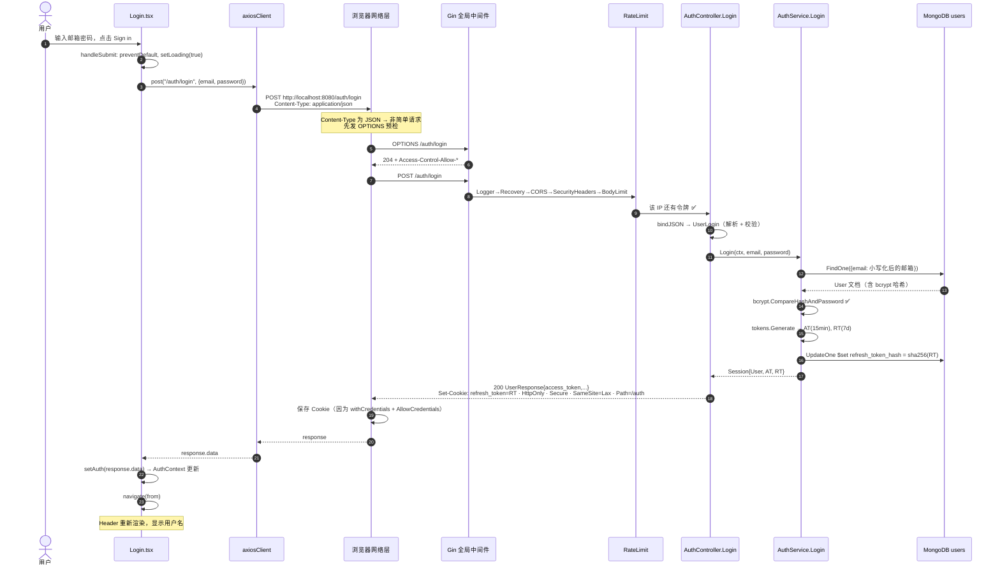
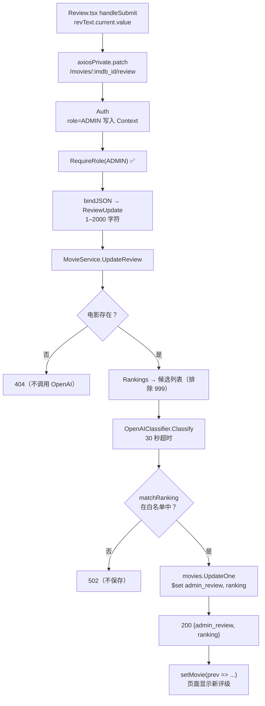

# 第 14 章　端到端请求流程

> 本章目标：把前面各章的知识串起来，完整追踪三个真实场景中，数据如何从用户点击按钮开始，穿过前端、网络、后端、数据库（和 OpenAI），最终回到屏幕上。每一步都标注了对应的源文件和函数。

---

## 14.1 场景一：用户登录

### 14.1.1 全程时序图



### 14.1.2 逐步说明与代码对照

| # | 位置 | 发生了什么 | 如果这里出错 |
|---|---|---|---|
| 1–2 | `Login.tsx` `handleSubmit` | 阻止表单默认提交，进入加载状态 | 忘记 `preventDefault` → 整页刷新 |
| 3 | `Login.tsx` | 使用公共实例 `axiosClient` | — |
| 5–7 | 浏览器 + `main.go` 中的 CORS 配置 | 预检请求 | Origin 不在白名单 → 浏览器控制台报 CORS 错误，真正的请求根本没有发出 |
| 8 | `main.go` 的 `router.Use(...)` | 全局中间件 | 请求体超过 1 MB → 400 |
| 9 | `middleware.RateLimit` | 按 IP 限流 | 一分钟内尝试太多次 → 429 |
| 10 | `controllers.bindJSON` | JSON → `UserLogin`，校验邮箱格式 | 格式错误 → 400 |
| 12–13 | `AuthService.Login` / `UserRepository.FindByEmail` | 按小写邮箱查用户 | 不存在 → 仍然做一次假的 bcrypt 比对，然后 401 “invalid email or password” |
| 14 | `AuthService.Login` | 比对密码（约几十毫秒，故意慢） | 不匹配 → 401（同样的消息） |
| 15 | `tokens.Manager.Generate` | 签发两个 JWT（不同密钥、随机 `jti`） | — |
| 16 | `UserRepository.SetRefreshTokenHash` | 只保存 RT 的哈希 | DB 错误 → 500（日志中有详情） |
| 18 | `AuthController.writeSession` | 设置 Cookie，返回 `UserResponse`（不含密码哈希和 RT） | — |
| 19 | 浏览器 | 存储 Cookie | 缺少 `withCredentials` 或 `AllowCredentials` → Cookie 被丢弃，之后刷新页面就会掉线 |
| 22 | `Login.tsx` | AT 进入 React state（内存） | — |
| 23 | `Login.tsx` | 跳回原本想去的页面 | — |

### 14.1.3 自己验证

```bash
# -v 显示完整的请求和响应头
curl -v -X POST http://localhost:8080/auth/login \
  -H 'Origin: http://localhost:5173' -H 'Content-Type: application/json' \
  -d '{"email":"ada@example.com","password":"secret123"}' -c cookies.txt
```

在浏览器中：DevTools → Network → 选中 `login` 请求 → 查看 Headers（`Set-Cookie`）、Response；Application → Cookies → `http://localhost:8080`（Cookie 属于**后端**的域，不是前端的；它的 Path 列显示 `/auth`）。

---

## 14.2 场景二：查看推荐（包含 Token 过期自动续期）

### 14.2.1 数据在每一层的形态

| 层 | 数据形态 |
|---|---|
| React state | `auth.access_token: "eyJhbGci..."` |
| HTTP 请求 | `GET /me/recommendations` + `Authorization: Bearer eyJhbGci...` |
| `middleware.Auth` | `*tokens.Claims{UserID: "6650...", Role: "USER", ...}` |
| `gin.Context.Keys` | `{"userID": "6650...", "role": "USER"}` |
| Controller | `middleware.UserID(c)` → `"6650..."` |
| `UserRepository.FavouriteGenreNames` | 投影后的文档 → 匿名 struct → `[]string{"Drama"}` |
| `MovieRepository.Recommend` 的查询 | `{"genre.genre_name": {"$in": ["Drama"]}}`，sort `{ranking.ranking_value: 1}`，limit 5 |
| Go | `[]models.Movie` |
| HTTP 响应 | `[{"id":"...","imdb_id":"tt0111161","title":"...",...}]` |
| React state | `movies: MovieModel[]` |
| 屏幕 | 电影卡片网格 |

### 14.2.2 正常路径（AT 有效）

1. `Recommended.tsx`：`axiosPrivate.get("/me/recommendations")`
2. `useAxiosPrivate.tsx` 请求拦截器：附加 `Authorization`
3. 浏览器发送（预检 → 真实请求）
4. Gin 处理链：`Logger → Recovery → CORS → SecurityHeaders → BodyLimit → Auth → MovieController.Recommended`
5. `middleware.Auth`：`CutPrefix("Bearer ")` → `tm.ValidateAccess` → `c.Set`
6. `MovieController.Recommended`：创建带超时的 ctx，读取 `middleware.UserID(c)`
7. `MovieService.Recommended` → `UserRepository.FavouriteGenreNames`：查询 1
8. `MovieService.Recommended` → `MovieRepository.Recommend`：查询 2
9. 200 JSON → `setMovies` → 重新渲染

### 14.2.3 异常路径（AT 过期）

完整时序图见第 11 章 11.14.4 节。概括：

```text
GET /me/recommendations (AT1 已过期)
  → Auth: ValidateAccess 返回 jwt.ErrTokenExpired → 401 {"error":"invalid or expired token"}
  → 响应拦截器: status 401 && !_retry
      → refreshSession() → POST /auth/refresh (Cookie RT1，Path=/auth 匹配)
          → AuthService.Refresh: 校验 RT1 签名 ✅、读取最新用户、签发 AT2/RT2
          → RotateRefreshTokenHash(hash(RT1) → hash(RT2)) ✅
      ← 200 {access_token: AT2}，Set-Cookie RT2
      → setAuth、更新 ref
  → 重试 GET /me/recommendations (AT2)
  ← 200 [...]
```

在 Network 面板中你会看到 **3 个请求**（不计预检）：`recommendations`(401) → `refresh`(200) → `recommendations`(200)。

---

## 14.3 场景三：管理员发布影评



**耗时分布（估计）**：JWT 校验 < 1ms；三次 MongoDB 操作（查电影、查评级、更新）各几毫秒到几十毫秒；**OpenAI 调用通常需要数百毫秒到数秒**——这是整个请求中最慢的部分。前端的 `saving` 状态和 Spinner 就是为此设计的；后端给这个接口的超时（40 秒）也比普通接口（10 秒）长。

**数据库中的前后对比**

```json
// 之前
{ "imdb_id": "tt0068646", "admin_review": "", "ranking": {"ranking_value": 999, "ranking_name": "Not_Ranked"} }
// 之后
{ "imdb_id": "tt0068646", "admin_review": "A masterpiece of family and power.",
  "ranking": {"ranking_value": 1, "ranking_name": "Excellent"} }
```

此后，这部电影在喜爱 Drama 的用户的推荐列表中会排在更靠前的位置——**两个业务流程通过 `ranking_value` 联系在了一起**。也正因如此，`matchRanking` 拒绝无法识别的回答非常重要：一个错误的 `ranking_value` 会直接影响所有用户的推荐结果。

---

## 14.4 场景四：刷新页面时发生了什么

```text
1. 浏览器重新加载 index.html → main.tsx
2. React state 全部重置：auth = null, loading = true
3. AuthProvider useEffect → refreshSession() → POST /auth/refresh（浏览器自动带 Cookie）
   （开发模式下 StrictMode 会让 effect 执行两次，但 refreshInFlight 让它们共享一个请求）
4. 同时 RequiredAuth 因为 loading=true 显示加载指示器
5. /auth/refresh 成功 → setAuth(user)、setLoading(false)
6. RequiredAuth 重新渲染 → auth 存在 → <Outlet/> → 原页面
```

如果是首页（不受保护），`Home` 会立即渲染并请求 `/movies`，与 `/auth/refresh` **并行**进行，互不等待。注意 `GET /movies` 请求**不会**携带 RT Cookie（Path 不匹配）。

---

## 14.5 调试技巧：如何追踪一个请求

| 层 | 工具 | 看什么 |
|---|---|---|
| React | React DevTools（浏览器扩展） | 组件 state、Context 的值 |
| 浏览器网络 | DevTools → Network | 请求头、响应头、状态码、耗时、预检请求、Cookie |
| 浏览器 Cookie | DevTools → Application → Cookies | `refresh_token` 是否存在、过期时间、Path、SameSite |
| 后端日志 | 运行 `go run .` 的终端 | Gin 日志：`[GIN] 200 | 12ms | ::1 | GET "/me/recommendations"`；内部错误：`internal error on GET /me/recommendations: ...` |
| 后端代码 | `log.Printf` 或 Delve 调试器 | 变量值 |
| 自动化测试 | `go test ./routes -run TestAuthorization -v` | 不启动服务器，直接验证一条请求的结果 |
| 数据库 | mongosh / Compass | 文档在操作前后的变化 |

第 15 章会详细讲解这些工具。

---

## 本章练习

> 答案见 [第 20 章](20-exercise-solutions.md#第-14-章)

**关键概念回顾**
- 一次登录请求中，浏览器实际发出了几个 HTTP 请求？为什么？
- 推荐接口一共查询了几次数据库？分别查什么？

**面试题 14.1** “从你在浏览器里点击登录按钮，到页面上显示你的名字，中间发生了什么？”（这是一道经典的开放式面试题，请尽可能详细地回答。）

**练习 14.2** 在后端 `AuthService.Login`、`middleware.Auth`、`MovieService.Recommended` 中添加 `log.Printf`，在前端 `useAxiosPrivate` 拦截器中添加 `console.log`，然后完成一次“登录 → 推荐页”的操作，把前后端日志按时间顺序整理出来。（完成后记得删除这些日志——尤其不要打印 Token。）

**练习 14.3** 仿照 14.1.1 节，为“注册”流程画一张完整的时序图。注意它与登录的两处不同：类型 ID 的查询，以及注册成功后直接登录。

**练习 14.4** 用 MongoDB Compass 观察一次“登录 → 刷新 → 登出”过程中，用户文档中 `refresh_token_hash` 和 `updated_at` 两个字段的变化。

**理解检验 14.5** 场景三中，如果 OpenAI 调用成功但 `UpdateOne` 失败，会产生什么后果？费用已经产生了吗？数据是否一致？
