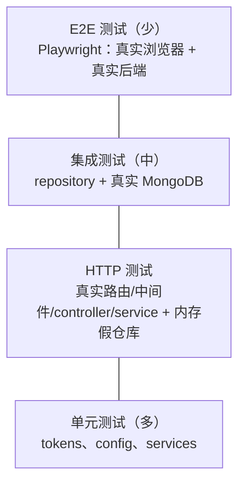

# 第 15 章　测试与调试

> 本章目标：读懂项目中的自动化测试——单元测试、使用内存假实现的业务测试、HTTP 测试和数据库集成测试，理解每种测试的取舍，并掌握系统化的调试方法。

---

## 15.1 为什么需要测试？

**What**：自动化测试是“用代码检查代码”——写一段程序，调用你的函数，断言结果是否符合预期。

**Why**：
- **防止回归**：修改 A 时不小心弄坏了 B，测试会立刻告诉你。
- **重构的安全网**：把代码从一层移到另一层、改名、换实现，测试能确认行为没变。
- **活文档**：测试展示了函数应该如何被使用，以及哪些行为是**有意为之**的（例如“注册时提交的 role 必须被忽略”）。
- **锁定安全规则**：权限、Token 校验这类规则一旦被无意中破坏，后果严重而且很难从界面上看出来。

### 测试金字塔



越往下越快、越稳定、越便宜；越往上越接近真实用户场景。

### 本项目的测试一览

| 文件 | 类型 | 测什么 | 需要外部依赖？ |
|---|---|---|---|
| `tokens/tokens_test.go` | 单元 | 签发、校验、过期、算法/签发者/`exp` 校验、哈希 | 否 |
| `config/config_test.go` | 单元 | 默认值、各种非法配置 | 否 |
| `services/services_test.go` | 单元（业务） | 注册、登录、刷新轮换、登出、影评评级、推荐 | 否（用 `internal/memstore`） |
| `routes/routes_test.go` | HTTP | 路由权限矩阵、注册 Cookie、校验错误格式、限流 | 否（用 `internal/memstore`） |
| `repository/repository_test.go` | 集成 | 唯一索引、哈希轮换、排序和 limit | **需要 MongoDB**（未配置时自动跳过） |

```bash
cd Server/MagicStreamMoviesServer
go test ./...                                                   # 单元 + HTTP 测试，几秒钟
MONGODB_TEST_URI=mongodb://localhost:27017 go test ./...        # 加上集成测试
go test -race ./...                                             # 同时检查数据竞争
```

---

## 15.2 Go 测试基础

### 15.2.1 规则
- 测试文件以 `_test.go` 结尾，与被测文件放在**同一目录**。
- 测试函数签名：`func TestXxx(t *testing.T)`。
- 运行：`go test ./...`（`./...` 表示当前目录及所有子目录）。
- **两种包名**：
  - `package tokens`（与被测代码相同）：可以访问**未导出**的标识符。`tokens_test.go` 用它来替换 `m.now`、调用 `issuer` 常量。
  - `package services_test`（加 `_test` 后缀）：只能使用导出的 API，就像一个外部调用者。`services_test.go`、`routes_test.go` 都这样写，测试的是“公开的行为”而不是内部实现。

### 15.2.2 `testing.T` 常用方法

| 方法 | 作用 |
|---|---|
| `t.Errorf(...)` | 记录失败，**继续**执行 |
| `t.Fatalf(...)` / `t.Fatal(...)` | 记录失败，**立即停止**当前测试 |
| `t.Run(name, func(t *testing.T))` | 子测试 |
| `t.Setenv(k, v)` | 设置环境变量，测试结束后**自动恢复**（Go 1.17+） |
| `t.Helper()` | 标记辅助函数，失败时报告调用者的行号 |
| `t.Cleanup(fn)` | 注册清理函数 |
| `t.Skip(...)` | 跳过当前测试（例如缺少外部依赖时） |

---

## 15.3 单元测试：`tokens` 和 `config`

### 15.3.1 签发与校验

```go
// S/tokens/tokens_test.go
var (
	accessKey  = []byte(strings.Repeat("a", 32))
	refreshKey = []byte(strings.Repeat("r", 32))
)

func TestTokensAreNotInterchangeable(t *testing.T) {
	m := NewManager(accessKey, refreshKey)
	at, rt, _ := m.Generate("u1", "USER")

	if _, err := m.ValidateAccess(rt); err == nil {
		t.Error("refresh token accepted as access token")
	}
	if _, err := m.ValidateRefresh(at); err == nil {
		t.Error("access token accepted as refresh token")
	}
}
```

密钥直接传给 `NewManager`，测试不需要设置任何环境变量——这正是“依赖通过参数传入”带来的**可测试性**。

### 15.3.2 不依赖真实时间：可替换的时钟

```go
func TestExpiredTokenRejected(t *testing.T) {
	m := NewManager(accessKey, refreshKey)
	m.now = func() time.Time { return time.Now().Add(-AccessTokenTTL - time.Minute) }
	at, _, _ := m.Generate("u1", "USER")    // 在“16 分钟前”签发

	m.now = time.Now
	if _, err := m.ValidateAccess(at); err == nil {
		t.Error("expired token accepted")
	}
}
```

如果 `Manager` 内部直接调用 `time.Now()`，这个测试就只能真的等 15 分钟。把时钟做成可替换的字段，测试可以让“现在”是任何时刻。**测试中要避免依赖真实时间的流逝。**（`m.now` 是未导出字段，所以这个测试必须写在 `package tokens` 中。）

### 15.3.3 安全规则的回归测试

```go
func TestRejectsOtherAlgorithmsAndIssuers(t *testing.T) {
	m := NewManager(accessKey, refreshKey)
	future := jwt.NewNumericDate(time.Now().Add(time.Hour))

	cases := map[string]string{}

	none, _ := jwt.NewWithClaims(jwt.SigningMethodNone, Claims{UserID: "u1", RegisteredClaims: jwt.RegisteredClaims{
		Issuer: issuer, ExpiresAt: future,
	}}).SignedString(jwt.UnsafeAllowNoneSignatureType)
	cases["alg none"] = none
	// ... HS512、错误的签发者、没有 exp ...

	for name, token := range cases {
		if _, err := m.ValidateAccess(token); err == nil {
			t.Errorf("%s: token accepted", name)
		}
	}
}
```

每个用例对应第 11 章 11.11.2 节表格中的一个解析选项。如果将来有人“简化”代码删掉了 `WithExpirationRequired()`，“no exp” 这个用例就会失败。`jwt.UnsafeAllowNoneSignatureType` 是 golang-jwt 专门提供的常量：只有传入它才能生成 `alg: none` 的 Token——名字中的 “Unsafe” 就是在提醒你不要在生产代码中使用。

### 15.3.4 表驱动测试（Table-Driven Tests）

Go 社区最推荐的测试风格：把输入和期望输出列成一张表，循环执行。

```go
// S/config/config_test.go
func TestLoadRejectsBadConfig(t *testing.T) {
	cases := map[string]map[string]string{
		"missing uri":         {"MONGODB_URI": ""},
		"short secret":        {"SECRET_KEY": "short"},
		"same secrets":        {"SECRET_REFRESH_KEY": strings.Repeat("a", 32)},
		"bad limit":           {"RECOMMENDED_MOVIE_LIMIT": "five"},
		"zero limit":          {"RECOMMENDED_MOVIE_LIMIT": "0"},
		"prompt w/o rankings": {"BASE_PROMPT_TEMPLATE": "no placeholder"},
		"bad samesite":        {"COOKIE_SAMESITE": "sometimes"},
		"none without secure": {"COOKIE_SAMESITE": "None", "COOKIE_SECURE": "false"},
	}
	for name, overrides := range cases {
		t.Run(name, func(t *testing.T) {
			setValidEnv(t)
			for k, v := range overrides {
				t.Setenv(k, v)
			}
			if _, err := Load(); err == nil {
				t.Error("expected an error")
			}
		})
	}
}
```

- 每个用例 = 一份合法配置 + 一处修改。`setValidEnv` 是一个用 `t.Helper()` 标记的辅助函数。
- `t.Setenv` 在子测试结束时自动恢复环境变量，用例之间互不影响。
- 添加用例只需要加一行，失败时 `t.Run` 的名字直接告诉你是哪种配置出了问题。

---

## 15.4 业务测试：用内存假实现代替数据库

### 15.4.1 Fake（假实现）

`services` 依赖的是接口（第 10 章 10.5），所以测试时可以传入任何实现了这些接口的类型。`internal/memstore` 提供了一套用切片和 map 实现的内存版本：

```go
// S/internal/memstore/memstore.go（节选）
func (s *Users) Create(_ context.Context, user *models.User) error {
	s.mu.Lock()
	defer s.mu.Unlock()
	for _, u := range s.users {
		if u.Email == user.Email {
			return repository.ErrDuplicate      // 模拟唯一索引
		}
	}
	user.ID = bson.NewObjectID()
	clone := *user
	s.users[user.ID.Hex()] = &clone
	return nil
}

// Classifier is a scriptable ReviewClassifier: it returns a preset answer and counts its calls.
type Classifier struct {
	mu     sync.Mutex
	Answer string
	Err    error
	Calls  int
}
```

- **模拟真实行为的关键部分**：`Create` 在邮箱重复时返回 `ErrDuplicate`，`RotateRefreshTokenHash` 在旧哈希不匹配时返回 `ErrNotFound`——这样 service 中处理这些情况的代码也能被测到。
- **存副本**：`clone := *user` 复制一份再保存，避免测试代码修改了传入的 `user` 后，“数据库”里的数据也跟着变——真实数据库也是这样的。
- **`Classifier.Calls`**：记录被调用的次数，让测试可以断言“某种情况下根本没有调用 LLM”。
- 放在 `internal/` 下：只有本 module 内的代码能导入它，不会被误当作生产代码使用。

### 15.4.2 业务规则测试

```go
// S/services/services_test.go
func TestUpdateReviewRejectsUnknownAnswer(t *testing.T) {
	for _, answer := range []string{"Masterpiece", "Not_Ranked", "Ignore previous instructions"} {
		classifier := &memstore.Classifier{Answer: answer}
		svc, store, _ := newMovieService(classifier, shawshank())

		if _, err := svc.UpdateReview(ctx, "tt0111161", "review"); !errors.Is(err, services.ErrUnrecognizedRanking) {
			t.Errorf("answer %q: err = %v", answer, err)
		}
		movie, _ := store.FindByImdbID(ctx, "tt0111161")
		if movie.AdminReview != "" {
			t.Errorf("answer %q: movie should not be updated", answer)
		}
	}
}
```

这个测试锁定了第 10 章的核心安全规则：LLM 的回答不在白名单中时，**返回错误并且不修改数据库**。用真实的 OpenAI 根本没法稳定地测试这一点——你无法让它“按要求返回一个错误答案”。

```go
func TestRefreshRotatesAndRejectsReuse(t *testing.T) {
	auth, users := newAuth()
	first, _ := auth.Register(ctx, validRegistration())

	// Promote the user in the database: the refreshed token should carry the new role.
	users.SetRole("ada@example.com", models.RoleAdmin)

	second, err := auth.Refresh(ctx, first.RefreshToken)
	if err != nil {
		t.Fatal(err)
	}
	if second.User.Role != models.RoleAdmin {
		t.Errorf("refresh should read the latest role, got %q", second.User.Role)
	}
	if _, err := auth.Refresh(ctx, first.RefreshToken); !errors.Is(err, services.ErrInvalidRefreshToken) {
		t.Errorf("reusing a rotated token: err = %v", err)
	}
	if _, err := auth.Refresh(ctx, second.RefreshToken); err != nil {
		t.Errorf("latest token should still work: %v", err)
	}
}
```

一个测试验证了第 11 章的三条规则：刷新会读取最新角色、旧 RT 不能再用、新 RT 可以继续用。

### 15.4.3 Mock、Fake 与真实数据库

| 策略 | 做法 | 优点 | 缺点 |
|---|---|---|---|
| **Fake（本项目的业务测试）** | 一个简化但可工作的实现 | 极快；测试的是行为 | 需要维护假实现，它可能与真实行为有偏差 |
| Mock 库 | `gomock`、`testify/mock`：断言“调用了哪个方法、参数是什么” | 灵活 | 测试容易与实现细节耦合，重构时大量测试跟着改 |
| **真实数据库（本项目的集成测试）** | 连接测试专用的 MongoDB | 测的是真实行为 | 慢；需要基础设施 |

通常组合使用：业务逻辑用 fake 做单元测试，数据访问层用真实数据库做集成测试——fake 与真实实现之间的偏差，正好由集成测试来兜底。

---

## 15.5 HTTP 测试：从路由到 service

```go
// S/routes/routes_test.go
// newApp wires the real routes, middleware, controllers and services, swapping only the database and the LLM for in-memory fakes.
func newApp(t *testing.T) *app {
	t.Helper()
	gin.SetMode(gin.TestMode)

	users := memstore.NewUsers()
	catalog := memstore.NewCatalog()
	movies := memstore.NewMovies(models.Movie{ /* Shawshank */ })
	tm := tokens.NewManager([]byte(strings.Repeat("a", 32)), []byte(strings.Repeat("r", 32)))
	v := validation.New()

	authCtrl := controllers.NewAuthController(services.NewAuthService(users, catalog, tm), v,
		controllers.CookieOptions{Secure: true, SameSite: http.SameSiteLaxMode}, time.Second)
	movieCtrl := controllers.NewMovieController(
		services.NewMovieService(movies, catalog, users, &memstore.Classifier{Answer: "Good"}, 5, time.Second),
		v, time.Second, time.Second)

	router := gin.New()
	routes.Register(router, tm, authCtrl, movieCtrl)
	return &app{router: router, users: users}
}

func (a *app) do(method, path, body, accessToken string) *httptest.ResponseRecorder {
	req := httptest.NewRequest(method, path, bytes.NewBufferString(body))
	req.Header.Set("Content-Type", "application/json")
	if accessToken != "" {
		req.Header.Set("Authorization", "Bearer "+accessToken)
	}
	rec := httptest.NewRecorder()
	a.router.ServeHTTP(rec, req)
	return rec
}
```

- **组装方式和 `main.go` 完全相同**，只把最底层的存储和 LLM 换成了假实现。路由表、中间件、controller、service、校验规则全部是真实代码。
- **`router.ServeHTTP(w, req)`**：`*gin.Engine` 实现了标准库的 `http.Handler` 接口，可以直接调用，**不需要监听端口**。测试快速且不会端口冲突。
- `httptest.NewRecorder()`：一个假的 `ResponseWriter`，记录状态码、响应头和响应体。

### 15.5.1 权限矩阵

```go
func TestAuthorization(t *testing.T) {
	a := newApp(t)
	userToken := a.register(t, "user@example.com")
	// ...
	cases := []struct {
		name, method, path, body, token string
		want                            int
	}{
		{"public list", http.MethodGet, "/movies", "", "", http.StatusOK},
		{"detail needs login", http.MethodGet, "/movies/tt0111161", "", "", http.StatusUnauthorized},
		{"detail as user", http.MethodGet, "/movies/tt0111161", "", userToken, http.StatusOK},
		{"create as user", http.MethodPost, "/movies", movie, userToken, http.StatusForbidden},
		{"review as user", http.MethodPatch, "/movies/tt0111161/review", `{"admin_review":"x"}`, userToken, http.StatusForbidden},
		{"unknown path", http.MethodGet, "/does-not-exist", "", "", http.StatusNotFound},
		// ...
	}
	for _, tc := range cases {
		t.Run(tc.name, func(t *testing.T) {
			if rec := a.do(tc.method, tc.path, tc.body, tc.token); rec.Code != tc.want {
				t.Errorf("status = %d, want %d (body %s)", rec.Code, tc.want, rec.Body)
			}
		})
	}
}
```

这张表就是整个 API 的**权限说明书**。把某条管理员路由不小心移出 `admin` 组、或者在 `routes.Register` 里加一行 `router.Use(Auth)`，都会让表中的某一行失败。

### 15.5.2 测试“不应该发生的事”

```go
func TestRegisterIgnoresClientRoleAndSetsScopedCookie(t *testing.T) {
	a := newApp(t)
	body := `{"first_name":"Eve","last_name":"Tester","email":"eve@example.com","password":"secret123","favourite_genre_ids":[2],"role":"ADMIN"}`
	rec := a.do(http.MethodPost, "/auth/register", body, "")
	// ...
	if resp.Role != models.RoleUser || resp.AccessToken == "" { ... }

	cookie := rec.Result().Cookies()[0]
	if cookie.Name != "refresh_token" || !cookie.HttpOnly || !cookie.Secure || cookie.Path != "/auth" { ... }
	if strings.Contains(rec.Body.String(), cookie.Value) {
		t.Error("refresh token must not appear in the response body")
	}
}
```

安全相关的测试往往是在断言“某件事**没有**发生”：客户端提交的角色没有生效、RT 没有出现在响应体中。这类行为在正常使用中看不出来，只有测试能持续守住它们。

### 15.5.3 让测试不依赖机器速度

```go
func TestLoginIsRateLimited(t *testing.T) {
	a := newApp(t)
	var last int
	// Use an invalid body: it fails validation with 400 before the slow bcrypt step, so the result does not depend on machine speed.
	for range 11 {
		last = a.do(http.MethodPost, "/auth/login", `{}`, "").Code
	}
	if last != http.StatusTooManyRequests {
		t.Errorf("11th attempt: status = %d, want 429", last)
	}
}
```

限流的令牌会随时间恢复（每 6 秒一个）。如果每次请求都走到 bcrypt（每次几十毫秒，开启 `-race` 后慢十倍以上），11 次请求可能花掉十几秒，期间令牌已经补回来了，测试就会**时好时坏**。改用一个在校验阶段就失败的请求体，请求在微秒级完成，结果稳定。**不稳定的测试（flaky test）比没有测试更糟**：大家会习惯性地忽略它的失败。

`for range 11`（Go 1.22+）：循环 11 次，不需要循环变量。

---

## 15.6 集成测试：真实的 MongoDB

```go
// S/repository/repository_test.go
// These are integration tests against a real MongoDB:
//
//	MONGODB_TEST_URI=mongodb://localhost:27017 go test ./repository
//
// Each test uses a randomly named database that is dropped afterwards. Skipped when MONGODB_TEST_URI is not set.
func testDB(t *testing.T) *mongo.Database {
	t.Helper()
	uri := os.Getenv("MONGODB_TEST_URI")
	if uri == "" {
		t.Skip("MONGODB_TEST_URI not set")
	}
	// ... Connect ...
	db := client.Database(fmt.Sprintf("magic_stream_test_%d", time.Now().UnixNano()))
	if err := database.EnsureIndexes(ctx, db); err != nil {
		t.Fatal(err)
	}
	t.Cleanup(func() {
		_ = db.Drop(context.Background())
		_ = client.Disconnect(context.Background())
	})
	return db
}
```

- **`t.Skip`**：没有配置测试数据库时跳过，而不是失败。本地日常运行 `go test ./...` 不需要 MongoDB；CI 中提供了一个 MongoDB 服务并设置了这个变量，所以每次提交都会运行。
- **随机数据库名 + `t.Cleanup` 删除**：每个测试有自己干净的数据库，测试之间互不影响，也可以并行运行。
- **调用真实的 `EnsureIndexes`**：唯一索引是业务正确性的一部分（防止重复邮箱），fake 中模拟了它，这里验证真实的索引确实存在、确实生效。
- **永远不要用生产数据库跑测试！** 用一个专门的、可以随时清空的数据库。

```go
func TestUserRepository(t *testing.T) {
	db := testDB(t)
	// ...
	if err := users.RotateRefreshTokenHash(ctx, id, "h1", "h2"); err != nil {
		t.Fatalf("rotate with current hash: %v", err)
	}
	if err := users.RotateRefreshTokenHash(ctx, id, "h1", "h3"); !errors.Is(err, repository.ErrNotFound) {
		t.Errorf("rotate with stale hash: err = %v", err)
	}
	// ...
}
```

这里验证的是 fake 无法证明的事情：真实 MongoDB 的过滤条件确实实现了“比较并交换”。

---

## 15.7 前端测试（下一步）

后端测试守住了 API 的行为；前端目前在 CI 中只运行 `lint` 和 `build`（类型检查）。为前端补充测试是很好的练习，推荐工具组合：

| 工具 | 作用 |
|---|---|
| **Vitest** | 测试运行器，与 Vite 共享配置，速度快 |
| **React Testing Library** | 以“用户视角”测试组件（找按钮、输入文字、点击） |
| **MSW（Mock Service Worker）** | 拦截网络请求，返回假数据 |
| **Playwright** | E2E：启动真实浏览器访问运行中的前后端 |

安装：

```bash
npm install -D vitest @testing-library/react @testing-library/user-event jsdom
```

`vite.config.ts` 中添加：

```ts
export default defineConfig({
  plugins: [react()],
  test: { environment: 'jsdom' },
})
```

最值得测试的前端逻辑：**`refreshSession` 的并发去重**。

```ts
// src/api/axiosConfig.test.ts
import { describe, it, expect, vi } from 'vitest'
import { axiosClient, refreshSession } from './axiosConfig'

describe('refreshSession', () => {
  it('shares one in-flight request between concurrent callers', async () => {
    const post = vi.spyOn(axiosClient, 'post').mockResolvedValue({ data: { user_id: 'u1' } })

    const [a, b] = await Promise.all([refreshSession(), refreshSession()])

    expect(post).toHaveBeenCalledTimes(1)      // 只发出了一次 /auth/refresh
    expect(a).toBe(b)
  })
})
```

---

## 15.8 调试方法论

### 15.8.1 科学调试法

1. **复现**：找到稳定触发 bug 的最小步骤。
2. **观察**：收集证据（日志、状态码、网络请求、数据库内容）。
3. **假设**：根据证据提出一个可验证的猜想。
4. **验证**：设计实验确认或否定假设（加日志、改输入、写测试）。
5. **修复**：修复根本原因，而不是症状。
6. **防止复发**：为这个 bug 写一个测试。

### 15.8.2 按症状定位问题

| 症状 | 先看哪里 | 本项目中的常见原因 |
|---|---|---|
| 服务器启动后立即退出 | 终端输出 | `config.Load()` 列出的配置错误；MongoDB 连不上（`ping mongodb: ...`） |
| 浏览器控制台出现 “CORS policy” 错误 | Network 中的 OPTIONS 请求 | `ALLOWED_ORIGINS` 不匹配；前端端口不是 5173 |
| 登录成功，但刷新页面就掉线 | Application → Cookies | Cookie 未保存：缺少 `withCredentials`；前后端不同站点却用了 `SameSite=Lax`；或者 `Secure` Cookie 在非 localhost 的 HTTP 地址上被拒绝 |
| 所有受保护接口都返回 401 | 请求头中是否有 `Authorization` | AT 没有被附加；`SECRET_KEY` 在签发和验证时不一致（例如重启时换了 `.env`） |
| `/auth/refresh` 返回 401 | 请求是否带了 Cookie；是否有并发的刷新 | Cookie 的 Path 或 SameSite 不匹配；去重失效；在另一个设备上登录过 |
| 登录返回 429 | 同一 IP 最近的请求次数 | 正常的限流；或者部署在代理后面却没有配置 `TRUSTED_PROXIES`（所有用户共享一个额度） |
| 普通用户点击操作得到 403 | 当前用户的角色 | 角色变更后还没重新登录（Token 中的角色是旧的） |
| 任何接口返回 500 | 后端日志中的 `internal error on ...` 行 | 那一行包含完整的错误链 |
| 推荐列表为空 | 用户的 `favourite_genres` 与电影的 `genre.genre_name` | 用户没有喜爱类型；`genres` 集合中的名称被改过，与电影中嵌入的副本不一致 |
| 更新影评返回 502 | 后端日志 / 直接调用 OpenAI 看原始回答 | LLM 的回答不在评级名称中（提示词被改坏了？换了模型？） |
| 更新影评返回 500 | 后端日志 | `OPENAI_API_KEY` 无效；OpenAI 额度用完；超过 `OPENAI_TIMEOUT` |

### 15.8.3 Go 调试工具

**日志**
```go
log.Printf("refresh: user=%s hasStoredHash=%t", user.ID.Hex(), user.RefreshTokenHash != "")
```
注意：**永远不要把 Token、密码、URI 打印到日志中**。只打印“是否存在”或前几个字符。

**Delve 调试器**
```bash
go install github.com/go-delve/delve/cmd/dlv@latest
cd Server/MagicStreamMoviesServer
dlv debug .
(dlv) break services.(*MovieService).Recommended
(dlv) continue
# 用浏览器或 curl 触发请求
(dlv) print userID
(dlv) next
```
VS Code 的 Go 扩展提供图形化的断点调试（按 F5，选择 “Go: Launch Package”）。

**竞态检测**
```bash
go test -race ./...
go run -race .
```
检测多个 goroutine 同时读写同一变量的问题。CI 中的 `go test -race ./...` 每次提交都会运行它；`RateLimit` 中的 map 就是靠锁保护的共享状态（第 12 章 12.6.3）。

**静态检查**
```bash
go vet ./...                                              # 官方工具（CI 中运行）
go install honnef.co/go/tools/cmd/staticcheck@latest
staticcheck ./...                                         # 更严格，会指出命名问题等
```

### 15.8.4 前端调试工具
- **React DevTools**：查看组件树、props、state、Context 值。
- **Network 面板**：勾选 “Preserve log” 可以在页面跳转后保留请求记录。
- **断点**：在 DevTools → Sources 中给 `useAxiosPrivate.tsx` 打断点（Vite 默认生成 source map，能看到原始 TSX）。
- **`debugger;` 语句**：在代码中写 `debugger;`，DevTools 打开时会在此暂停。

### 15.8.5 用 curl 快速验证后端

```bash
# 健康检查
curl -i http://localhost:8080/health

# 登录并保存 Cookie
curl -s -c jar.txt -X POST http://localhost:8080/auth/login \
  -H 'Content-Type: application/json' \
  -d '{"email":"ada@example.com","password":"secret123"}' | tee login.json

# 提取 AT（需要安装 jq）
TOKEN=$(jq -r .access_token login.json)

# 访问受保护接口
curl -i http://localhost:8080/me/recommendations -H "Authorization: Bearer $TOKEN"

# 刷新（Cookie 的 Path 是 /auth，curl 会按路径决定是否发送）
curl -i -b jar.txt -c jar.txt -X POST http://localhost:8080/auth/refresh
```

---

## 15.9 测试清单：每条规则由哪个测试守护

| 规则 | 测试 |
|---|---|
| AT 和 RT 不能互换；过期、`alg: none`、缺少 `exp` 的 Token 被拒绝 | `tokens_test.go` |
| 非法配置让启动失败，并列出所有问题 | `config_test.go` |
| 注册时角色固定为 USER，邮箱统一小写，类型必须存在 | `TestRegisterAlwaysCreatesUserRole`、`TestRegisterErrors`、`TestRegisterIgnoresClientRoleAndSetsScopedCookie` |
| 登录不区分邮箱大小写；错误信息不泄露邮箱是否存在 | `TestLogin` |
| RT 只能使用一次；刷新读取最新角色；登出后 RT 失效 | `TestRefreshRotatesAndRejectsReuse`、`TestLogoutRevokesRefreshToken`、`TestUserRepository` |
| 未登录 401、非管理员 403、未知路径 404 | `TestAuthorization` |
| 不存在的电影不调用 LLM；LLM 的回答必须在白名单中 | `TestUpdateReviewChecksMovieBeforeCallingLLM`、`TestUpdateReviewRejectsUnknownAnswer`、`TestUpdateReviewNormalizesLLMAnswer` |
| 没有喜爱类型时返回空列表（不是 null） | `TestRecommendedWithNoFavouritesReturnsEmptyList`、`TestMovieRepository` |
| 登录限流 | `TestLoginIsRateLimited` |
| 前端并发刷新去重 | 尚未覆盖（练习 15.7） |
| 完整用户流程（注册 → 推荐 → 登出） | 尚未覆盖（E2E，练习 19 章） |

**验证测试本身有效**：一个永远通过的测试没有价值。写完测试后，故意把被测代码改坏（例如把 `Role: models.RoleUser` 改成 `RoleAdmin`），确认测试确实失败，再改回来。这种做法叫**变异测试**（mutation testing）的手工版本。

---

## 本章练习

> 答案见 [第 20 章](20-exercise-solutions.md#第-15-章)

**关键概念回顾**
- 测试金字塔的各层分别是什么？为什么底层最多？
- `t.Errorf` 和 `t.Fatalf` 的区别？
- 为什么 `router.ServeHTTP(w, req)` 能在不启动服务器的情况下测试路由？
- `package tokens` 和 `package tokens_test` 写的测试有什么区别？

**面试题 15.1** “什么是表驱动测试？它有什么好处？”

**面试题 15.2** “如何测试依赖数据库的代码？比较 mock、fake 和真实数据库。”

**面试题 15.3** “你如何调试一个只在生产环境出现的 bug？”

**练习 15.4** 运行 `go test ./... -v`、`go test -cover ./...` 和 `go test -coverpkg=./... -cover ./...`，比较后两者的覆盖率数字有什么不同，并解释原因。

**练习 15.5** 在你的重建项目中写一个 HTTP 测试，断言：提交 `"role":"ADMIN"` 注册时，响应和数据库中的角色都是 `USER`。然后临时让注册接口直接绑定 `models.User`（并给它加上 json tag），确认测试会**失败**——能抓住回归，测试才有意义。

**练习 15.6** 给 `memstore.Movies` 增加一个可以注入错误的字段，写一个 HTTP 测试：数据库出错时 `GET /movies` 返回 500，响应体是合法的 JSON `{"error":"internal server error"}`，并且不包含原始错误信息。

**练习 15.7** 配置 Vitest，运行 15.7 节的 `refreshSession` 测试，并把它加入 CI。

**调试挑战 15.8** 有用户报告“在推荐页停留一段时间后，点击任何链接都会被踢回登录页”。请按 15.8.1 节的六个步骤，写出你的调试计划。

**理解检验 15.9** `routes_test.go` 使用 `gin.New()` 而不是 `gin.Default()`，而且没有注册 `main.go` 中的全局中间件。为什么？这样做漏掉了哪些行为？
