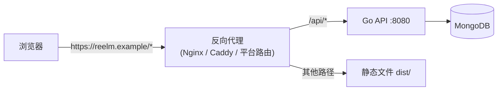

# 第 17 章　构建与部署

> 本章目标：理解“从源代码到线上服务”的全过程——构建产物、生产配置、优雅关闭、容器化、部署拓扑与 CI。本章讲解的 Dockerfile、docker-compose 和 CI 配置都在仓库中，可以直接运行。

---

## 17.1 构建产物

### 17.1.1 后端：一个二进制文件

```bash
cd Server/MagicStreamMoviesServer
go build -o bin/magicstream .
./bin/magicstream
```

- `go build` 把所有代码和依赖**静态链接**成一个可执行文件。目标机器上不需要安装 Go。
- **交叉编译**：在 Mac 上为 Linux 服务器构建：
  ```bash
  GOOS=linux GOARCH=amd64 CGO_ENABLED=0 go build -ldflags="-s -w" -o bin/magicstream .
  ```
  - `CGO_ENABLED=0`：禁用 C 语言互操作，生成完全静态的二进制，可以放进最小的容器镜像。
  - `-ldflags="-s -w"`：去掉调试符号，减小文件体积。
- 种子命令是另一个独立的二进制：`go build -o bin/seed ./cmd/seed`。它通过 `//go:embed` 把 JSON 数据编译进了二进制文件，部署时不需要额外复制数据文件。

### 17.1.2 前端：一堆静态文件

```bash
cd Client/magic-stream-client
npm ci              # 严格按照 package-lock.json 安装（CI 环境推荐用 ci 而不是 install）
npm run build       # tsc -b && vite build
ls dist/            # index.html + assets/*.js + assets/*.css + favicon.svg
```

`dist/` 中的文件可以放在**任何**静态文件服务器上：Nginx、S3 + CloudFront、Vercel、Netlify、Cloudflare Pages。

> ⚠️ **`VITE_` 变量是在构建时被写死的。** `import.meta.env.VITE_API_BASE_URL` 在 `vite build` 时会被**直接替换**为字符串字面量。所以：
> - 构建生产版本前，必须设置正确的生产 API 地址：`VITE_API_BASE_URL=https://api.reelm.example npm run build`。
> - 修改 API 地址后需要**重新构建**，改服务器上的环境变量没有用。

---

## 17.2 生产环境的配置

所有配置都通过环境变量提供，由 `config.Load()` 统一校验（第 04 章 4.5 节）。

| 配置 | 开发环境 | 生产环境 | 原因 |
|---|---|---|---|
| `GIN_MODE` | 默认 `debug` | `release` | debug 模式会打印所有路由和警告，略慢 |
| 配置来源 | `.env` 文件 | 平台注入的环境变量 / Secret 管理 | `.env` 不应部署到服务器 |
| `PORT` | 默认 8080 | 平台指定（Render、Cloud Run、Heroku 都通过 `PORT` 告诉你监听哪个端口） | — |
| `ALLOWED_ORIGINS` | `http://localhost:5173` | `https://reelm.example` | 生产前端地址 |
| `MONGODB_URI` | 本地或 Atlas 开发集群 | 生产集群，独立的数据库用户（最小权限） | 隔离 |
| `COOKIE_SECURE` | `true`（localhost 被视为安全上下文） | `true` | `Secure` Cookie 只在 HTTPS 下发送 |
| `COOKIE_SAMESITE` | `Lax` | 取决于部署拓扑（17.5） | — |
| `TRUSTED_PROXIES` | 空 | 负载均衡器 / 反向代理的地址 | 限流需要真实的客户端 IP（第 12 章 12.6.3） |
| HTTPS | 无 | **必须**，通常在代理或平台层终结 | — |

**同一份代码可以直接部署**：`main` 只在 `.env` 存在时加载它（文件不存在不算错误），之后统一从进程环境变量读取。缺少任何必需配置，服务器会打印完整的问题列表并退出——部署平台会把这次部署标记为失败，而不是让一个配置错误的服务器上线。

---

## 17.3 优雅关闭（Graceful Shutdown）

### 17.3.1 为什么需要

如果用 `router.Run(":8080")` 启动服务器，它会**一直阻塞**。当你按 Ctrl+C 或者平台发送 `SIGTERM` 信号时，Go 进程默认**立即退出**：
- `main` 中注册的 `defer`（例如断开数据库）**根本不会执行**。
- 正在处理中的请求会被**强行中断**（例如一个正在等待 OpenAI 响应的影评更新）。

**优雅关闭**是指：收到停止信号后，(1) 停止接受新连接；(2) 等待正在处理的请求完成（设一个上限）；(3) 释放资源（数据库连接）；(4) 退出。

### 17.3.2 实现

```go
// S/main.go（run 的最后部分）
// On Ctrl+C or SIGTERM (docker stop), shut down gracefully: stop accepting connections and let in-flight requests finish.
ctx, stop := signal.NotifyContext(context.Background(), os.Interrupt, syscall.SIGTERM)
defer stop()

serverErr := make(chan error, 1)
go func() {
	log.Printf("listening on %s", server.Addr)
	serverErr <- server.ListenAndServe()
}()

select {
case err := <-serverErr:
	if !errors.Is(err, http.ErrServerClosed) {
		return err
	}
case <-ctx.Done():
	log.Println("shutting down...")
}

shutdownCtx, cancelShutdown := context.WithTimeout(context.Background(), 30*time.Second)
defer cancelShutdown()
return server.Shutdown(shutdownCtx)
```

逐行讲解：

- **`signal.NotifyContext`**：返回一个 Context，收到 SIGINT（Ctrl+C）或 SIGTERM（`docker stop`、Kubernetes 停止 Pod）时被取消。
- **`go func() { ... }()`**：在后台 goroutine 中运行服务器，主 goroutine 继续往下执行。
- **channel**：`serverErr` 是一个带 1 个缓冲的 channel，Go 中 goroutine 之间通信的管道。后台 goroutine 把 `ListenAndServe` 的返回值发送进去。有缓冲，所以即使没人接收，发送也不会阻塞，goroutine 可以正常结束。
- **`select`**：同时等待多个 channel，哪个先就绪就执行哪个分支：
  - 服务器自己出错退出（例如端口被占用）→ 返回这个错误。
  - 收到停止信号 → 进入关闭流程。
- **`server.Shutdown(ctx)`**：关闭监听，**等待所有进行中的请求处理完毕**，最多等 30 秒。之后 `ListenAndServe` 返回 `http.ErrServerClosed`——这是正常关闭的标志，不是失败。
- **`return` 而不是 `log.Fatal`**：`run()` 返回后，之前注册的 `defer client.Disconnect(...)` 才会执行，数据库连接被正常关闭。`log.Fatal` 会直接调用 `os.Exit`，跳过所有 `defer`。这就是 `main` 只做 `if err := run(); err != nil { log.Fatal(err) }` 的原因。

```go
// S/main.go
func main() {
	if err := run(); err != nil {
		log.Fatal(err)
	}
}
```

### 17.3.3 HTTP Server 的超时

`server` 不是 `gin.Engine.Run` 内部创建的默认 `http.Server`，而是显式构造的，带有读写超时（详见第 16 章 16.10.2）。`WriteTimeout` 设置为“普通请求超时 + OpenAI 超时 + 5 秒”，保证最慢的合法请求（写影评）也不会被切断。

---

## 17.4 容器化

### 17.4.1 后端 Dockerfile（多阶段构建）

```dockerfile
# Server/MagicStreamMoviesServer/Dockerfile
# ---- build stage ----
FROM golang:1.27-alpine AS build
WORKDIR /src

# Copy only the dependency manifests first so this layer stays cached until they change.
COPY go.mod go.sum ./
RUN go mod download

COPY . .
RUN CGO_ENABLED=0 go build -trimpath -ldflags="-s -w" -o /out/server . \
 && CGO_ENABLED=0 go build -trimpath -ldflags="-s -w" -o /out/seed ./cmd/seed

# ---- runtime stage: just the binaries and CA certificates, running as a non-root user ----
FROM gcr.io/distroless/static-debian12:nonroot
COPY --from=build /out/server /out/seed /app/
EXPOSE 8080
USER nonroot:nonroot
ENTRYPOINT ["/app/server"]
```

- **为什么用多阶段？** 构建阶段的镜像包含完整的 Go 工具链（几百 MB）；运行阶段只复制最终的二进制文件，镜像只有十几 MB，而且没有 shell、包管理器等可能被攻击者利用的工具。
- **distroless**：Google 维护的极简基础镜像，只包含 CA 证书、时区数据等运行静态二进制所需的最少文件。连接 MongoDB Atlas 和 OpenAI 都需要 HTTPS，所以 CA 证书是必需的——这也是不用完全空白的 `scratch` 镜像的原因。
- **`nonroot` 用户**：容器内的进程不以 root 身份运行。即使应用被攻破，攻击者也没有 root 权限。
- **`-trimpath`**：从二进制中去掉构建机器上的文件路径，构建结果更可复现，也不会泄露本地目录结构。
- **两个二进制**：`/app/server` 是默认入口；`/app/seed` 可以用 `--entrypoint` 覆盖入口来运行。

**`.dockerignore`**（防止 `.env` 被打包进镜像）：

```text
.env
.env.*
!.env.example
bin/
*.out
```

构建与运行：

```bash
docker build -t magicstream-api ./Server/MagicStreamMoviesServer
docker run --rm -p 8080:8080 --env-file ./Server/MagicStreamMoviesServer/.env magicstream-api
```

（`--env-file` 在运行时注入环境变量，`.env` 文件本身不在镜像里。容器中没有 `.env` 文件，`godotenv.Load` 返回“文件不存在”，被正常忽略。）

### 17.4.2 用 Docker Compose 在本地跑起后端

```yaml
# docker-compose.yml（仓库根目录）
# Start MongoDB and the backend locally:
#   docker compose up -d --build
#   docker compose run --rm --entrypoint /app/seed server   # load seed data
# The backend reads Server/MagicStreamMoviesServer/.env, with MONGODB_URI pointed at the mongo service below.
services:
  mongo:
    image: mongo:8
    volumes:
      - mongo-data:/data/db
    healthcheck:
      test: ["CMD", "mongosh", "--quiet", "--eval", "db.adminCommand('ping')"]
      interval: 5s
      retries: 10

  server:
    build: ./Server/MagicStreamMoviesServer
    env_file: ./Server/MagicStreamMoviesServer/.env
    environment:
      MONGODB_URI: mongodb://mongo:27017
    ports:
      - "8080:8080"
    depends_on:
      mongo:
        condition: service_healthy

volumes:
  mongo-data:
```

- **服务名即主机名**：在 compose 网络中，`server` 容器通过 `mongo:27017` 访问数据库。`environment` 中的值会覆盖 `env_file` 中的同名变量。
- **`depends_on` + `condition: service_healthy`**：只写 `depends_on: [mongo]` 只保证 mongo 容器**先启动**，不保证 MongoDB **已经能接受连接**。加上健康检查后，server 会等到 `ping` 成功才启动。（后端启动时本身也会 Ping 数据库，连不上就退出，所以两者配合得很好。）
- **数据卷**：`mongo-data` 让数据在容器重建后依然保留。
- **种子数据**：`docker compose run --rm --entrypoint /app/seed server` 用同一个镜像、同样的环境变量运行种子命令。

前端开发时仍然用 `npm run dev`，连接 `http://localhost:8080`。

### 17.4.3 前端（Nginx 托管静态文件）

仓库中没有前端的 Dockerfile——前端只是一堆静态文件，通常直接交给静态托管平台（17.1.2）。如果你想用容器部署，可以这样写：

```dockerfile
# Client/magic-stream-client/Dockerfile（示例）
FROM node:24 AS build
WORKDIR /app
COPY package.json package-lock.json ./
RUN npm ci
COPY . .
ARG VITE_API_BASE_URL
ENV VITE_API_BASE_URL=$VITE_API_BASE_URL
RUN npm run build

FROM nginx:1.27-alpine
COPY nginx.conf /etc/nginx/conf.d/default.conf
COPY --from=build /app/dist /usr/share/nginx/html
```

```nginx
# Client/magic-stream-client/nginx.conf（示例）
server {
    listen 80;
    root /usr/share/nginx/html;

    # SPA 回退：所有未知路径都返回 index.html
    location / {
        try_files $uri $uri/ /index.html;
    }

    # 带哈希的静态资源可以长期缓存
    location /assets/ {
        add_header Cache-Control "public, max-age=31536000, immutable";
    }
}
```

**为什么需要 `try_files ... /index.html`？** 用户直接访问 `https://reelm.example/recommended` 时，服务器上并没有 `recommended` 这个文件。没有回退规则，Nginx 会返回 404。有了回退规则，Nginx 返回 `index.html`，React Router 在浏览器中解析 `/recommended` 并渲染对应页面。**这是部署 SPA 时最常见的坑。**

---

## 17.5 部署拓扑：CORS 与 Cookie

### 方案 A：同站不同子域（推荐，对应默认配置）

```text
https://reelm.example      （前端）
https://api.reelm.example  （后端）
```

- 跨源（需要 CORS），但**同站**。RT Cookie 是第一方 Cookie，默认的 `SameSite=Lax` 就能工作，不会被浏览器的第三方 Cookie 策略拦截。
- 配置：`ALLOWED_ORIGINS=https://reelm.example`，`COOKIE_SAMESITE=Lax`（默认）。

### 方案 B：前后端不同站点

```text
https://reelm.vercel.app  ──→  https://magicstream-api.onrender.com
```

- 需要 CORS。
- RT Cookie 必须 `SameSite=None; Secure`：设置 `COOKIE_SAMESITE=None`（`config.Load` 会确认 `COOKIE_SECURE` 为 true）。
- ⚠️ **风险**：这是一个**第三方 Cookie**。Safari 默认阻止，其他浏览器也在收紧。部分用户会出现“登录后刷新页面就掉线”的问题。而且 `SameSite=None` 失去了对 CSRF 的天然防护（第 11 章 11.7.3）。能用方案 A 就不要用方案 B。

### 方案 C：反向代理，同源部署



- 前端请求 `/api/movies`，代理去掉 `/api` 前缀后转发给后端的 `/movies`。
- **完全同源**：不需要 CORS，Cookie 可以用 `SameSite=Strict`。
- 需要修改：前端 `VITE_API_BASE_URL=/api`；代理转发时去掉前缀；Cookie 的 `Path` 要与浏览器看到的路径一致（浏览器看到的是 `/api/auth/...`，所以 `refreshCookiePath` 要相应改成 `/api/auth`，或者让后端路由本身带上 `/api` 前缀）；`TRUSTED_PROXIES` 设为代理地址。

本地开发也可以用 Vite 自带的代理模拟方案 C：

```ts
// vite.config.ts（示例）
export default defineConfig({
  plugins: [react()],
  server: {
    proxy: {
      '/api': { target: 'http://localhost:8080', rewrite: (p) => p.replace(/^\/api/, '') },
    },
  },
})
```

---

## 17.6 部署时的其他注意事项

| 事项 | 说明 |
|---|---|
| **可信代理** | 部署在负载均衡器后面时，把它的地址填入 `TRUSTED_PROXIES`。不填：所有请求的 `ClientIP` 都是代理的地址，所有用户共享一个限流额度。填 `0.0.0.0/0`：客户端可以伪造 `X-Forwarded-For` 绕过限流。 |
| **健康检查** | `GET /health` 返回 `{"status":"ok"}`，不需要认证，供负载均衡器和平台判断服务是否存活。它只说明进程在运行；如果需要“数据库也可用”的就绪检查，可以再加一个会 Ping MongoDB 的接口。 |
| **MongoDB Atlas 网络** | 需要把服务器的出口 IP 加入 Atlas 的 IP 白名单。 |
| **索引** | 服务器每次启动都会调用 `EnsureIndexes`，不需要手动创建。如果线上数据中已经存在重复的邮箱或 `imdb_id`，创建唯一索引会失败，服务器拒绝启动——需要先清理重复数据。 |
| **种子数据** | 首次部署后运行一次种子命令，导入 `genres` 和 `rankings`；然后用 `-admin` 提升第一个管理员。 |
| **日志** | 生产环境推荐结构化日志（标准库 `log/slog`，JSON 格式），便于日志平台检索。 |
| **多实例** | 限流状态保存在单个进程的内存中。水平扩展到多个实例时，需要把限流移到共享存储（Redis）或网关层。 |
| **OpenAI 用量** | 在 OpenAI 控制台设置用量上限和告警。 |

---

## 17.7 CI：每次推送自动检查

```yaml
# .github/workflows/ci.yml
name: CI

on:
  push:
    branches: [main]
  pull_request:

jobs:
  server:
    runs-on: ubuntu-latest
    defaults:
      run:
        working-directory: Server/MagicStreamMoviesServer
    services:
      mongo:
        image: mongo:8
        ports: ["27017:27017"]
    steps:
      - uses: actions/checkout@v4
      - uses: actions/setup-go@v5
        with:
          go-version-file: Server/MagicStreamMoviesServer/go.mod
          cache-dependency-path: Server/MagicStreamMoviesServer/go.sum
      - name: gofmt
        run: test -z "$(gofmt -l .)" || (gofmt -l . && exit 1)
      - run: go vet ./...
      - name: test (including MongoDB integration tests)
        run: go test -race ./...
        env:
          MONGODB_TEST_URI: mongodb://localhost:27017
      - run: go build ./...

  client:
    runs-on: ubuntu-latest
    defaults:
      run:
        working-directory: Client/magic-stream-client
    steps:
      - uses: actions/checkout@v4
      - uses: actions/setup-node@v4
        with:
          node-version: 24
          cache: npm
          cache-dependency-path: Client/magic-stream-client/package-lock.json
      - run: npm ci
      - run: npm run lint
      - run: npm run build
```

- **两个 job 并行运行**：后端和前端互不依赖。
- **`services: mongo`**：GitHub Actions 在 job 旁边启动一个 MongoDB 容器，映射到 `localhost:27017`。设置 `MONGODB_TEST_URI` 后，原本会跳过的 repository 集成测试也会运行。
- **`go-version-file`**：从 `go.mod` 中读取 Go 版本，不需要在两个地方维护版本号。
- **`gofmt` 检查**：`gofmt -l` 列出格式不规范的文件；输出非空就让 job 失败。代码格式由工具决定，Code Review 不需要讨论缩进。
- **`-race`**：每次提交都检查数据竞争。
- **缓存**：`setup-go` 和 `setup-node` 根据锁文件缓存依赖，加快后续运行。

---

## 17.8 上线检查清单

- [ ] 所有密钥只通过平台的 Secret 配置注入；如果曾经泄露过，已经轮换（第 16 章）
- [ ] `GIN_MODE=release`
- [ ] `ALLOWED_ORIGINS` 是生产前端地址
- [ ] 根据部署拓扑设置 `COOKIE_SAMESITE`
- [ ] `TRUSTED_PROXIES` 已配置
- [ ] 前端用生产 `VITE_API_BASE_URL` 重新构建
- [ ] HTTPS 已启用（在代理或平台层），并配置 HSTS
- [ ] 静态托管配置了 SPA 回退
- [ ] 种子数据已导入，第一个管理员已提升
- [ ] 健康检查接口已接入平台
- [ ] OpenAI 用量上限已设置
- [ ] CI 通过

---

## 本章练习

> 答案见 [第 20 章](20-exercise-solutions.md#第-17-章)

**关键概念回顾**
- 为什么修改服务器上的环境变量无法改变已构建前端的 API 地址？
- 什么是 SPA 回退？不配置会怎样？
- 为什么 `main` 要把启动逻辑放在 `run()` 中、并返回 `error` 而不是直接 `log.Fatal`？

**面试题 17.1** “Docker 多阶段构建有什么好处？”

**面试题 17.2** “什么是优雅关闭？在 Kubernetes 中为什么重要？”

**面试题 17.3** “前后端分别部署在不同域名时，Cookie 认证会遇到什么问题？有哪些解决方案？”

**练习 17.4** 临时在 `MovieController.ListMovies` 开头加入 `time.Sleep(5 * time.Second)`，启动服务器，发起 `curl http://localhost:8080/movies`，在请求处理期间按 Ctrl+C。观察 curl 是否仍然拿到了完整的响应，以及服务器日志的顺序。（验证后删除 `Sleep`。）

**练习 17.5** 编写 17.4.3 节的前端 Dockerfile 和 nginx.conf，在 `docker-compose.yml` 中加入 `web` 服务，用 `docker compose up` 运行完整系统。注意 `ALLOWED_ORIGINS` 需要改成前端容器映射出来的地址。

**练习 17.6** 配置 17.5 节的 Vite 代理，让前端通过 `/api` 访问后端。需要同时修改哪些地方，Cookie 才能正常工作？

**调试挑战 17.7** 在 17.4.3 节的 nginx.conf 中删除 `try_files` 那一行，构建并运行容器，登录后在 `/recommended` 页面按 F5。会发生什么？

**理解检验 17.8** 为什么 Dockerfile 中要先 `COPY go.mod go.sum` 并 `go mod download`，然后才 `COPY . .`？
