# 第 18 章　从零重建：分步路线

> 本章目标：给你一份可以**照着一步步执行**的重建路线。共 15 个里程碑，每个里程碑都有：要写的文件、要实现的内容（指向详细讲解的章节）、以及**检查点**——一条命令或一个测试，通过了才进入下一步。
>
> 建议在一个全新的目录（例如 `~/rebuild/magic-stream-movies`）中进行，**不要打开原项目的代码**。卡住时先回到对应章节重读讲解，实在不行再看原代码。

---

## 18.0 两种重建策略

| 策略 | 说明 | 适合 |
|---|---|---|
| **按层重建（本章）** | 从第一个接口开始就按 config / repository / services / controllers 分层，每个里程碑都写测试 | 第一遍，目标是理解每一层的职责 |
| **先单层、再重构** | 先把所有逻辑写在 Handler 里让功能跑通，再按第 02 章的分层逐步抽取 service 和 repository，用测试保证行为不变 | 第二遍，亲身体会“为什么要分层” |

第二种策略很有价值：只有亲手把一个“胖 Handler”拆开过，才会真正理解分层解决了什么问题。但它要求你先有测试——否则无法确认重构没有改变行为。

---

## 里程碑总览

```mermaid
flowchart LR
    M1["M1 骨架 + 配置"] --> M2["M2 数据库 + 种子"] --> M3["M3 Model + 校验"] --> M4["M4 公开读接口"]
    M4 --> M5["M5 tokens 包"] --> M6["M6 注册 + 登录"] --> M7["M7 认证与授权"]
    M7 --> M8["M8 推荐"] --> M9["M9 刷新 + 登出"] --> M10["M10 AI 评级"]
    M10 --> M11["M11 加固 + 测试"] --> M12["M12 前端骨架"] --> M13["M13 前端认证"] --> M14["M14 前端页面"] --> M15["M15 容器 + CI"]
```



---

## M1：后端骨架与配置

**目标**：一个能响应 `/health` 的 Gin 服务；所有配置在启动时读取并校验。

**步骤**
1. 创建目录与 module（第 04 章 4.1–4.2）：
   ```bash
   mkdir -p magic-stream-movies/Server/MagicStreamMoviesServer && cd $_
   git init ../..
   go mod init github.com/<你的用户名>/magic-stream-movies/Server/MagicStreamMoviesServer
   go get github.com/gin-gonic/gin github.com/gin-contrib/cors github.com/joho/godotenv
   ```
2. 创建仓库根目录的 `.gitignore`、后端的 `.env.example` 和 `.env`（第 04 章 4.6）。**先写 `.gitignore`，再创建 `.env`。**
3. 写 `config/config.go`：先只支持 `PORT`、`ALLOWED_ORIGINS`，用 `errors.Join` 汇总错误（第 04 章 4.5）。之后每个里程碑需要新配置时再往里加。
4. 写 `main.go`：`main` 只调用 `run()`；`run()` 中加载 `.env`、调用 `config.Load()`、用 `gin.New()` 创建引擎、`router.Use(gin.Logger(), gin.Recovery(), cors.New(...))`，**然后**注册 `/health`。

**✅ 检查点**
```bash
go run .
curl -i -H "Origin: http://localhost:5173" http://localhost:8080/health
# 期望：200 {"status":"ok"}，响应头中有 Access-Control-Allow-Origin: http://localhost:5173
```
从 M2 开始有了必填配置，每加一个必填项，都临时删掉它运行一次，确认服务器拒绝启动并给出清楚的错误。

---

## M2：数据库与种子数据

**目标**：启动时连接 MongoDB、Ping 成功、创建索引；有一个可以重复运行的种子命令。

**步骤**
1. `go get go.mongodb.org/mongo-driver/v2/mongo`
2. `config` 中加入 `MONGODB_URI`、`DATABASE_NAME`（必填）。
3. 创建 `database/database_connection.go`：`Connect(ctx, uri)` 返回 `(*mongo.Client, error)`，内部 Ping；`EnsureIndexes(ctx, db)`（第 07 章 7.4.1、7.7）。**不要打印 URI。**
4. `main` 中连接数据库，`defer client.Disconnect(...)`。
5. 创建 `cmd/seed/main.go` 和 `cmd/seed/data/*.json`，用 `//go:embed` 嵌入数据，按唯一键 upsert（第 07 章 7.8）。

**✅ 检查点**
- `go run ./cmd/seed` 运行两次，`db.movies.countDocuments()` 两次结果相同。
- `db.users.getIndexes()` 中有 `email_1`。
- 停掉 MongoDB 再启动服务器，应看到 `ping mongodb: ...` 并退出（可能需要等待服务器选择超时）。
- 把 `MONGODB_URI` 改成 `not-a-uri`，应看到 `connect to mongodb: error parsing uri: ...`。

---

## M3：Model 与校验

**目标**：定义所有数据结构和请求 DTO；一个共享的 validator。

**步骤**
1. `go get github.com/go-playground/validator/v10`
2. `models/movie_model.go`：`Genre`、`Ranking`、`Movie`、`MovieCreate`、`ReviewUpdate`、`ReviewUpdateResponse`、`NotRankedValue`（第 08 章 8.3）。
3. `models/user_model.go`：`User`（所有字段 `json:"-"`）、`UserRegister`（**没有 Role**）、`UserLogin`、`UserResponse`、角色常量（第 08 章 8.4）。
4. `validation/validation.go`：`New()`（JSON 字段名、`imdb_id`、`youtube_id` 规则）、`Describe(err)`（第 13 章 13.3）。

**✅ 检查点**
```bash
go build ./...
go vet ./...      # 检查 struct tag 格式
```
写一个小测试：`validation.New().Struct(models.UserRegister{FirstName: "A"})` 的 `Describe` 结果中包含 `first_name: min=2`。

---

## M4：公开读接口（第一次贯通三层）

**目标**：`GET /movies`、`GET /genres`，代码按 repository → service → controller 组织。

**步骤**
1. `repository/repository.go`：`ErrNotFound`、`ErrDuplicate`、`translate`（第 07 章 7.4.4）。
2. `repository/movie_repository.go`：`MovieRepository.List`，以及泛型的 `findAll`（第 07 章 7.6）。`repository/catalog_repository.go`：`Genres`。
3. `services/movie_service.go`：先只定义 `MovieStore`、`CatalogStore` 接口和 `List`、`Genres` 方法（第 10 章 10.5）。
4. `controllers/response.go`：`respondError`（先只有 500 的分支）。`controllers/movie_controller.go`：`MovieController` 结构体、`ListMovies`、`ListGenres`（第 09 章 9.3、9.6）。**每个错误分支都 `return`。**
5. `routes/routes.go`：`Register(router, ...)`，注册这两个公开路由。
6. `main` 中组装：repository → service → controller → routes。

**✅ 检查点**
```bash
curl -s http://localhost:8080/movies | head -c 300
curl -s http://localhost:8080/genres
```
停掉 MongoDB 再请求 `/movies`：应得到 500 `{"error":"internal server error"}`，服务器日志中有完整原因。

---

## M5：tokens 包

**目标**：签发和校验 JWT，**先写测试**。

**步骤**
1. `go get github.com/golang-jwt/jwt/v5`
2. `tokens/tokens.go`：`Claims`、`Manager`（两个密钥 + 可替换的时钟）、`Generate`、`ValidateAccess`、`ValidateRefresh`、`parse`（含 `WithValidMethods`、`WithIssuer`、`WithExpirationRequired`）、随机 `jti`、`Hash`（第 11 章 11.4–11.5、11.11）。
3. `tokens/tokens_test.go`：至少覆盖——能签发能校验、AT/RT 不能互换、同一秒签发的两个 Token 不同、过期被拒绝、`alg: none` / 错误签发者 / 缺少 `exp` 被拒绝（第 15 章 15.3）。
4. `config` 中加入 `SECRET_KEY`、`SECRET_REFRESH_KEY`（必填、≥ 32 字节、两者不同）。

**✅ 检查点**
```bash
go test ./tokens -v
```
把 `parse` 中的 `WithExpirationRequired()` 删掉，确认对应的测试失败，再改回来。

---

## M6：注册与登录

**目标**：`POST /auth/register`、`POST /auth/login`，都返回 AT（响应体）和 RT（Cookie）。

**步骤**
1. `go get golang.org/x/crypto/bcrypt`
2. `repository/user_repository.go`：`Create`（回填 `ID`、重复 → `ErrDuplicate`）、`FindByEmail`、`SetRefreshTokenHash`；`catalog_repository.go` 加上 `GenresByIDs`。
3. `services/errors.go`：业务错误。`services/auth_service.go`：`UserStore`、`GenreLookup` 接口；`NormalizeEmail`；`Register`（字节长度检查、类型查询、bcrypt、角色固定、直接插入）；`Login`（`dummyHash`、统一错误）；`startSession`（第 11 章 11.3、11.6）。
4. `controllers/response.go`：补上 `bindJSON` 和业务错误映射表（第 09 章 9.5）。`controllers/user_controller.go`：`AuthController`、`Register`、`Login`、`writeSession`、`setRefreshCookie`（`Path=/auth`，第 11 章 11.7）。
5. `config` 中加入 `COOKIE_SECURE`、`COOKIE_SAMESITE`。
6. `routes.go` 中注册 `/auth/register`、`/auth/login`。

**✅ 检查点**
```bash
curl -i -c jar.txt -X POST http://localhost:8080/auth/register -H 'Content-Type: application/json' -d '{
  "first_name":"Ada","last_name":"Lovelace","email":"Ada@Example.com",
  "password":"secret123","favourite_genre_ids":[2],"role":"ADMIN"}'
# 期望 201；响应中 role 是 USER、email 是小写；Set-Cookie: refresh_token=...; Path=/auth; HttpOnly; Secure; SameSite=Lax
# 再执行一次 → 409 email is already registered
# 把 favourite_genre_ids 改成 [99] → 400 one or more genres do not exist
```
在 mongosh 中确认：`password` 是以 `$2a$10$` 开头的哈希；`refresh_token_hash` 是 64 位十六进制；**没有**任何 Token 原文。

把 `access_token` 粘贴到 <https://jwt.io> 的解码器中（**只在学习时用测试 Token 这样做**），确认载荷中只有 `uid`、`role`、`iss`、`sub`、`exp`、`iat`、`jti`。

---

## M7：认证与授权

**目标**：`GET /movies/:imdb_id` 需要登录；`POST /movies` 需要管理员。

**步骤**
1. `middleware/auth.go`：`Auth(tm)`、`RequireRole(roles...)`、`UserID(c)`、`Role(c)`，Context 键名为未导出常量（第 11 章 11.12–11.13、第 12 章 12.5）。
2. service 和 controller 中加上 `Get`/`GetMovie`、`Create`/`CreateMovie`（第 09 章 9.6.2–9.6.3、第 10 章 10.4）。
3. `routes.go` 中创建 `protected` 组和嵌套的 `admin` 组（第 09 章 9.2）。
4. 写 `routes/routes_test.go`：用内存假实现组装应用（先写 `internal/memstore` 的 `Users`、`Movies`、`Catalog`），加入 `TestAuthorization` 的权限表（第 15 章 15.5）。

**✅ 检查点**
```bash
curl -i http://localhost:8080/movies/tt0111161                                   # 401
TOKEN=<上一步的 access_token>
curl -i http://localhost:8080/movies/tt0111161 -H "Authorization: Bearer $TOKEN" # 200
curl -i -X POST http://localhost:8080/movies -H "Authorization: Bearer $TOKEN" \
  -H 'Content-Type: application/json' -d '{}'                                    # 403
curl -i http://localhost:8080/does-not-exist                                     # 404
go test ./...
```

---

## M8：个性化推荐

**目标**：`GET /me/recommendations`。

**步骤**
1. `UserRepository.FavouriteGenreNames`（投影 + 解码到匿名 struct + `make` 初始化切片），`MovieRepository.Recommend`（第 10 章 10.2.5）。
2. `MovieService.Recommended`（`ErrNotFound` 当作没有喜爱类型、空列表短路），`MovieController.Recommended`（第 10 章 10.2.3）。
3. `config` 中加入 `RECOMMENDED_MOVIE_LIMIT`（正整数，第 10 章 10.2.4）。
4. 注册到 `protected` 组。

**✅ 检查点**
```bash
curl -s http://localhost:8080/me/recommendations -H "Authorization: Bearer $TOKEN"
# 返回的每部电影都至少包含一个 Ada 喜爱的类型，且按 ranking_value 升序，不超过 5 部
```
用 mongosh 手动执行等价查询（第 10 章 10.2.5），对比结果。给 `services_test.go` 加上 `TestRecommendedWithNoFavouritesReturnsEmptyList`。

---

## M9：刷新与登出

**目标**：`POST /auth/refresh`（带轮换）、`POST /auth/logout`。

**步骤**
1. `UserRepository.FindByID`、`RotateRefreshTokenHash`（**比较并交换**，第 11 章 11.9.4）。
2. `AuthService.Refresh`、`Logout`（第 11 章 11.9–11.10）。
3. `AuthController.Refresh`、`Logout`；注册到 `/auth` 下，不加 `Auth` 中间件（它们靠 Cookie 识别用户）。
4. 写 `TestRefreshRotatesAndRejectsReuse`、`TestLogoutRevokesRefreshToken`。

**✅ 检查点**（完成第 11 章练习 11.9）
```bash
cp jar.txt old-jar.txt
curl -i -b jar.txt -c jar.txt -X POST http://localhost:8080/auth/refresh       # 200，新 Cookie
curl -i -b old-jar.txt -X POST http://localhost:8080/auth/refresh              # 401
curl -i -b jar.txt -c jar.txt -X POST http://localhost:8080/auth/logout        # 200
curl -i -b jar.txt -X POST http://localhost:8080/auth/refresh                  # 401
```

> 注意：curl 的 Cookie 文件会遵守 `Secure` 和 `Path` 属性。对 `http://localhost` 而言，较新版本的 curl 与浏览器一样把 localhost 视为安全来源；如果你的 curl 没有发送 Cookie，可以用 `-H "Cookie: refresh_token=..."` 手动发送。

---

## M10：AI 影评评级

**目标**：`PATCH /movies/:imdb_id/review`。

**步骤**
1. `go get github.com/tmc/langchaingo`
2. `services/openai_classifier.go`：`OpenAIClassifier`（启动时创建一次）。`MovieService` 中加上 `ReviewClassifier` 接口、`UpdateReview`（先查电影 → 候选列表 → 带超时的分类 → `matchRanking` 白名单 → 保存），以及 `matchRanking`（第 10 章 10.3）。
3. `MovieRepository.UpdateReview`、`MovieController.UpdateReview`（更长的超时）。
4. `config` 中加入 `OPENAI_API_KEY`、`OPENAI_MODEL`、`BASE_PROMPT_TEMPLATE`（必须含 `{rankings}`）、`OPENAI_TIMEOUT`、`REQUEST_TIMEOUT`。
5. 给 `memstore` 加上可编程的 `Classifier`，写 `TestUpdateReviewNormalizesLLMAnswer`、`TestUpdateReviewRejectsUnknownAnswer`、`TestUpdateReviewChecksMovieBeforeCallingLLM`。
6. 提升测试用户为管理员：`go run ./cmd/seed -admin ada@example.com`，然后**重新登录**（旧 Token 中的角色仍然是 USER）。

**✅ 检查点**
```bash
curl -i -X PATCH http://localhost:8080/movies/tt0111161/review \
  -H "Authorization: Bearer $ADMIN_TOKEN" -H 'Content-Type: application/json' \
  -d '{"admin_review":"A masterpiece of hope and friendship."}'
# 期望 200 {"admin_review":"...","ranking":{"ranking_value":1,"ranking_name":"Excellent"}}
# 用普通用户的 Token 调用 → 403
# 对不存在的电影调用 → 404，并且 OpenAI 控制台中没有新的调用记录
```

**🎉 至此后端功能全部完成。** 对照第 01 章 1.3.1 节的 API 表，逐个确认。

---

## M11：加固与测试

**目标**：安全中间件、HTTP Server 超时、优雅关闭；完整的测试套件。

**步骤**
1. `middleware/security.go`：`SecurityHeaders`、`BodyLimit`、`RateLimit`（第 12 章 12.6）。全局中间件在 `main` 中注册；`RateLimit` 只挂在登录和注册上。
2. `config` 中加入 `TRUSTED_PROXIES`，`main` 中调用 `router.SetTrustedProxies`。
3. 用 `http.Server`（带超时）替换 `router.Run`，实现优雅关闭（第 17 章 17.3）。
4. 补齐测试：`config_test.go`、`services_test.go`、`routes_test.go` 中的限流和注册 Cookie 测试；`repository_test.go` 集成测试（第 15 章）。

**✅ 检查点**
```bash
go vet ./...
go test -race ./...
MONGODB_TEST_URI=mongodb://localhost:27017 go test ./repository -v
curl -i http://localhost:8080/health          # 有安全响应头
```
运行服务器，发起一个请求后按 Ctrl+C，确认看到 `shutting down...`。

---

## M12：前端骨架

**目标**：显示电影列表的首页。

**步骤**
1. `npm create vite@latest magic-stream-client -- --template react-ts`（在 `Client/` 下）
2. `npm install axios bootstrap react-bootstrap react-router-dom`
3. `.env.example` 和 `.env`：`VITE_API_BASE_URL=http://localhost:8080`
4. `main.tsx` 中 `import "bootstrap/dist/css/bootstrap.min.css"`；`index.html` 中设置 `data-bs-theme="dark"`。
5. 写 `src/types/movie.ts`、`src/types/user.ts`（第 08 章 8.6）。
6. 写 `src/api/axiosConfig.ts`（先只导出 `axiosClient`）。
7. 写 `components/movie/Movie.tsx`、`components/movies/Movies.tsx`、`components/home/Home.tsx`（第 13a 章 13a.2、13a.5）。
8. 在 `App.tsx` 中渲染 `<Home />`。

**✅ 检查点**：`npm run dev`，浏览器打开 <http://localhost:5173>，看到电影网格；DevTools Network 中 `/movies` 请求为 200，没有 CORS 错误。

---

## M13：前端认证

**目标**：能注册（注册后直接登录）、登录、登出，刷新页面保持登录。

**步骤**
1. 写 `context/AuthContext.ts`、`context/AuthProvider.tsx`（先不加会话恢复）、`hook/useAuth.tsx`（第 13a 章 13a.2.6）。
2. 在 `main.tsx` 中用 `AuthProvider` 和 `BrowserRouter` 包裹 `App`。
3. 在 `App.tsx` 中定义路由表（第 13a 章 13a.3.1），写 `Header`、`Footer`。
4. 写 `Register.tsx`（只发送 `favourite_genre_ids`，成功后 `setAuth` 并跳转首页）、`Login.tsx`（按状态码提示错误，不打印响应）。
5. 在 `App.tsx` 中实现 `handleLogout`。
6. 在 `axiosConfig.ts` 中加入 `refreshSession()`（**含去重**，第 11 章 11.14.2）。
7. 在 `AuthProvider` 中加入页面加载时的会话恢复和 `loading` 状态（第 11 章 11.14.1）。
8. 写 `RequiredAuth.tsx`（加载中显示 Spinner，第 13a 章 13a.3.2）。

**✅ 检查点**
- 注册 → 直接回到首页，Header 显示名字。
- **按 F5 刷新页面，仍然保持登录**（DevTools Network 中能看到一个 `/auth/refresh` 请求；开发模式下即使 effect 执行两次也只有一个请求）。
- Application → Cookies 中能看到 `refresh_token`，勾选了 HttpOnly，Path 是 `/auth`。
- 登出后刷新页面，变为未登录状态。

---

## M14：受保护页面

**步骤**
1. 写 `hook/useAxiosPrivate.tsx`（第 11 章 11.14.3）——先只写请求拦截器，验证推荐页能加载；再加响应拦截器（只处理 401）。
2. 写 `Recommended.tsx`、`Review.tsx`（按 403 / 502 给出提示）、`StreamMovie.tsx`（`<iframe>` + 校验 ID）（第 13a 章 13a.5.7–13a.5.9）。
3. 在 `Home` 和 `Movie` 中接入 `updateMovieReview`，按登录状态和角色显示按钮。

**✅ 检查点**
- 推荐页显示与 M8 中 curl 结果相同的电影。
- 点击海报能播放预告片；手动把地址改成 `/stream/abc`，显示“链接无效”。
- 以管理员身份发布影评，评级标签更新；普通用户看到的是只读影评和“Read review”按钮。
- **自动续期测试**：把后端 `AccessTokenTTL` 临时改为 `10 * time.Second`，登录后等 15 秒，在推荐页刷新数据。Network 中应依次出现 `recommendations`(401) → `refresh`(200) → `recommendations`(200)，页面正常显示。测试完记得改回。

---

## M15：容器与 CI

- [ ] 后端 `Dockerfile`（多阶段、distroless、非 root）和 `.dockerignore`（第 17 章 17.4.1）
- [ ] 根目录 `docker-compose.yml`（MongoDB + 后端，带健康检查），能用 `docker compose run --rm --entrypoint /app/seed server` 导入种子数据（第 17 章 17.4.2）
- [ ] `.github/workflows/ci.yml`：gofmt、vet、`go test -race`（含 MongoDB 服务）、前端 lint 和 build（第 17 章 17.7）
- [ ] `npm run lint`、`npm run build` 通过
- [ ] 对照第 16 章 16.13 节的安全检查清单
- [ ] 写一份 `README.md`：如何配置 `.env`、如何导入种子数据、如何提升管理员、如何运行测试

---

## 18.16 重建过程中的自检问题

完成每个里程碑后，合上电脑，回答下面的问题。答不上来就回到对应章节。

| 里程碑 | 自检问题 |
|---|---|
| M1 | `gin.Default()` 和 `gin.New()` 有什么区别？为什么 `router.Use` 要写在注册路由之前？ |
| M2 | `mongo.Connect` 返回时，网络连接已经建立了吗？为什么每次启动都调用 `EnsureIndexes` 是安全的？ |
| M3 | 为什么 `User` 的所有字段都是 `json:"-"`？`UserRegister` 为什么没有 `Role`？ |
| M4 | repository 为什么要把 `mongo.ErrNoDocuments` 翻译成自己的错误？ |
| M5 | 为什么密钥要通过参数传入，而不是包级变量？为什么需要随机的 `jti`？ |
| M6 | 为什么注册时不先查询邮箱是否存在？`dummyHash` 防御的是什么？ |
| M7 | 401 和 403 有什么区别？为什么前端特别在意这个区别？ |
| M8 | `genre.genre_name` + `$in` 是怎样匹配数组的？为什么要在空列表时短路？ |
| M9 | 为什么轮换要写成“比较并交换”，而不是先读再写？ |
| M10 | LLM 返回了一个不在列表中的词，会发生什么？为什么先检查电影是否存在？ |
| M11 | 限流为什么要配置可信代理？`log.Fatal` 为什么会让 `defer` 不执行？ |
| M12 | `useEffect` 的回调为什么不能直接写成 async？ |
| M13 | 为什么 `refreshSession` 必须去重？StrictMode 在其中扮演什么角色？ |
| M14 | `useAxiosPrivate` 为什么用 `useMemo` 和 `useRef`？为什么只处理 401？ |
| M15 | Docker 多阶段构建的好处是什么？CI 中的 MongoDB 服务有什么作用？ |

---

## 本章练习

> 答案见 [第 20 章](20-exercise-solutions.md#第-18-章)

**练习 18.1** 完成 M1–M11（后端），记录每个里程碑花费的时间和遇到的问题。

**练习 18.2** 完成 M12–M15（前端、容器与 CI）。

**练习 18.3** 完成 18.16 节的全部自检问题，写下答案。

**练习 18.4（进阶）** 用“先单层、再重构”的策略再做一遍：先在 Handler 里直接写数据库查询，让所有接口跑通并写好 HTTP 测试；然后逐步抽取 repository 和 service，每抽取一步都运行测试，确认行为不变。记录你在重构过程中发现的问题。
