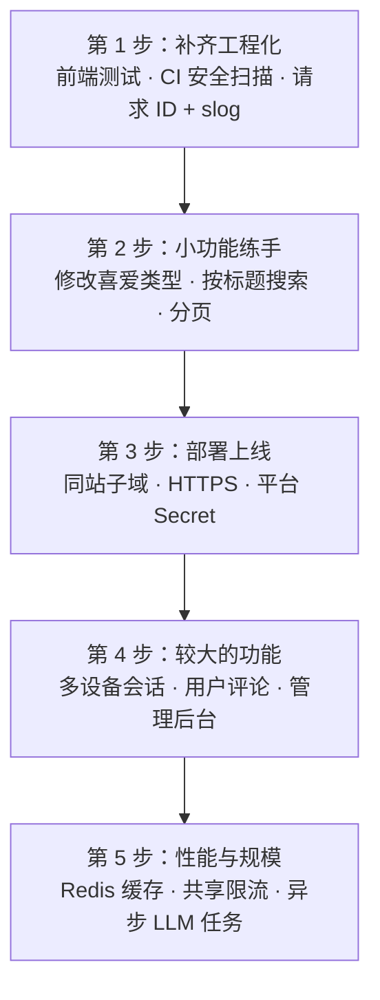

# 第 21 章　设计决策与进阶扩展

> 本章把散落在各章中的**设计决策**汇总成一张表：每一项都写明“选了什么、放弃了什么、为什么”。然后列出这个设计**有意接受的权衡**，以及可以在此基础上继续做的扩展。
>
> 面试中被问到“你为什么这样设计”时，这一章就是你的提纲。

---

## 21.1 关键设计决策

### 21.1.1 架构

| 决策 | 备选方案 | 为什么这样选 | 详解 |
|---|---|---|---|
| 分层：controllers → services → repository | Handler 中直接查询数据库 | 业务规则可以脱离 HTTP 和 MongoDB 测试；换数据库只改 repository | 2.4、10.5 |
| services 依赖自己定义的小接口 | 直接依赖 `*repository.UserRepository` | 测试时可以传入内存假实现；接口只包含真正用到的方法 | 2.4、15.4 |
| 依赖通过构造函数注入，在 `main` 中组装 | 全局变量、包级变量 | 依赖关系显式可见；没有初始化顺序问题；可测试 | 9.3、11.5.1 |
| 配置在启动时一次性读取并校验 | 各处按需 `os.Getenv` | 配置错误在部署时就暴露，并一次性列出所有问题 | 4.5、10.2.4 |
| 中间件挂在路由组上 | `router.Use(Auth)` 依赖调用顺序 | 保护范围只取决于路由写在哪个组；未知路径是 404 | 9.2 |
| 业务错误 + 统一映射表 | 每个 Handler 自己决定状态码 | services 不知道 HTTP；错误格式统一；内部错误不外泄 | 9.5、13.6 |
| RESTful URL，认证接口在 `/auth` 下 | 动词式 URL（`/addmovie`） | 可预测；可以把 RT Cookie 限定在 `/auth` 路径 | 9.2.5、11.7.1 |

### 21.1.2 数据

| 决策 | 备选方案 | 为什么这样选 | 详解 |
|---|---|---|---|
| 类型和评级以副本形式嵌入电影和用户文档 | 只存 ID 引用 | 一次查询拿到完整数据；推荐查询可以直接按名称过滤 | 7.2.2 |
| 客户端只提交 ID，副本由服务器复制 | 接收客户端提交的完整对象 | 保证嵌入的副本真实存在于字典集合中 | 7.2.2、10.4 |
| 用户 ID 就是 `_id` | 另外维护一个 `user_id` 字段 | 只有一个 ID，不会不一致 | 7.3.4 |
| 唯一索引 + 直接插入 | 先查询再插入 | 没有 check-then-act 竞态 | 7.7 |
| 启动时 `EnsureIndexes` | 手动执行建索引脚本 | 任何新环境都自动拥有正确的索引 | 7.7 |
| 种子数据嵌入二进制、按唯一键 upsert | 手动导入 JSON | 可重复运行；容器中也能用 | 7.8 |

### 21.1.3 认证与安全

| 决策 | 备选方案 | 为什么这样选 | 详解 |
|---|---|---|---|
| 短 AT（内存）+ 长 RT（HttpOnly Cookie） | Session；长期 JWT；Token 放 localStorage | 兼顾无状态验证与可撤销；XSS 偷不走 RT，CSRF 用不了 AT | 11.4、11.7.3 |
| RT 每次使用都轮换，用比较并交换实现 | RT 在有效期内可重复使用 | 限制被盗 RT 的寿命；登出真正生效；并发安全 | 11.9 |
| 数据库只存 RT 的 SHA-256 | 存 RT 原文；同时存 AT | 数据库泄露不会泄露可用的 Token | 11.8 |
| JWT 载荷只有 `uid` 和 `role` | 放入姓名、邮箱 | Token 小；不在日志和代理中暴露个人信息 | 11.4.2 |
| 限定算法和签发者、要求 `exp` | 只用默认解析 | 防御算法混淆、跨系统 Token、永不过期的 Token | 11.11 |
| Cookie：`Path=/auth`、`SameSite=Lax`（可配置） | `Path=/`、`SameSite=None` | RT 只出现在需要它的请求中；默认防 CSRF，不受第三方 Cookie 限制 | 11.7 |
| 401 与 403 严格区分 | 都返回 401 | 前端只在 401 时刷新 Token | 9.1 |
| 角色只能通过种子命令提升 | 注册时可选；在线提升接口 | HTTP API 中不存在提权入口 | 16.3.3 |
| LLM 输出必须在白名单中，否则 502 且不保存 | 原样保存 LLM 的回答 | 一次异常回答不会污染所有用户的推荐结果 | 10.3.5 |

### 21.1.4 工程化

| 决策 | 备选方案 | 为什么这样选 | 详解 |
|---|---|---|---|
| 业务和 HTTP 测试用内存 fake，repository 用真实 MongoDB | 全部用 mock；全部连真实数据库 | 大部分测试毫秒级完成；集成测试兜底 fake 与真实行为的偏差 | 15.4、15.6 |
| `http.Server` + 优雅关闭 | `router.Run` | 有超时；部署时不打断进行中的请求 | 17.3 |
| distroless 多阶段镜像，非 root 运行 | 完整的 Linux 基础镜像 | 镜像小、攻击面小 | 17.4.1 |
| 预告片用 `<iframe>` | 播放器库 | 零依赖，只有一个视频来源时足够 | 6.3.1 |

---

## 21.2 有意接受的权衡

没有完美的设计。以下是本项目**知道并接受**的限制，以及什么时候应该重新考虑：

| 权衡 | 现状 | 什么时候需要改变 | 可能的方案 |
|---|---|---|---|
| AT 无法立即撤销 | 降级或登出后，已签发的 AT 最多 15 分钟内仍然有效 | 需要“立即踢下线”的场景（封禁账户） | AT 黑名单（`jti` + Redis）、`token_version` |
| 单会话 | 每个用户只有一个有效 RT，在新设备登录会让旧设备在下次刷新时掉线 | 用户需要多设备同时在线 | `sessions` 集合（练习 19.21） |
| 注册接口暴露邮箱是否已注册 | 409 `email is already registered` | 邮箱本身是敏感信息的产品 | 邮件确认流程，无论是否注册都显示相同提示 |
| 限流状态在进程内存中 | 单实例部署时有效 | 水平扩展到多个实例 | Redis 计数；网关层限流 |
| 嵌入的副本可能过期 | 修改 `genres` / `rankings` 中的名称不会自动同步到已有文档 | 字典数据需要经常修改 | 改用引用；或修改时批量更新副本 |
| RT 重用检测 | 旧 RT 被拒绝，但不会因此撤销当前会话 | 对盗用风险更敏感的应用 | 练习 11.8 |
| 写影评同步等待 LLM | 请求要等几秒 | LLM 调用变慢或量变大 | 异步任务队列，前端轮询或推送结果 |
| 前端没有自动化测试 | CI 只做 lint 和类型检查 | 前端逻辑变复杂 | Vitest + Playwright（15.7） |
| 管理员只能用命令行提升 | 需要服务器或数据库的访问权限 | 需要多人管理 | 只有管理员能调用的提权接口，并记录审计日志 |

---

## 21.3 进阶扩展

可以在现有代码上继续做的练习，按涉及的知识点分组：

| 功能 | 涉及的知识 |
|---|---|
| 用户修改喜爱类型 `PATCH /me/genres` | 受保护路由、DTO 校验、`$set`、前端表单、更新 `auth` 状态（练习 19.19） |
| 管理后台：前端添加电影的表单 | 管理员路由、表单校验、`POST /movies`、角色控制显示 |
| 分页 `GET /movies?page=2&limit=20` | `c.Query`、`SetSkip`/`SetLimit`、响应格式变更与兼容（练习 19.20） |
| 按标题搜索 | MongoDB 文本索引、`$text`、前端防抖（debounce） |
| 普通用户评分与评论 | 新集合 `reviews`、唯一复合索引、聚合 `$group` / `$avg`（毕业项目 C） |
| 多设备登录 | `sessions` 集合、TTL 索引（练习 19.21） |
| 用 Redis 缓存 `/movies` | 缓存失效策略；写入电影或影评时清除缓存 |
| 请求 ID 与结构化日志 | 中间件、`log/slog`、在错误日志中关联请求（练习 12.5） |
| 就绪检查 `/ready` | 区分“进程存活”和“依赖可用”；Ping MongoDB |
| 检查泄露密码 | Have I Been Pwned 的 k-匿名 API、外部调用的超时与降级 |
| OpenAPI 文档 + 自动生成前端类型 | `swaggo`、`openapi-typescript`，消除前后端类型的手动同步 |
| 前端测试 | Vitest、React Testing Library、MSW、Playwright |
| CI 安全扫描 | `govulncheck`、`npm audit`、`gitleaks` 加入工作流 |
| 部署到云平台 | 同站子域、HTTPS、HSTS、`TRUSTED_PROXIES`、平台 Secret 管理（第 17 章） |

---

## 21.4 推荐的扩展顺序

**为什么先补测试和 CI？** 后面每一步都会修改现有代码。先让安全网更完整，之后每一次修改都能被验证——这就是测试驱动开发（TDD）中“红 → 绿 → 重构”循环的前提。每个新功能也都应该从一个会失败的测试开始。
